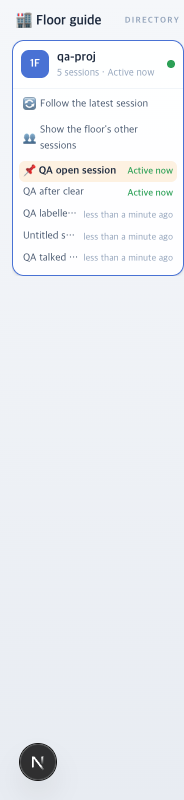

# 51 · 빈 세션을 목록에서 뺀다

- 브랜치: `fix/51-no-empty-sessions`
- 근거: 50 머지 뒤 검토 — 「개선사항 없을지 검토해봐」, 「진행해」

## 목표

`/clear` 말고도 층별 안내에 빈 세션이 계속 쌓였다. 아무 일도 없었던 세션을 목록에서 뺀다.

## 한 일

- 시작 이벤트 없이 종료 이벤트만 온 세션은 만들지 않는다(`backend/app/core/event_processor.py`). 전에는 시작을 되살려 빈 세션을 만들었다. 사용자 DB 에서 20분 동안 이런 세션이 10개 생겼고, 모두 대화 기록 파일이 없었다.
- 끝난 세션 중 시작 · 대기 알림 · 종료 말고 이벤트가 없고 제목도 이름표도 없는 세션은 목록에서 뺀다(`backend/app/api/routes/sessions.py`). 열었다 바로 닫은 세션이나, 프롬프트 전에 `/resume` 으로 떠난 세션이다.
- 프롬프트가 없어도 도구를 쓴 세션(에이전트 팀의 팀원 등)은 남긴다. 이벤트가 지워졌어도 대화 기록에 제목이 있는 세션도 남긴다.
- 시험: 종료만 온 세션은 기록이 0 이다. 빈 세션과 알림만 있는 세션은 빠지고, 대화 · 도구 · 이름표 · 열린 세션은 남는다. 시작과 종료만 보내던 목록 스모크 시험은 프롬프트를 하나 넣게 고쳤다.

## 검증

| 단계 | 명령 · 방법 | 결과 |
| --- | --- | --- |
| 정적 검증 | `make -C backend checkall` | 통과 — 포맷 · 린트 · 타입 · 시험 501. 프런트 · 훅 · 플러그인은 바뀌지 않았다 |
| 실검증 | 사용자가 띄워 둔 서버(4747 · 8000)는 건드리지 않았다. 수정 후 백엔드 8030 · 수정 전(`origin/main`) 백엔드 8031, 둘 다 빈 DB · 요약 꺼짐. 프런트 4750 은 8030 을 본다. 같은 이벤트 아홉 경우를 양쪽에 넣고 목록 API 와 층별 안내를 읽었다. 헤드리스 Chromium 1280×800 | TC 4건 — ✅ 4 |
| 사용자 DB | 사용자 백엔드(8000, 핫 리로드)의 목록 | 50 규칙만으로는 34개, 지금 20개 |
| 정리 | QA 서버 3개 · 브라우저를 내리고 baseline 워크트리 · QA DB · 스크립트를 지웠다 | `:8030` · `:8031` · `:4750` 듣는 프로세스 0 |

### 실검증 TC

| TC | 우선순위 | 판정 | 방법 · 근거 |
| --- | --- | --- | --- |
| A-01 종료만 온 세션은 생기지 않는다 | P1 | ✅ | 수정 전에는 목록에 있다. 수정 후에는 세션 · 이벤트 기록이 모두 0 이다 |
| A-02 빈 세션은 빠진다 | P1 | ✅ | 시작 → 종료, 시작 → 대기 알림 → 종료. 수정 전에는 2개 다 보이고, 수정 후에는 없다 |
| A-03 할 일이 있었던 세션은 남는다 | P1 | ✅ | 대화한 세션 · 도구만 쓴 세션 · 이름표 붙인 세션 · 열린 세션이 양쪽에 다 있다 |
| A-04 층별 안내 | P1 | ✅ | 수정 전 8개, 수정 후 「5 sessions」(아래 그림). `/clear` 로 끝난 세션은 양쪽 다 없다(50 회귀). 콘솔 오류 0 |

## 검증하지 못한 것

- 종료만 오는 세션을 누가 보내는지는 확인하지 못했다. 대화 기록 파일이 없고 `cwd` 가 `/private/tmp` 인 것도 있어서 Claude Code 의 예비 프로세스로 보인다. 고친 내용은 보내는 쪽과 상관없이 동작한다.
