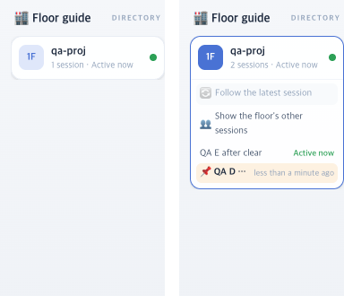

# 52 · 보고 있던 세션을 층별 안내에 남긴다

- 브랜치: `fix/52-keep-shown-session`
- 근거: 50 머지 뒤 검토 4번 — 자동 따라가기를 끈 채 보던 세션을 `/clear` 하면 층별 안내에서 사라진다. 「진행해 /cruise」

## 목표

백엔드는 `/clear` 로 끝난 세션(50)과 아무 일 없이 끝난 세션(51)을 목록에서 뺀다. 그런데 사무실이 그 세션을 보고 있으면 층별 안내에서 사라지면 안 된다.

## 한 일

- 목록을 받을 때 보고 있던 세션이 빠졌으면 마지막으로 받은 기록을 끝난 상태로 붙여 둔다(`keepShownSession`, `frontend/src/systems/floors.ts`). 다른 세션으로 옮기면 다음 목록에서 빠진다.
- 삭제된 세션은 붙여 두지 않는다. 삭제 알림을 받으면 붙여 둔 기록에서 먼저 지운다(`frontend/src/hooks/useSessions.ts`).
- 50 에서 자동 따라가기용으로 넣은 「프로젝트 기억하기」는 지웠다. 보던 세션이 목록에 남아서 같은 방법으로 프로젝트를 찾는다.
- 시험 3건: 빠진 세션을 끝난 상태로 남긴다 · 다른 세션을 보면 빠진다 · 본 적 없는 세션은 붙이지 않는다.

## 검증

| 단계 | 명령 · 방법 | 결과 |
| --- | --- | --- |
| 정적 검증 | 프런트 `bun run lint` · `tsc --noEmit` · `bun run test` | 통과 — 시험 289. 타입 오류는 dev 서버가 남긴 `.next/types/validator.ts` 4건뿐이고 `src` 는 0 이다. 백엔드 · 훅 · 플러그인은 바뀌지 않았다 |
| 실검증 | 사용자가 띄워 둔 서버(4747 · 8000)는 건드리지 않았다. 이 브랜치 · `origin/main` 을 워크트리로 떠서 백엔드 8030 · 8031(빈 DB · 요약 꺼짐), 프런트 4750 · 4751 로 띄웠다. 같은 이벤트를 양쪽에 넣고 층별 안내를 읽었다. 헤드리스 Chromium 1280×800 | TC 4건 — ✅ 4 |
| 정리 | QA 서버 4개 · 브라우저를 내리고 워크트리 2개 · QA DB · 스크립트를 지웠다 | `:8030` · `:8031` · `:4750` · `:4751` 듣는 프로세스 0 |

### 실검증 TC

| TC | 우선순위 | 판정 | 방법 · 근거 |
| --- | --- | --- | --- |
| B-00 처음 열기 | P2 | ✅ | 양쪽 다 하나뿐인 세션 C 를 연다 |
| B-01 따라가기 켬 → `/clear` | P1 | ✅ | 양쪽 다 새 세션 D 로 옮겨 간다(50 회귀) |
| B-02 따라가기 끔 → `/clear` | P1 | ✅ | 수정 전에는 층이 접히고 D 가 사라진다(그림 왼쪽). 수정 후에는 📌 D 가 끝난 상태로 남고 새 세션 E 가 그 위에 보인다(그림 오른쪽) |
| B-03 보던 세션 삭제 | P1 | ✅ | 양쪽 다 E 로 옮겨 가고, D 는 층별 안내에 남지 않는다. 콘솔 오류 0 |

## 검증하지 못한 것

없음.
