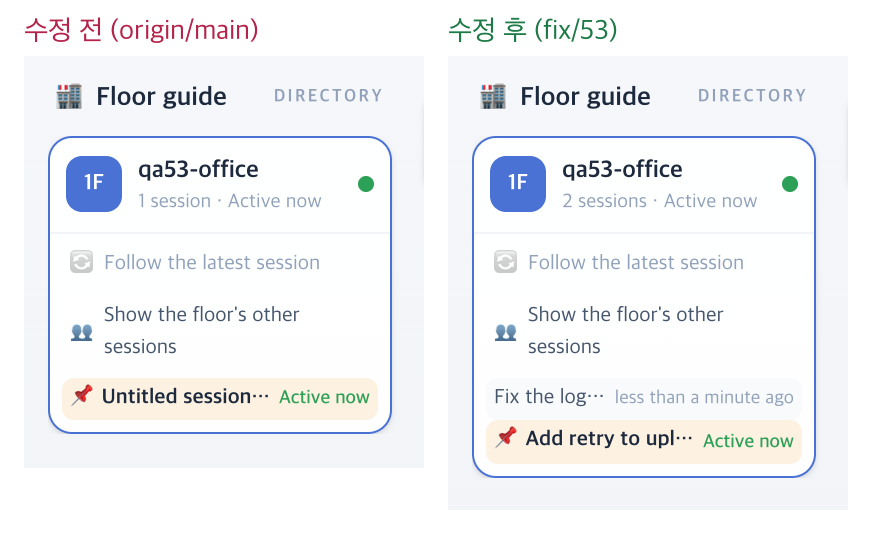

# 53 · 압축 · 다시 열기에도 사무실 기록을 지키기

- 브랜치: `fix/53-keep-events-on-compact`
- 근거: 52 머지 뒤 검토 1번 — 열린 세션 10개 중 4개가 압축 뒤 기록 1건만 남았고, 그중 2개는 제목도 잃어 끝나면 빈 세션으로 빠질 참이었다. 「모두 수정해 /cruise」

## 목표

같은 세션 id 로 다시 시작하는 압축(compact) · 다시 열기(resume)는 대화가 이어지는 것이다. 그때 저장된 이벤트를 지우지 않아 세션 제목과 사무실 기록이 남게 한다. `/clear` 로 끝난 세션을 목록에서 빼는 50 의 동작은 그대로 둔다.

## 한 일

- 훅이 `session_start` 의 시작 이유를 `data.source`(startup · resume · clear · compact)로 보낸다. 지금까지는 요약 문구 `Session started (compact)` 에만 있었다(`hooks/src/claude_office_hooks/event_mapper.py`).
- 백엔드는 compact · resume 으로 시작하면 저장된 이벤트를 지우지 않는다. 메모리에 없으면 DB 에서 되살린다. source 를 안 보내는 지금 설치된 훅은 요약 문구에서 읽는다(`backend/app/models/events.py` 의 `session_start_source`, `backend/app/core/event_processor.py` 의 `_wipes_stored_events`).
- 세션 목록은 「닫혀 있고 마지막 종료가 `/clear`」 인 세션만 뺀다. 다시 연 세션은 열려 있는 동안, 그리고 다른 이유로 끝난 뒤에도 남는다. compact · resume 으로 시작한 적 있는 세션은 이전 백엔드가 기록을 지웠어도 빈 세션으로 빼지 않는다(`backend/app/api/routes/sessions.py`).
- 시험: 훅 1건, 백엔드 — compact · resume · 요약 문구만 있는 compact 는 기록을 지키고 재시작 뒤 되살린다 · startup · clear 는 처음부터다 · 다시 연 `/clear` 세션의 목록 규칙 · 기록이 지워진 compact 세션이 끝나도 남는다. `test_event_restore.py` 의 「resume 은 처음부터」 시험은 새 규칙(되살린다)으로 바꿨다.

## 검증

| 단계 | 명령 · 방법 | 결과 |
| --- | --- | --- |
| 정적 검증 | 백엔드 `make checkall` · 훅 `make checkall` | 통과 — 백엔드 시험 509 · ruff · pyright 0, 훅 시험 114. 프런트는 바뀌지 않았다 |
| 실검증 | run-qa-flow. 이 브랜치 · `origin/main` 을 워크트리로 떠서 백엔드 8030 · 8031(빈 QA SQLite · 요약 꺼짐), 프런트 4750 · 4751. 같은 이벤트를 양쪽에 넣고 층별 안내 · 목록 API · 활동 로그를 읽었다. 헤드리스 Chromium 1600×1100(스모크는 1280 · 1920 도). 사용자가 띄운 서버(8000 · 4747)는 건드리지 않았다 | TC 12건 — ✅ 12. 수정 전 재현 5건(A-01 · A-02 · A-03 · B-02 · B-03). Aside 탐색 흐름 5 · 이상 5(재현 1 · 재현 안 됨 1 · 스펙대로 3) |
| 정리 | QA 서버 4개를 내리고 워크트리 2개 · QA DB 를 지웠다 | `:8030` · `:8031` · `:4750` · `:4751` 듣는 프로세스 0 |

## 검증하지 못한 것

없음. 실제 `claude` 의 `/compact` · `--resume` 은 사용량을 써서 훅과 같은 모양의 이벤트를 POST 했다. 훅이 보내는 모양은 단위 시험이 확인한다.

## 발견한 기존 결함

- 백엔드를 다시 켜면 활동 로그에서 프롬프트 줄과 도구 대상이 빠진다. 되살린 기록 줄을 `"detail": {}` 로 만들기 때문이다. 수정 전도 같다 → 56.
- 보던 세션을 바꾸면 생각 중인 동료의 「Thinking for Ns」 말풍선이 1초부터 다시 센다. 캐릭터를 다시 놓을 때 지금부터 세기 때문이다(`isoPeople.ts:386`). 수정 전도 같다 → 57.
