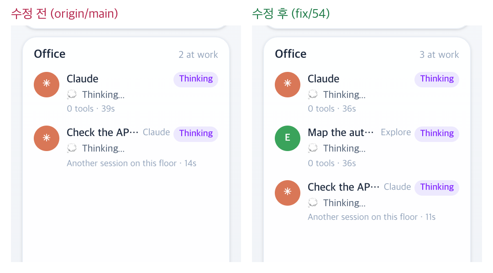

# 54 · 짝 없는 서브에이전트 끝 신호 버리기

- 브랜치: `fix/54-drop-unpaired-subagent-stop`
- 근거: 52 머지 뒤 검토 3번 — 서브에이전트 끝 신호 309건 중 291건이 시작 신호 없이 왔고 대화 기록 파일도 없었다. 「모두 수정해 /cruise」

## 목표

Claude Code 가 스스로 돌리는 보조 에이전트의 끝 신호(SubagentStop)는 사무실의 어느 직원과도 상관이 없다. 그 신호를 버려서, 아직 연결되지 않은 진짜 직원을 잘못 퇴근시키지 않게 한다. 백엔드가 모르는 세션에서 오면 이름 없는 세션을 만들지 않게 한다.

## 한 일

- 백엔드는 `agent_id` 없는 SubagentStop 이 세 조건에 다 맞으면 저장하지도 처리하지도 않는다. 아는 직원의 native id 가 아니고, 세션 대화 기록 파일은 보이고, 그 에이전트의 기록 파일은 없을 때다. 세션 복구보다 먼저 거른다(`backend/app/core/event_processor.py` 의 `_is_unannounced_subagent_stop`).
- 실제 DB 로 기준을 확인했다. 시작 신호와 짝이 없는 끝 신호 305건은 모두 기록 파일이 없었다. 짝이 있는 16건은 모두 있었다.
- Docker 처럼 기록 경로를 바꿔 읽는 백엔드는 같은 변환(`translate_path`)을 거친다. 기록 폴더를 아예 못 보는 백엔드는 세션 기록 파일도 안 보여서 아무것도 버리지 않는다.
- 시험 3건: 짝 없는 끝 신호를 버리고 연결 전 직원이 그대로다 · SubagentInfo 를 놓친 진짜 직원(기록 파일 있음)은 퇴근한다 · 기록을 못 보는 백엔드는 버리지 않는다.

## 검증

| 단계 | 명령 · 방법 | 결과 |
| --- | --- | --- |
| 정적 검증 | 백엔드 `make checkall` | 통과 — 시험 512 · ruff · pyright 0. 프런트 · 훅은 바뀌지 않았다 |
| 실검증 | run-qa-flow. 이 브랜치 · `origin/main` 을 워크트리로 떠서 백엔드 8030 · 8031(빈 QA SQLite · `HOME` 을 스크래치 홈으로 바꿔 가짜 기록 파일), 프런트 4750 · 4751. 같은 이벤트를 양쪽에 넣고 Office 목록 · 층별 안내 · replay 를 읽었다. 헤드리스 Chromium 1600×1100(스모크는 1280 · 1920 도). 사용자가 띄운 서버(8000 · 4747)와 `~/.claude` 는 건드리지 않았다 | TC 7건 — ✅ 7. 수정 전 재현 3건(A-01 · A-02 · A-03) |
| 정리 | QA 서버 4개를 내리고 워크트리 2개 · QA DB · 스크래치 홈을 지웠다 | `:8030` · `:8031` · `:4750` · `:4751` 듣는 프로세스 0 |

## 검증하지 못한 것

없음. 실제 Claude Code 를 띄우지 않고 훅과 같은 모양의 이벤트를 POST 했다. 짝 없는 끝 신호를 보내는 내부 도우미가 정확히 무엇인지는 확인하지 못했다.

## 발견한 기존 결함

- 다른 세션에 갔다가 돌아오면 일하던 직원이 엘리베이터로 다시 출근하고, 직원 · Claude 의 경과 시간이 0초부터 다시 센다(탐색 EX-01 · EX-02). 수정 전도 같다. 53 에서 찾은 「Thinking for Ns 가 1초부터」 와 같은 뿌리라 57 에 합쳤다.
