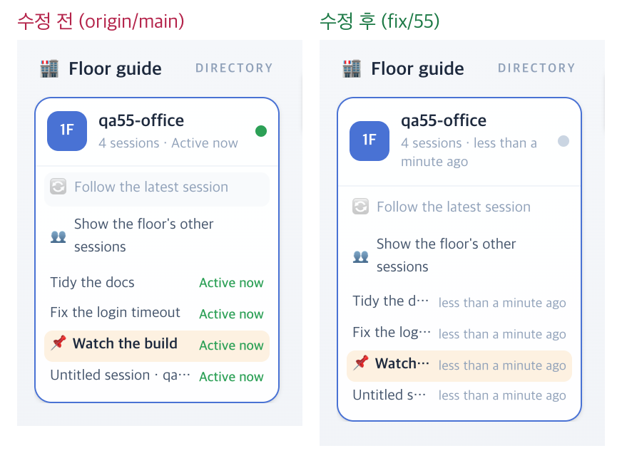

# 55 · 턴이 끝난 세션은 「지금 활동 중」이 아니다

- 브랜치: `fix/55-turn-ended-not-active`
- 근거: 52 머지 뒤 검토 2번 — 턴이 끝나고 60초 뒤 오는 「입력 기다림」 알림이 시각을 늦춰, 멈춘 세션이 약 6분 동안 일하는 중으로 보이고 같은 층 동료로 사무실에 들어왔다. 「모두 수정해 /cruise」

## 목표

할 일을 끝내고 사용자 입력을 기다리는 세션은 층별 안내에서 「Active now」 로 보이지 않고, 같은 층 동료로 사무실에 들어오지 않게 한다. 49 의 「생각만 하는 세션도 5분 동안 활동 중」 은 그대로 둔다.

## 한 일

- 세션 목록이 `idle` 을 실어 보낸다. 알림을 뺀 마지막 이벤트가 메인 에이전트의 `stop` 이거나, 프롬프트 전의 `session_start` · `session_end` 면 턴이 끝난 것이다. 메인이 멈춘 뒤 백그라운드 에이전트가 일하면 그 이벤트가 마지막이라 계속 일하는 중이다. 리드가 다시 멈춰도 세션 상태에 사무실 직원이 남아 있으면 일하는 중이다 — 실검증의 탐색이 찾은 빈틈이다(`backend/app/api/routes/sessions.py` 의 `_idle_sessions`).
- 화면의 「지금 활동 중」 판정은 `idle` 이면 거짓이다. 층별 안내 라벨 · 층의 초록 점 · 같은 층 동료 · 층 입구 세션이 함께 따른다(`frontend/src/systems/floors.ts` 의 `isActiveNow`).
- 층별 안내 시계는 15초마다 간다. 그 사이에 바뀐 세션의 시각이 「in less than a minute」(미래형)로 보였는데, 멈춘 세션이 바로 시각을 보이게 되면서 멈출 때마다 보였다. 시각을 시계로 눌렀다(`IsoFloorGuide.tsx` 의 `ago`).
- 시험: 백엔드 — 일하는 · 멈춘(알림 뒤) · 빈 · 백그라운드 에이전트 · 직원을 두고 리드가 멈춘 세션의 `idle`. 프런트 — 턴이 끝난 세션은 방금 이벤트가 왔어도 활동 중이 아니다.

## 검증

| 단계 | 명령 · 방법 | 결과 |
| --- | --- | --- |
| 정적 검증 | 백엔드 `make checkall` · 프런트 `bun run lint` · `tsc --noEmit` · `bun run test` | 통과 — 백엔드 시험 513 · ruff · pyright 0, 프런트 시험 290 · lint 0 · `src` 타입 오류 0 |
| 실검증 | run-qa-flow. 이 브랜치 · `origin/main` 을 워크트리로 떠서 백엔드 8030 · 8031(빈 QA SQLite), 프런트 4750 · 4751. 같은 이벤트를 양쪽에 넣고 층별 안내 · Office 목록 · 목록 API 를 읽었다. 헤드리스 Chromium 1600×1100(스모크는 1280 · 1920 도). 사용자가 띄운 서버(8000 · 4747)는 건드리지 않았다 | TC 10건 — ✅ 10. 수정 전 재현 4건(A-01 ~ A-04). Aside 탐색 흐름 4 · 이상 3(이번 항목 빈틈 1 — 고침 · 기존 결함 1 · 스펙대로 1) |
| 정리 | QA 서버 4개를 내리고 워크트리 2개 · QA DB 를 지웠다 | `:8030` · `:8031` · `:4750` · `:4751` 듣는 프로세스 0 |

## 검증하지 못한 것

없음. 실제 Claude Code 를 띄우지 않고 훅과 같은 모양의 이벤트를 POST 했다.

## 발견한 기존 결함

- 새로고침하면 Office 의 경과 시간이 0초부터 다시 센다(탐색 EX-02). 경과 시간을 이 페이지가 그 상태를 처음 본 때부터 세기 때문이다. 수정 전도 같다. 53 · 54 에서 찾은 「세션을 바꾸면 0초부터」 와 같은 뿌리라 57 에 합쳤다.
