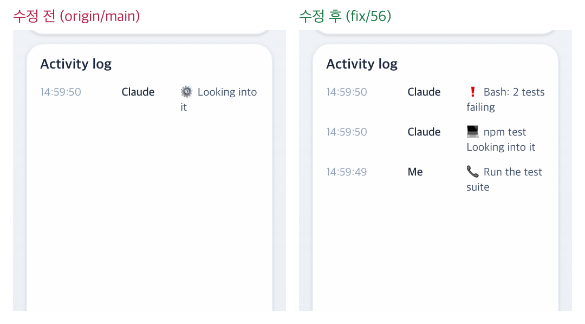

# 56 · 재시작 뒤에도 활동 로그 상세 지키기

- 브랜치: `fix/56-restored-log-detail`
- 근거: 53 실검증에서 찾은 기존 결함 — 백엔드를 다시 켜면 활동 로그에서 프롬프트 줄과 도구 대상이 빠지고 「⚙️ Looking into it」 만 남았다. 「모두 수정해 /cruise」

## 목표

백엔드가 DB 에서 세션을 되살려도 활동 로그가 재시작 전과 같게 한다. 53 에서 압축 뒤에도 기록을 지키게 되면서 되살릴 일이 늘어 더 자주 보였다.

## 한 일

- 기록 줄의 상세(`detail` — 프롬프트 · 도구와 그 입력 · 실패 · 직원의 일 · 응답)를 만드는 코드를 `_history_detail` 로 뺐다. 실시간 줄과 DB 에서 되살린 줄이 같은 함수를 쓴다. 되살린 줄은 지금까지 `{}` 였다(`backend/app/core/event_processor.py`).
- 시험: 재시작 뒤 되살린 상세가 실시간 상세와 같다(`test_restored_history_keeps_what_the_log_shows`).

## 검증

| 단계 | 명령 · 방법 | 결과 |
| --- | --- | --- |
| 정적 검증 | 백엔드 `make checkall` | 통과 — 시험 514 · ruff · pyright 0. 프런트 · 훅은 바뀌지 않았다 |
| 실검증 | run-qa-flow. 이 브랜치 · `origin/main` 을 워크트리로 떠서 백엔드 8030 · 8031(빈 QA SQLite), 프런트 4750 · 4751. 같은 이벤트를 양쪽에 넣고 활동 로그를 읽은 뒤, 같은 DB 로 백엔드를 다시 켜고 다시 읽었다. 헤드리스 Chromium 1600×1100(스모크는 1280 · 1920 도). 사용자가 띄운 서버(8000 · 4747)는 건드리지 않았다 | TC 6건 — ✅ 6. 수정 전 재현 3건(A-01 · A-02 · A-03). Aside 탐색 흐름 5 · 이상 4(모두 스펙대로 — 로그 칸이 긴 경로 · 이름을 일부러 자르는 것은 개선 후보로 리포트에 적었다) |
| 정리 | QA 서버 4개를 내리고 워크트리 2개 · QA DB 를 지웠다 | `:8030` · `:8031` · `:4750` · `:4751` 듣는 프로세스 0 |

## 검증하지 못한 것

없음.
