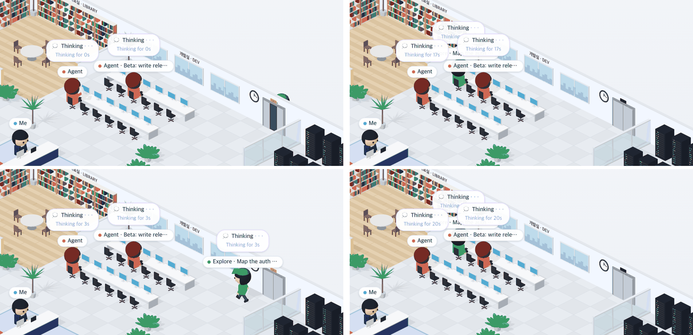

# 57 · 세션을 바꾸거나 새로고침해도 사무실 시계 이어 가기

- 브랜치: `fix/57-thinking-seconds-on-switch`
- 근거: 53 · 54 · 55 실검증 탐색에서 찾은 기존 결함 — 53 EX-02 · 54 EX-01/EX-02 · 55 EX-02. 「모두 수정해 /cruise」

## 목표

보던 세션을 바꾸거나 새로고침해도 사무실이 사람을 처음 본 것처럼 다루지 않게 한다. 생각 중인 동료의 「Thinking for Ns」, Office 목록의 경과 초, 일하던 직원의 자리가 그대로 이어져야 한다.

## 한 일

- overview 가 세션마다 그 세션을 이끄는 Claude 의 마지막 이벤트 시각을 싣는다(`OverviewEntry.last_event_at`). 상태 머신이 리드의 마지막 이벤트 시각(`lead_event_at`, 훅이 찍은 시각)을 따로 들고, DB 에서 되살릴 때도 채운다(`backend/app/core/state_machine.py` · `backend/app/core/event_processor.py` · `backend/app/core/overview.py`). 프런트 타입은 `make gen-types` 로 다시 만들었다.
- 사무실의 사람마다 「언제부터」(`IsoPerson.since`)를 둔다. Claude · 직원은 활동 로그의 자기 마지막 이벤트, 동료는 overview 의 `lastEventAt` 이다(`frontend/src/systems/officePeople.ts` · `frontend/src/hooks/useFloorColleagues.ts`). 「나」는 없다.
- 생각 말풍선과 Office 목록의 초를 그 시각부터 센다. 목록은 그 값이 없을 때만 예전처럼 본 때부터 센다(`frontend/src/components/iso/isoPeople.ts` · `frontend/src/components/iso/IsoSidePanel.tsx` · `frontend/src/systems/officeRoster.ts`).
- 화면을 새로 그릴 때(세션 전환 · 새로고침)는 모두 제자리에 앉힌다. 지켜보는 중에 새로 생긴 직원만 엘리베이터에서 걸어 나온다(`IsoPeople.fresh`).
- 실검증에서 이번 수정이 만든 결함 2건을 찾아 고쳤다.
  - 사무실은 페이지가 열린 뒤 흐른 시간으로 움직이는데 이벤트 시각은 벽시계라, 말풍선이 「Thinking for 0s」 에서 멈췄다. 이벤트 시각을 그 프레임의 시계로 옮긴 뒤 센다(909e18b).
  - 처음에는 overview 가 세션 전체의 마지막 이벤트를 실어서, 직원이 일하면 동료 말풍선 초가 처음부터 다시 셌다. 그 세션을 열었을 때의 Claude 초와 달랐다. 리드의 마지막 이벤트로 바꿨다(991e701).
- 시험: overview 가 리드의 마지막 이벤트 시각을 싣는다(`test_says_when_the_lead_last_did_something`) · 직원의 일은 그 시각을 바꾸지 않고 재시작 뒤에도 남는다(`test_lead_time_follows_the_lead_and_survives_a_restart`) · 사람마다 자기 마지막 이벤트로 날짜를 단다(`officePeople.test.ts`).

## 검증

| 단계 | 명령 · 방법 | 결과 |
| --- | --- | --- |
| 정적 검증 | 백엔드 · 프런트 `make checkall` | 통과 — 백엔드 시험 516 · ruff · pyright 0, 프런트 시험 291 · lint · tsc · build |
| 실검증 | run-qa-flow. 이 브랜치 · `origin/main` 을 워크트리로 떠서 백엔드 8030 · 8031(빈 QA SQLite), 프런트 4750 · 4751. 같은 층에 세션 3개를 같은 순서로 넣고, 층별 안내로 세션을 바꾸고 새로고침하며 사무실 이름표 · 말풍선 · Office 목록을 DOM 으로 읽었다. 헤드리스 Chromium 1600×1000(스모크는 1280 · 1920 도). 사용자가 띄운 서버(8000 · 4747)는 건드리지 않았다 | TC 9건 — ✅ 9. 수정 전 재현 5건(A-01~A-05). 이번 수정이 만든 결함 2건(X-01 · 탐색 EX-02)은 고친 뒤 TC 전부를 다시 돌려 통과. Aside 탐색 흐름 4 · 이상 7(재현 4 — EX-02 는 위처럼 고쳤고, EX-01 · EX-04 · EX-07 은 수정 전도 같은 기존 결함이라 계획 58 · 59 로 넣었다 · 스펙 2 · QA 데이터 탓 1) |
| 정리 | QA 서버 4개를 내리고 워크트리 2개 · QA DB 를 지웠다 | `:8030` · `:8031` · `:4750` · `:4751` 듣는 프로세스 0 |

## 검증하지 못한 것

없음. 실제 Claude Code 를 띄우지 않고 훅과 같은 모양의 이벤트를 POST 했다.
