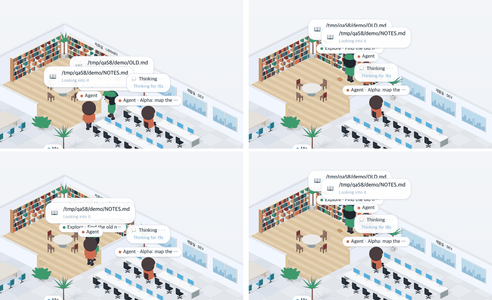

# 58 · 다시 그려도 하던 방과 앉던 책상 지키기

- 브랜치: `fix/58-keep-rooms-on-redraw`
- 근거: 57 실검증 탐색에서 찾은 기존 결함 — 57 EX-01 · EX-04. 「모두 수정해 /cruise」

## 목표

보던 세션을 바꾸거나 새로고침해도 사무실이 사람을 책상부터 다시 놓지 않게 한다. 서재 · 서버실에서 일하던 사람은 그 방의 같은 자리에, 직원은 앉던 책상에 그대로 있어야 한다.

## 한 일

- 화면을 새로 그릴 때(세션 전환 · 새로고침)는 지금 도구가 보내는 방에 바로 둔다. 지켜보는 중에 처음 나타난 사람은 예전처럼 책상에서 걸어간다(`frontend/src/components/iso/isoPeople.ts` 의 `firstWalker`). 그래서 `seatedWalker` 가 방도 받는다(`frontend/src/systems/isoErrands.ts`).
- 사람마다 마지막으로 앉은 책상과 방마다 서 있던 자리를 탭 저장소(sessionStorage `agent-office:places`, 128개까지)에 기억한다. 자리를 줄 때 그 자리가 비어 있으면 먼저 준다(`frontend/src/systems/placeMemory.ts`). 기억이 있는 사람부터 놓아서 새로 온 사람이 그 자리를 먼저 가져가지 않게 한다.
- 실검증에서 이번 수정이 만든 결함을 찾아 고쳤다. 처음에는 책상만 기억해서, 서재의 두 사람이 다시 그릴 때마다 자리를 바꿨다. 방 안 자리도 기억하게 했다(2fce4fb).
- 시험: 자리 고르기 · 탭 저장소 왕복 · 오래된 것부터 잊기(`placeMemory.test.ts`) · 방에 바로 놓인 사람은 걷지 않고 일한다(`isoErrands.test.ts`).

## 검증

| 단계 | 명령 · 방법 | 결과 |
| --- | --- | --- |
| 정적 검증 | 프런트 `make checkall` | 통과 — 시험 298 · lint · tsc · build. 백엔드 · 훅은 바뀌지 않았다 |
| 실검증 | run-qa-flow. 이 브랜치 · `origin/main` 을 워크트리로 떠서 백엔드 8030 · 8031(빈 QA SQLite), 프런트 4750 · 4751. 같은 층에 세션 3개를 같은 순서로 넣고, 층별 안내로 세션을 바꾸고 새로고침하며 사무실 이름표 좌표를 DOM 으로 읽었다. 헤드리스 Chromium 1600×1000(스모크는 1280 · 1920 도). 사용자가 띄운 서버(8000 · 4747)는 건드리지 않았다 | TC 10건 — ✅ 10. 수정 전 재현 4건(A-01~A-04). 이번 수정이 만든 결함 1건(X-01)은 고친 뒤 TC 전부를 다시 돌려 통과. Aside 탐색 흐름 5 · 이상 2(재현 1 — 세션을 고른 첫 순간 화면이 한 번 비는 것은 수정 전도 같아 계획 59 에 합쳤다 · QA 데이터 탓 1) |
| 정리 | QA 서버 4개를 내리고 워크트리 2개 · QA DB 를 지웠다 | `:8030` · `:8031` · `:4750` · `:4751` 듣는 프로세스 0 |

## 검증하지 못한 것

없음. 실제 Claude Code 를 띄우지 않고 훅과 같은 모양의 이벤트를 POST 했다.
