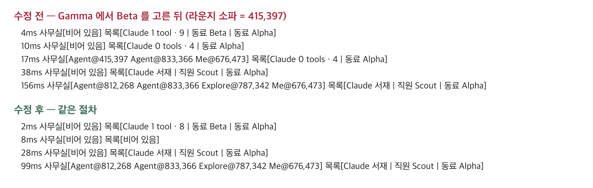

# 59 · 세션을 고른 첫 순간 빈 Claude · 「0 tools」 줄 없애기

- 브랜치: `fix/59-no-empty-frame-on-switch`
- 근거: 57 · 58 실검증 탐색에서 찾은 기존 결함 — 57 EX-07 · 58 EX-01. 「모두 수정해 /cruise」

## 목표

세션을 고르거나 페이지를 열 때, 그 세션의 상태가 오기 전 비워진 스토어가 화면에 그려지지 않게 한다. 라운지 소파에 Claude 하나만 있는 사무실과 Office 목록의 「Agent 0 tools」 줄이 잠깐 보였다가 실제 화면으로 바뀌던 것을 없앤다.

## 한 일

- 보이는 세션의 스냅샷이 들어왔는지 알려 주는 선택자 `selectShownSessionId` 를 더했다. 첫 스냅샷 전과 세션을 바꿔 스토어를 비운 뒤에는 null 이다(`frontend/src/stores/gameStore.ts`).
- 사무실은 그 값이 null 이면 아무도 놓지 않고, 값이 바뀌면 먼저 비운다. 스냅샷이 오면 사람들을 제자리에 한 번에 놓는다(`frontend/src/components/iso/IsoOffice.tsx`). 예전에는 세션 id 가 「None」 인 동안 빈 스토어를 그려 소파의 Claude 가 보였다.
- Office 목록도 그 값이 null 이면 줄을 그리지 않는다(`frontend/src/components/iso/IsoSidePanel.tsx`).
- 시험: 선택자가 첫 스냅샷 전 · 전환 뒤 null 이고 스냅샷 뒤 그 세션이다(`gameStore.test.ts`).

## 검증

| 단계 | 명령 · 방법 | 결과 |
| --- | --- | --- |
| 정적 검증 | 프런트 `make checkall` | 통과 — 시험 299 · lint · tsc · build. 백엔드 · 훅은 바뀌지 않았다 |
| 실검증 | run-qa-flow. 이 브랜치 · `origin/main` 을 워크트리로 떠서 백엔드 8030 · 8031(빈 QA SQLite), 프런트 4750 · 4751. 그 순간은 수십 ms 라 화면 캡처로는 안 잡혀서, 페이지 안에 기록기를 넣고 DOM 이 바뀔 때마다 사무실 이름표와 Office 목록을 적었다. 세션 전환 3번 · 새로고침 · 백엔드 재시작(같은 DB)을 수정 전 · 후에서 같은 순서로 했다. 사용자가 띄운 서버(8000 · 4747)는 건드리지 않았다 | TC 9건 — ✅ 9. 수정 전 재현 2건(A-01 · A-03 — 「0 tools」 줄 3/3, 소파의 Claude 1/3, 첫 로드 1.3초). Aside 탐색 흐름 5 · 이상 4(모두 스펙대로 — 열 때 고르는 세션 · 기다리는 동안 「0 at work」 · 쉬는 Claude 도 세는 목록 · 8글자 세션 id). 새로고침 때 동료가 걸어가는 기존 결함은 계획 60 으로 넣었다 |
| 정리 | QA 서버 4개를 내리고 워크트리 2개 · QA DB 를 지웠다 | `:8030` · `:8031` · `:4750` · `:4751` 듣는 프로세스 0 |

## 검증하지 못한 것

그 순간을 화면 캡처로는 남기지 못했다(헤드리스 캡처 한 장이 1.5초 남짓이라 그 사이 지나간다). DOM 기록으로 판정했다.
