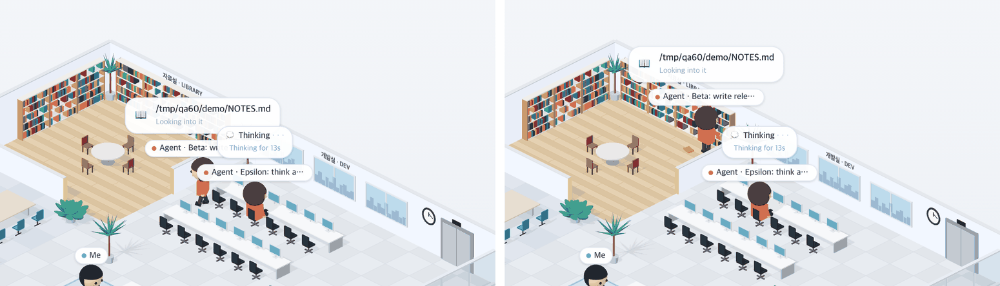

# 60 · 늦게 온 동료도 하던 방에 바로 두기

- 브랜치: `fix/60-colleagues-placed-on-load`
- 근거: 59 실검증에서 찾은 기존 결함 — 페이지를 열면 같은 층 동료가 책상에서 하던 방으로 걸어간다(59 X-01). 「모두 수정해 /cruise」

## 목표

페이지를 열거나 새로고침해도, 같은 층 다른 세션의 Claude(동료)가 책상에서 걸어가지 않고 일하던 방에 바로 있게 한다. 58 에서 남긴 경우다 — 화면을 다시 그릴 때만 방에 바로 뒀고, 그 뒤에 나타나는 사람은 책상에서 출발했다.

## 한 일

- 동료는 그 세션의 리드 overview 가 온 뒤에 그린다. 새 페이지에서는 세션 목록이 overview 소켓의 첫 메시지보다 먼저 와서, 동료가 하는 일 없이 책상에 놓였다가 overview 가 오면 방으로 걸어갔다(`frontend/src/hooks/useFloorColleagues.ts`).
- 엘리베이터로 오는 직원 말고는, 처음 놓일 때 언제나 도구가 보내는 방에 바로 둔다. 지켜보는 중에 일을 시작한 동료도 그 방에 나타난다(`frontend/src/components/iso/isoPeople.ts` 의 `firstWalker`).
- 실검증 첫 회차에서 두 번째 변경만으로는 새로고침 때 여전히 걸어가는 것을 보고 첫 번째 변경을 더했다(5e9817d).
- 탐색에서 「Show the floor's other sessions」 를 껐다 켜면 동료가 지난 상태로 놓였다가 걸어가는 것을 찾았다. overview 소켓을 닫을 때 마지막 기록을 비운다(a68888e).

## 검증

| 단계 | 명령 · 방법 | 결과 |
| --- | --- | --- |
| 정적 검증 | 프런트 `make checkall` | 통과 — 시험 299 · lint · tsc · build. 백엔드 · 훅은 바뀌지 않았다 |
| 실검증 | run-qa-flow. 이 브랜치 · `origin/main` 을 워크트리로 떠서 백엔드 8030 · 8031(빈 QA SQLite), 프런트 4750 · 4751. 같은 층에 세션 4개를 같은 순서로 넣고, 새로고침 · 새 탭 · 쉬던 세션이 일을 시작하는 순간에 페이지 안 기록기로 동료 이름표 좌표를 DOM 이 바뀔 때마다 적었다. 사용자가 띄운 서버(8000 · 4747)는 건드리지 않았다 | TC 7건 — ✅ 7. 수정 전 재현 3건(A-01 · A-02 · A-03 — 동료가 책상 쪽에서 서재로 걸어감). Aside 탐색 흐름 5 · 이상 4(재현 1 — 토글을 다시 켤 때 지난 상태로 놓이는 것, 고침 · 스펙 3) |
| 정리 | QA 서버 4개를 내리고 워크트리 2개 · QA DB 를 지웠다 | `:8030` · `:8031` · `:4750` · `:4751` 듣는 프로세스 0 |

## 검증하지 못한 것

없음. 실제 Claude Code 를 띄우지 않고 훅과 같은 모양의 이벤트를 POST 했다.
