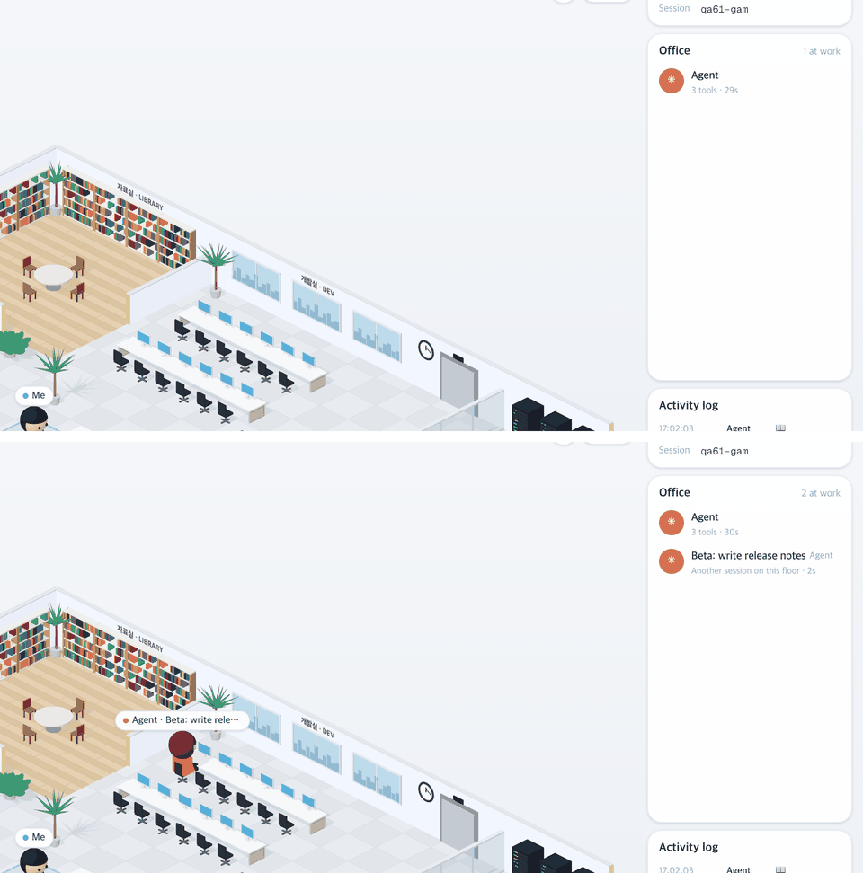

# 61 · 백엔드를 다시 켠 직후에도 동료 보이기

- 브랜치: `fix/61-colleagues-after-backend-restart`
- 근거: 60 의 알려진 한계 — 백엔드를 다시 켠 직후에는 메모리에 없는 활동 중 세션이 다음 이벤트 전까지 동료로 안 보였다. 「개선 부분에서 작업할 거 찾아서 진행해 /cruise」

## 목표

60 은 동료를 그 세션의 overview 항목이 온 뒤에만 그렸다. 그래서 백엔드를 다시 켜서 그 세션이 메모리에 없으면, 활동 중인데도 사무실과 Office 목록에서 빠졌다. 다시 켠 직후에도 동료가 보이게 한다.

## 한 일

- 동료는 overview 소켓의 첫 메시지까지만 기다린다. 그 뒤로는 overview 에 없는 세션도 책상에 보인다(하는 일은 다음 이벤트가 오면 안다). 소켓이 닫히면 다시 첫 메시지를 기다린다(`frontend/src/hooks/useFloorColleagues.ts`).
- 60 이 고친 두 가지(새로고침 때 동료가 걸어가는 것, 토글을 다시 켤 때 지난 상태로 놓이는 것)는 그대로 막혀 있다.

## 검증

| 단계 | 명령 · 방법 | 결과 |
| --- | --- | --- |
| 정적 검증 | 프런트 `make checkall` | 통과 — 시험 299 · lint · tsc · build. 백엔드 · 훅은 바뀌지 않았다 |
| 실검증 | run-qa-flow. 이 브랜치 · `origin/main` 을 워크트리로 떠서 백엔드 8030 · 8031(QA SQLite), 프런트 4750 · 4751. 같은 층에 세션 2개를 넣고, 백엔드를 같은 DB 로 다시 켠 뒤 새로 연 페이지에서 사무실 이름표와 Office 목록을 DOM 으로 읽었다. 사용자 지시로 HTML 리포트는 게시하지 않았다 | TC 5건 — ✅ 5. 수정 전 재현 1건(A-01 — 다시 켠 뒤 동료 Beta 가 그림 · 목록에서 빠짐). Aside 탐색 흐름 4 · 이상 4(재현 2 — 지켜보는 중에 백엔드가 다시 켜지면 서재의 동료가 책상으로 가는 것은 알려진 한계라 계획 64 로, 목록과 말풍선의 초가 1초 어긋나는 기존 결함은 계획 65 로 넣었다 · 스펙 2 — 5분 넘게 이벤트가 없는 세션은 「Active now」 에서 빠진다 · 쉬는 Claude 도 목록에 센다) |
| 정리 | QA 서버 4개를 내리고 워크트리 2개 · QA DB 를 지웠다 | `:8030` · `:8031` · `:4750` · `:4751` 듣는 프로세스 0 |

## 검증하지 못한 것

없음. 다시 켠 직후 메모리에 없는 동료는 하던 일을 모르니 다음 이벤트까지 책상에 있다(계획 64). 실제 Claude Code 를 띄우지 않고 훅과 같은 모양의 이벤트를 POST 했다.
