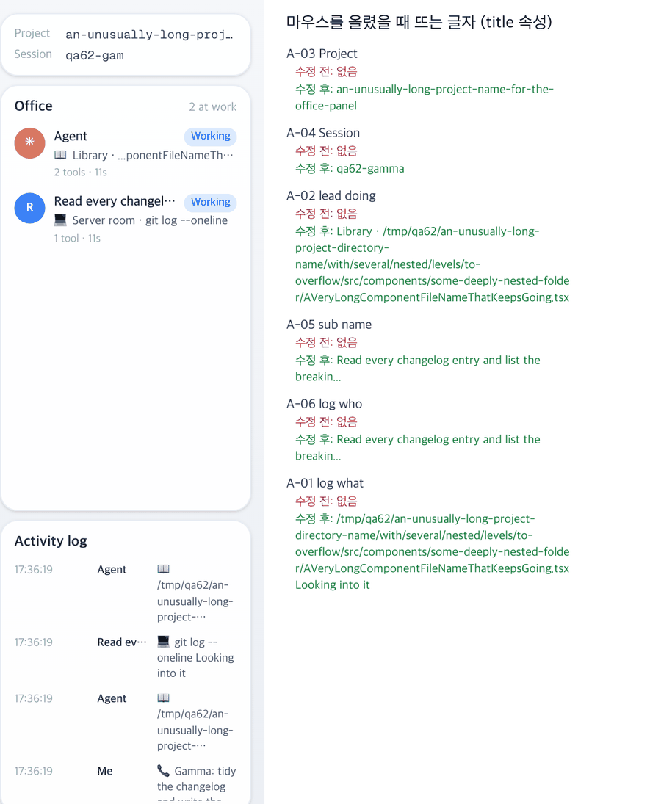

# 62 · 잘린 글자를 마우스로 전부 보기

- 브랜치: `feat/62-full-text-on-hover`
- 근거: 56 실검증에서 남긴 개선 후보 — 오른쪽 패널의 긴 경로 · 이름 · 하는 일이 잘려서 끝까지 볼 방법이 없다. 「개선 부분에서 작업할 거 찾아서 진행해 /cruise」

## 목표

오른쪽 패널에서 잘려 보이는 글자에 마우스를 올리면 브라우저 툴팁으로 전부 보이게 한다. 새 문구는 만들지 않고 화면 글자를 그대로 쓴다.

## 한 일

- Project · Session 칸, Office 목록의 이름과 하는 일, 활동 로그의 누가 · 무엇을 칸에 `title` 을 달았다(`frontend/src/components/iso/IsoSidePanel.tsx`).
- Session 칸은 화면에 8글자만 보이고, 툴팁은 세션 id 전부다.
- 값이 없어 「—」 를 보일 때는 `title` 을 달지 않는다.
- Office 목록의 하는 일은 말풍선 글(백엔드가 경로를 35자로 줄인 글)을 쓴다. 그래서 툴팁은 활동 로그에 남은 그 도구의 전체 대상으로 보인다. 말풍선 글이 그 대상을 줄인 것일 때만 쓰고, 아니면 화면 글자 그대로다(`frontend/src/systems/officeRoster.ts` 의 `toolTargets`).
- 실검증 탐색에서 찾았다. 처음에는 하는 일 툴팁도 줄인 경로 그대로여서 위처럼 고쳤다(c758bc9).
- 시험: 사람마다 마지막 도구의 전체 대상을 고른다 · 말풍선이 그 대상을 줄인 것일 때만 툴팁에 쓴다(`officeRoster.test.ts`).

## 검증

| 단계 | 명령 · 방법 | 결과 |
| --- | --- | --- |
| 정적 검증 | 프런트 `make checkall` | 통과 — 시험 301 · lint · tsc · build. 백엔드 · 훅은 바뀌지 않았다 |
| 실검증 | run-qa-flow. 이 브랜치 · `origin/main` 을 워크트리로 떠서 백엔드 8030 · 8031(QA SQLite), 프런트 4750 · 4751. 긴 프로젝트 이름 · 긴 파일 경로 · 긴 이름의 서브에이전트를 넣고, 칸마다 잘렸는지 · `title` · 그 점의 맨 위 요소를 DOM 으로 읽었다. 430 폭 시트는 터치로 열고 닫았고, 누르는 자리 점검(터치 · 마우스)도 돌렸다. 사용자 지시로 HTML 리포트는 게시하지 않았다 | TC 9건 — ✅ 9. 수정 전 재현 6건(A-01~A-06 — 잘린 칸에 `title` 없음). 이번 항목이 못 채운 것 1건(탐색 EX-02 — 하는 일 툴팁이 줄인 경로)은 고친 뒤 TC 전부를 다시 돌려 통과. 칸 위치 · 크기는 전 · 후 같고, 1280 · 1920 넘침 · 콘솔 오류 0. 누르는 자리 1개(시트 바깥 → 닫기) 터치 · 마우스 전 · 후 같음. Aside 탐색 흐름 5 · 이상 5(재현 1 — EX-02 는 위처럼 고쳤다 · 스펙 4 — 서브에이전트 이름은 기본 설정(AI 요약)에서 원래 짧은 이름이다 · 새 줄이 생겨 마우스 아래 줄이 바뀌어도 브라우저 툴팁은 마우스를 움직여야 바뀐다 · 툴팁은 키보드 포커스로 뜨지 않는다 · 안 잘린 칸에도 같은 글자가 뜬다) |
| 정리 | QA 서버 4개를 내리고 워크트리 2개 · QA DB 를 지웠다 | `:8030` · `:8031` · `:4750` · `:4751` 듣는 프로세스 0 |

## 검증하지 못한 것

- 브라우저가 그리는 툴팁 자체는 헤드리스 캡처에 나오지 않는다. `title` 값과 그 칸이 마우스 아래 맨 위 요소인지로 판정했다.
- 서브에이전트 이름은 백엔드가 지은 짧은 이름이라 툴팁도 그 이름이다. QA 는 AI 요약을 끈 채 돌려 첫 문장 50자에서 잘린 이름이 나왔다. 기본 설정에서는 10단어 안의 요약이다.
- 터치 기기와 키보드 포커스로는 `title` 툴팁이 뜨지 않는다(브라우저 동작).
