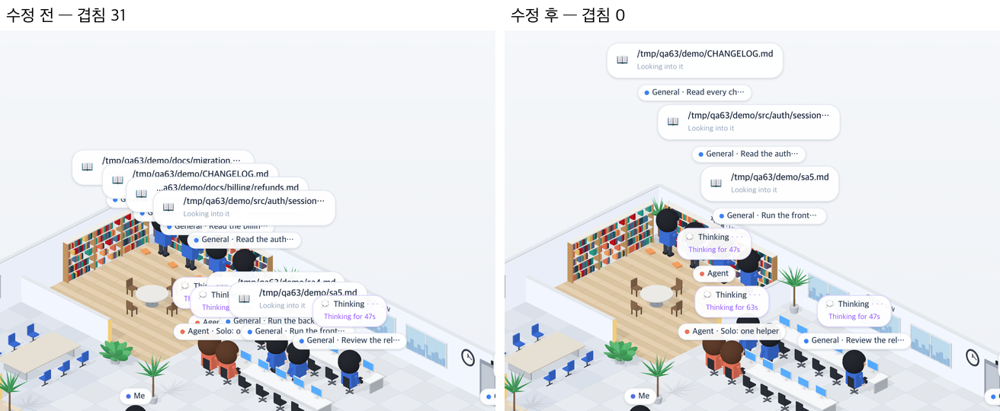

# 63 · 사람이 몰려도 이름표와 말풍선이 겹치지 않게

- 브랜치: `fix/63-chips-overlap`
- 근거: 56 실검증에서 남긴 개선 후보. 이웃 책상이나 서재에 사람이 몰리면 이름표와 말풍선이 서로 덮어 누가 무엇을 하는지 읽을 수 없다. 「개선 부분에서 작업할 거 찾아서 진행해 /cruise」

## 목표

사람이 몰려도 이름표와 말풍선이 서로 덮지 않게 한다. 새 문구는 만들지 않는다.

## 한 일

- 사람마다 이름표와 말풍선을 한 덩어리로 본다. 화면 아래쪽(보는 사람에게 가까운) 덩어리는 제자리에 두고, 그 위를 덮는 덩어리는 덮지 않을 만큼만 위로 올린다(`frontend/src/systems/labelLift.ts`).
- 160px 넘게 올려야 하는 덩어리는 사람에게서 너무 멀어진다. 그래서 말풍선을 빼고 이름표만 둔다. 이름표만으로도 자리가 없으면 둘 다 숨긴다. 오른쪽 Office 목록에는 모두 그대로 있다.
- 매 프레임 그린 뒤 이름표와 말풍선의 화면 위치를 재서 올릴 만큼 올린다(`frontend/src/components/iso/isoPeople.ts` 의 `liftCrowdedLabels`, `isoView.ts` 의 그리기 루프).
- 처음에는 올라가는 움직임을 0.15초에 걸쳐 미끄러지게 했다. 실검증에서 사람이 걷는 동안 이름표가 잠깐씩 최대 11쌍 겹쳤다. 그래서 한 번에 옮기게 바꿨다(7072d42).
- 시험: 안 닿는 사람은 그대로 · 덮는 쪽만 올린다 · 몰린 셋을 차례로 쌓는다 · 말풍선 자리가 없으면 이름표만 · 이름표 자리도 없으면 숨긴다(`frontend/tests/labelLift.test.ts`).

## 검증

| 단계 | 명령 · 방법 | 결과 |
| --- | --- | --- |
| 정적 검증 | 프런트 `make checkall` | 통과 — 시험 306 · lint · tsc · build. 백엔드 · 훅은 바뀌지 않았다 |
| 실검증 | run-qa-flow. 이 브랜치 · `origin/main` 을 워크트리로 떠서 백엔드 8030 · 8031(QA SQLite), 프런트 4750 · 4751. 한 세션에 서브에이전트 8명을 넣어 서재 · 서버실 · 책상에 몰리게 하고, 화면의 이름표 · 말풍선 상자가 서로 겹치는 쌍을 DOM 으로 셌다. 누르는 자리 점검(터치 · 마우스)도 돌렸다. 사용자 지시로 HTML 리포트는 게시하지 않았다 | TC 8건 — ✅ 8. 수정 전 재현 4건 — 몰린 화면 겹침 21쌍 · 서재 6명 31쌍 · 걷는 동안 최대 25쌍 · 도우미 하나 2쌍. 수정 후 전부 0쌍. 서재 6명일 때 이름표 11개 중 8개 · 말풍선 10개 중 7개가 보이고, Office 목록은 전 · 후 10줄 같다. 겹침이 없는 화면은 전 · 후 같고 올라간 것 0. 확대 · 축소 단계마다 0쌍. 1280 · 1920 넘침 · 콘솔 오류 0. 프레임 간격 가운데값 전 · 후 150ms 같다. 이번 항목이 만든 결함 1건(걷는 동안 미끄러지며 잠깐 겹침)은 위처럼 고친 뒤 TC 전부를 다시 돌려 통과. 누르는 자리 4개(확대 · 축소 · 원래대로 · 설정) 터치 · 마우스 전 · 후 같음. Aside 는 브라우저 프로필이 연결돼 있지 않아 탐색 초점을 헤드리스로 대신 돌렸다 — 다크 모드로 70초 지켜보기(사람이 옮겨 다님) · 끌어서 화면 옮기기 · 창 폭 1024 · 900 에서 겹침 0 · 오류 0. 사람이 도착할 때 숨는 사람이 바뀌는 것은 0.4초 간격 두 번으로, 깜박임이 아니다 |
| 정리 | QA 서버 4개를 내리고 워크트리 2개 · QA DB 를 지웠다 | `:8030` · `:8031` · `:4750` · `:4751` 듣는 프로세스 0 |

## 검증하지 못한 것

- Aside 탐색은 브라우저 프로필이 연결돼 있지 않아 돌리지 못했다. 같은 초점을 헤드리스로 대신 봤다.
- 숨긴 사람이 누구인지는 화면 위에 따로 표시하지 않는다. Office 목록에서만 보인다.
- 올라간 이름표는 사람 머리에서 최대 160px 떨어진다. 그 사이에 선을 긋지 않아 누구 것인지는 가까운 순서로 읽어야 한다.
