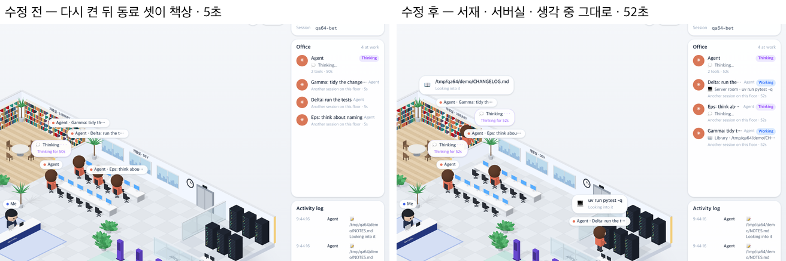

# 64 · 백엔드를 다시 켜도 동료가 하던 일을 안다

- 브랜치: `fix/64-colleagues-keep-activity-after-restart`
- 근거: 61 알려진 한계 · 61 탐색 EX-01. 백엔드를 다시 켜면 메모리에 없는 동료는 하던 일을 모른다. 그래서 서재에서 읽던 동료가 책상으로 걸어가고 초가 처음부터 다시 센다. 「개선 부분에서 작업할 거 찾아서 진행해 /cruise」

## 목표

백엔드를 다시 켠 직후에도 같은 층 다른 세션의 동료가 하던 일(방 · 말풍선 · 초)을 그대로 보여 준다.

## 한 일

- 동료 목록(overview)을 처음 줄 때, 메모리에 없는 열린 세션을 DB 에서 먼저 되살린다(`backend/app/core/event_processor.py` 의 `build_overview_snapshot`).
- 되살리는 세션은 끝나지 않았고 마지막 갱신이 6시간 안인 것만이다. 쉬는 세션을 메모리에서 비우는 기준(`SESSION_IDLE_EVICT_SECONDS`)과 같다.
- 되살리기는 세션을 볼 때 쓰던 것을 그대로 쓴다. 그래서 다음 이벤트가 와도 두 번 적용되지 않는다.
- 시험: 다시 켠 뒤 overview 가 읽는 중인 세션의 활동과 말풍선을 안다 · 끝난 세션과 하루 쉰 세션은 되살리지 않는다(`backend/tests/test_event_restore.py`). 첫 시험은 수정 전 코드에서 실패한다.

## 검증

| 단계 | 명령 · 방법 | 결과 |
| --- | --- | --- |
| 정적 검증 | 백엔드 `make checkall` | 통과 — 시험 518 · ruff · pyright. 프런트 · 훅은 바뀌지 않았다 |
| 실검증 | run-qa-flow. 이 브랜치 · `origin/main` 을 워크트리로 떠서 백엔드 8030 · 8031(QA SQLite), 프런트 4750 · 4751. 같은 층에 읽는 세션 · 명령 돌리는 세션 · 생각 중인 세션 · 끝난 세션을 두고, DB 는 둔 채 백엔드만 다시 켠 뒤 Office 목록과 방을 읽었다. 사용자 지시로 HTML 리포트는 게시하지 않았다 | TC 9건 — ✅ 9. 수정 전 재현 3건 — 다시 켜면 읽던 · 명령 돌리던 · 생각하던 동료가 모두 책상으로 가고 하는 일이 비며 초가 5초부터 다시 센다. 수정 후 서재 · 서버실 · 생각 중이 그대로이고 초가 마지막 이벤트부터 이어 센다(51초). 끝난 세션은 전 · 후 모두 안 보인다. 보는 세션 화면 · 다음 도구 뒤 이동 · 로그 한 번씩은 전 · 후 같다. 300번 넘게 이벤트가 쌓인 세션 둘을 더해 6개를 되살린 첫 overview 가 56ms(다시 연결은 15ms). 1280 · 1920 넘침 · 콘솔 오류 0. 누르는 자리 점검은 해당 없음 — 프런트 코드가 그대로다. Aside 는 브라우저 프로필이 연결돼 있지 않아 같은 초점(두 번 다시 켜기 · 새로고침 · 세션 바꿨다 돌아오기)을 헤드리스로 돌렸고, 수정 후는 매번 하던 일이 그대로였다 |
| 정리 | QA 서버 4개를 내리고 워크트리 2개 · QA DB 를 지웠다 | `:8030` · `:8031` · `:4750` · `:4751` 듣는 프로세스 0 |

## 검증하지 못한 것

- Aside 탐색은 브라우저 프로필이 연결돼 있지 않아 돌리지 못했다. 같은 초점을 헤드리스로 대신 봤다.
- 6시간 넘게 이벤트가 없던 열린 세션은 되살리지 않는다. 다음 이벤트가 오면 그때 되살아난다. 시험으로만 봤다.
- 말풍선이 바뀐 시각은 overview 에 없다. 그래서 다시 켠 뒤 말풍선을 보인 시간은 페이지가 처음 본 때부터 센다.
- 실제 Claude Code 를 띄우지 않고 훅과 같은 모양의 이벤트를 POST 했다.
