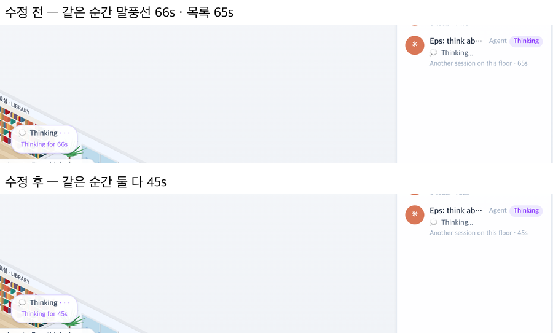

# 65 · Office 목록의 초를 생각 말풍선과 같게 세기

- 브랜치: `fix/65-list-seconds-match-bubble`
- 근거: 61 탐색 EX-04. 같은 순간 Office 목록은 「35s」, 생각 말풍선은 「Thinking for 34s」였다. 목록은 반올림, 말풍선은 내림으로 세서다. 「개선 부분에서 작업할 거 찾아서 진행해 /cruise」

## 목표

Office 목록의 초와 생각 말풍선의 초가 같은 순간 같은 숫자를 보이게 한다.

## 한 일

- 목록도 말풍선처럼 내림으로 센다. 둘이 같은 함수 `secondsSince` 를 쓴다(`frontend/src/systems/officeRoster.ts`).
- 내림으로만 바꾸면 이번엔 목록이 늦다. 목록은 1초 간격 타이머로 바뀌고 말풍선은 프레임마다 바뀌어서다. 그래서 목록을 줄마다 초가 오르는 그 순간에 다시 센다(`untilNextSecond`, `frontend/src/components/iso/IsoSidePanel.tsx`).
- 줄이 새로 오거나 바뀌면 다음 타이머를 기다리지 않고 바로 센다.
- 시험: 내림으로 센다 · 가장 먼저 초가 오르는 줄까지 기다린다 · 1초를 넘게 기다리지 않는다(`officeRoster.test.ts`).

## 검증

| 단계 | 명령 · 방법 | 결과 |
| --- | --- | --- |
| 정적 검증 | 프런트 `make checkall` | 통과 — 시험 309 · lint · tsc · build. 백엔드 · 훅은 바뀌지 않았다 |
| 실검증 | run-qa-flow. 이 브랜치 · `origin/main` 을 워크트리로 떠서 백엔드 8030 · 8031(QA SQLite), 프런트 4750 · 4751. 생각 중인 Claude · 생각 중인 동료 · 읽는 동료를 두고, 12초 동안 20ms 마다 목록 초와 말풍선 초를 읽어 비교했다. 누르는 자리 점검(터치 · 마우스)도 돌렸다. 사용자 지시로 HTML 리포트는 게시하지 않았다 | TC 7건 — ✅ 7. 수정 전 재현 — 목록과 말풍선이 1초 다른 샘플이 Claude 줄 17%(길게는 197ms) · 동료 줄 55%(길게는 580ms). 수정 후 6% · 길게는 100ms 로, 목록이 제때 바뀌고 말풍선이 다음 프레임(헤드리스 150ms 안팎)에 따라오는 동안뿐이다. 일하는 줄은 전 · 후 모두 1초씩 오르고, 새 도구가 오면 바로 0초다. 목록을 다시 그리는 횟수는 전 · 후 5초에 20번으로 같다. 1280 · 1920 넘침 · 콘솔 오류 0. 누르는 자리 4개(확대 · 축소 · 원래대로 · 설정) 터치 · 마우스 전 · 후 같음. Aside 는 브라우저 프로필이 연결돼 있지 않아 같은 초점(세션 바꾸기 · 동료 끄고 켜기 · 새로고침 직후)을 헤드리스로 돌렸고, 모두 한 프레임 안에서만 어긋났다 |
| 정리 | QA 서버 4개를 내리고 워크트리 2개 · QA DB 를 지웠다 | `:8030` · `:8031` · `:4750` · `:4751` 듣는 프로세스 0 |

## 검증하지 못한 것

- Aside 탐색은 브라우저 프로필이 연결돼 있지 않아 돌리지 못했다. 같은 초점을 헤드리스로 대신 봤다.
- 헤드리스는 그림을 소프트웨어로 그려 프레임 간격이 150ms 안팎이다. 실제 브라우저(60fps)에서는 어긋나는 시간이 한 프레임(16ms)으로 줄 것이지만 직접 재지는 않았다.
- 페이지가 시작 시각을 모르는 줄(이벤트 기록이 없는 사람)은 목록과 말풍선이 각자 처음 본 때부터 센다.
