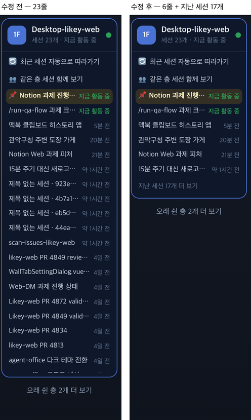

# 66 · 층 안내에서 지난 세션 접기

- 브랜치: `fix/66-fold-old-sessions`
- 근거: 사용자 지적. 「지금 쓰는거에비해서 너무많이 있지않아?」 — 층 하나에 세션이 23개 보이는데 지금 쓰는 건 6개다. 4~6일 전에 끝난 세션 12개와, 열고 아무것도 안 한 터미널 5개까지 다 보여서다.

## 목표

층 안내의 열린 층에는 지금 쓰는 세션만 보이고, 나머지는 한 번 눌러 볼 수 있게 접는다.

## 한 일

- 한 층 안에서 두 가지 세션을 「지난 세션 N개 더 보기」 밑으로 접는다. 하나는 끝난 지 1시간 넘은 세션이고, 하나는 열렸지만 아무것도 하지 않은 세션(프롬프트 없이 「입력 기다림」뿐)이다(`frontend/src/systems/floors.ts` 의 `splitSessions`).
- 지금 보고 있는 세션과 지금 일하는 세션은 늘 보인다. 접힌 세션을 열고 다시 접어도 그 세션은 목록에 남는다.
- 다른 층을 누르면 일하는 세션이 없을 때 접히지 않은 세션 중 가장 최근 것을 연다. 전에는 막 연 빈 터미널이 열렸다(`IsoFloorGuide.tsx` 의 `entranceOf`).
- 세션 목록이 세션마다 아무 일이라도 했는지를 알려 준다(`backend/app/api/routes/sessions.py` 의 `hasWork`). 기준은 끝난 빈 세션을 목록에서 빼던 기준과 같다.
- 문구는 「지난 세션 N개 더 보기」 · 「접기」 이고 영어 · 스페인어 · 포르투갈어도 넣었다.
- 시험: 끝난 지 1시간 넘은 세션과 빈 세션을 접고 보는 세션은 남긴다(`floors.test.ts`) · 목록이 빈 세션과 일한 세션을 가른다(`test_api.py`).

## 검증

| 단계 | 명령 · 방법 | 결과 |
| --- | --- | --- |
| 정적 검증 | 프런트 · 백엔드 `make checkall` | 통과 — 프런트 시험 311 · lint · tsc · build, 백엔드 시험 519 · ruff · pyright |
| 실검증 | run-qa-flow. 이 브랜치 · `origin/main` 을 워크트리로 떠서 백엔드 8030 · 8031, 프런트 4750 · 4751. DB 는 사용자 앱 DB 의 복사본(실데이터)이다. 사용자 지시로 HTML 리포트는 게시하지 않았다 | TC 7건 — ✅ 7. Desktop-likey-web 층이 수정 전 23줄에서 수정 후 6줄 + 「지난 세션 17개 더 보기」가 됐다. 펼치면 23줄 · 「접기」, 접힌 세션을 열고 접으면 7줄로 그 세션이 남는다. 새로 연 빈 터미널은 바로 접힌다(24번째가 18개 안으로). agent-office 층도 2줄에서 1줄 + 1개로 접힌다. 430 폭 시트에서도 버튼이 화면 안에 보인다. 1280 · 1920 넘침 · 콘솔 오류 0. 누르는 자리 점검(터치 · 마우스): 「지난 세션 더 보기」 는 수정 후 새로 눌리고, 세션 줄 · 다른 층 · 두 스위치는 전 · 후 모두 눌린다. 수정 전 두 번째 세션 줄은 수정 후 접혀서 없다(의도) |
| 정리 | QA 서버 4개를 내리고 워크트리 2개 · DB 복사본을 지웠다 | `:8030` · `:8031` · `:4750` · `:4751` 듣는 프로세스 0 |

## 검증하지 못한 것

- Aside 탐색은 브라우저 프로필이 연결돼 있지 않아 돌리지 못했다.
- 층 머리의 「세션 23개」 는 접힌 것까지 센 수 그대로다.
