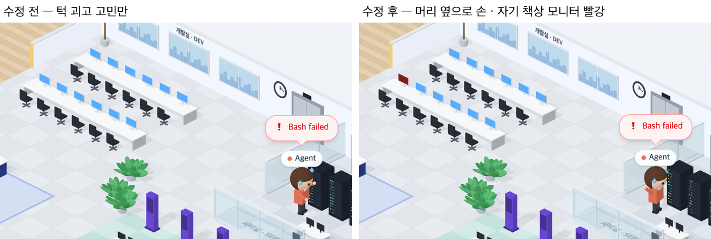

# 67 · 테스트가 실패하면 머리를 감싸 쥐기

- 브랜치: `feat/67-dismay-on-failed-tests`
- 근거: 사용자 요청(2026-10-27) 「좀 더 귀여운 기믹」 제안 표에 「다 진행해」. docs/plan/spec.md 「작업 공간 기믹」.

## 목표

테스트 명령이 실패하면 그 사람이 「아이고」 하고 머리 옆으로 손을 들고, 자기 책상 모니터가 빨갛게 깜빡인다. 성공 때 하는 만세의 짝이다.

## 한 일

- 사람마다 마지막 테스트 명령이 실패했는지 이벤트 기록에서 찾는다. 만세가 쓰는 판정과 같은 것을 쓰고, 성공과 실패만 다르다(`frontend/src/systems/roomGimmicks.ts` 의 `lastFailedTestId`).
- 새 실패가 오면 2.5초 동안 두 손을 머리 옆으로 들고 흔든다. 실패라서 흘리는 땀은 그대로 보인다(`isoCharacters.ts` 의 `dismay`, `isoPeople.ts`).
- 그동안 그 사람 자리의 모니터가 빨강 · 진빨강으로 깜빡인다(`isoEffects.ts`).
- 처음에는 만세처럼 방 쪽으로 돌아서게 했다. 그랬더니 랙 앞에서 등을 보여 손이 안 보여서 랙을 보는 방향 그대로 두었다. 팔도 처음엔 큰 머리 안쪽으로 들어가 안 보여서 머리 옆으로 벌렸다(1f45e11).
- 시험: 실패한 마지막 테스트를 찾는다 · 서브에이전트의 실패를 그 사람에게 붙인다(`roomGimmicks.test.ts` · `officePeople.test.ts`).

## 검증

| 단계 | 명령 · 방법 | 결과 |
| --- | --- | --- |
| 정적 검증 | 프런트 `make checkall` | 통과 — 시험 313 · lint · tsc · build |
| 실검증 | run-qa-flow. 이 브랜치 · `origin/main` 을 워크트리로 떠서 백엔드 8030 · 8031, 프런트 4750 · 4751. Claude 에게 `uv run pytest -q` 를 시키고 실패로 끝낸 뒤 랙 앞 Claude 와 개발실 모니터를 찍었다. 사용자 지시로 HTML 리포트는 게시하지 않았다 | TC 5건 — ✅ 5. 테스트 실패: 수정 전은 턱 괴고 고민만 하고, 수정 후는 머리 옆으로 손을 들고 Claude 자리 모니터가 빨갛다. 2.5초 뒤에는 전 · 후 같은 고민 자세로 돌아간다. 테스트 성공(만세)과 테스트가 아닌 명령의 실패(`git push`, 고민만 · 모니터 그대로)는 전 · 후 같다. 1280 · 1920 넘침 · 콘솔 오류 0. 누르는 자리 4개(확대 · 축소 · 원래대로 · 설정) 터치 · 마우스 전 · 후 같음 |
| 정리 | QA 서버 4개를 내리고 워크트리 2개 · QA DB 를 지웠다 | `:8030` · `:8031` · `:4750` · `:4751` 듣는 프로세스 0 |

## 검증하지 못한 것

- Aside 탐색은 브라우저 프로필이 연결돼 있지 않아 돌리지 못했다.
- 다른 세션의 동료는 이벤트 기록이 없어서 만세처럼 이 동작도 하지 않는다.
- 서브에이전트의 실패는 시험으로만 봤다.
