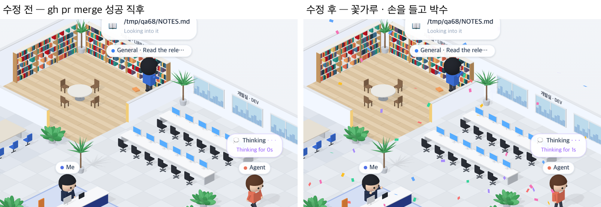

# 68 · 머지 · 푸시가 성공하면 꽃가루와 박수

- 브랜치: `feat/68-confetti-on-merge`
- 근거: 사용자 요청(2026-10-27) 「좀 더 귀여운 기믹」 제안 표에 「다 진행해」. docs/plan/spec.md 「작업 공간 기믹」.

## 목표

PR 머지나 푸시가 성공하면 사무실 위로 종이 꽃가루가 잠깐 떨어지고, 사무실 사람들이 박수 친다.

## 한 일

- 세션 안 누구든 `git push` · `gh pr merge` 를 성공으로 끝내면 그 일을 찾는다. 마지막 것이 실패면 없는 것으로 본다(`frontend/src/systems/roomGimmicks.ts` 의 `lastShipped`).
- 새로 성공한 것이 1분 안의 일이면 꽃가루 90장이 3초 동안 사무실 위에서 흔들리며 떨어진다(`isoEffects.ts`). 그래서 1분 넘게 지난 머지는 페이지를 새로 열어도 다시 터지지 않는다(`isoView.ts` 의 `setShipped`).
- 같은 3초 동안 걷고 있지 않은 사람은 손을 얼굴 앞으로 들고 박수 친다. 「나」 · Claude · 서브에이전트 · 동료 모두다(`isoCharacters.ts` 의 `clap`, `isoPeople.ts`). 실패해서 고민 중인 사람은 고민을 이어 간다.
- 처음에는 손을 가슴 높이로 했는데 타자 치는 자세와 구별이 안 돼서 얼굴 앞으로 올렸다(5ea8651).
- 시험: 푸시 · 머지 명령을 알아본다 · 마지막으로 성공한 것과 그 시각을 고른다 · 마지막이 실패면 없다(`roomGimmicks.test.ts`).

## 검증

| 단계 | 명령 · 방법 | 결과 |
| --- | --- | --- |
| 정적 검증 | 프런트 `make checkall` | 통과 — 시험 315 · lint · tsc · build |
| 실검증 | run-qa-flow. 이 브랜치 · `origin/main` 을 워크트리로 떠서 백엔드 8030 · 8031, 프런트 4750 · 4751. 서재에서 읽는 서브에이전트를 두고 Claude 에게 `gh pr merge 74 --merge --delete-branch` 를 성공으로 끝낸 뒤 찍었다. 사용자 지시로 HTML 리포트는 게시하지 않았다 | TC 5건 — ✅ 5. 머지 성공: 수정 전은 아무 일 없고, 수정 후는 사무실 전체에 꽃가루가 떨어지며 「나」 · 서브에이전트가 손을 들고 박수 친다. 머지한 Claude 는 자리로 걸어가는 중이라 박수 치지 않는다. 3초 뒤 꽃가루가 사라진다. 실패한 `git push` 뒤와 그 뒤 페이지를 새로 열 때는 전 · 후 모두 아무 일 없다. 1280 · 1920 넘침 · 콘솔 오류 0. 누르는 자리 4개(확대 · 축소 · 원래대로 · 설정) 터치 · 마우스 전 · 후 같음 |
| 정리 | QA 서버 4개를 내리고 워크트리 2개 · QA DB 를 지웠다 | `:8030` · `:8031` · `:4750` · `:4751` 듣는 프로세스 0 |

## 검증하지 못한 것

- Aside 탐색은 브라우저 프로필이 연결돼 있지 않아 돌리지 못했다.
- 1분 넘게 지난 머지를 처음 열 때 터지지 않는 것은 코드로만 봤다. 실검증은 실패한 푸시가 마지막인 경우만 다시 열어 봤다.
- 다른 세션의 머지는 그 세션 이벤트 기록이 없어서 꽃가루를 띄우지 않는다.
