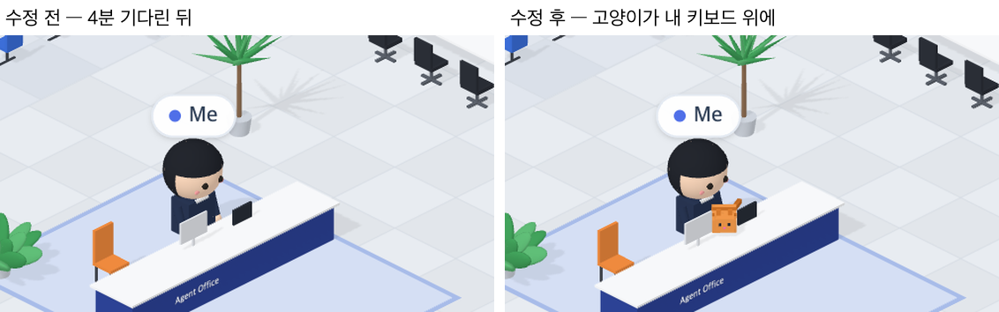

# 70 · 오래 기다리면 고양이가 내 키보드 위에

- 브랜치: `feat/70-cat-on-my-keyboard`
- 근거: 사용자 요청(2026-10-27) 「좀 더 귀여운 기믹」 제안 표에 「다 진행해」. docs/plan/spec.md 「작업 공간 기믹」.

## 목표

Claude 가 응답을 마치고 내 다음 질문을 몇 분 넘게 기다리면, 사무실 고양이가 「나」 키보드 위에 올라앉는다. 지금 내 차례라는 뜻이다.

## 한 일

- Claude 가 턴을 마치고 라운지에서 쉰 지 3분이 넘으면 고양이를 띄운다. 쉰 시간은 라운지 소일거리 · 졸기가 쓰는 마지막 이벤트 시각과 같다(`frontend/src/systems/roomGimmicks.ts` 의 `catOnKeyboard`, `isoPeople.ts`).
- 고양이는 오렌지 줄무늬에 점 눈 · 분홍 코 · 귀가 달린 블록 고양이다. 내 책상 위 키보드 자리로 폴짝 올라와 숨 쉬듯 몸이 오르내리고 꼬리를 흔든다(`isoEffects.ts`).
- 내가 새 질문을 보내면 Claude 가 일하러 가고, 고양이는 바로 사라진다.
- 처음에는 작고 방 쪽을 봐서 모니터에 가려 고양이로 안 읽혔다. 1.5배로 키우고 카메라 쪽을 보게 돌렸다(c4edb7c).
- 시험: 3분 전에는 없고 3분부터 있다(`roomGimmicks.test.ts`).

## 검증

| 단계 | 명령 · 방법 | 결과 |
| --- | --- | --- |
| 정적 검증 | 프런트 `make checkall` | 통과 — 시험 318 · lint · tsc · build |
| 실검증 | run-qa-flow. 이 브랜치 · `origin/main` 을 워크트리로 떠서 백엔드 8030 · 8031, 프런트 4750 · 4751. 이벤트 시각을 4분 전으로 넣어 Claude 가 4분째 기다리는 세션을 만들고, 내 자리를 찍은 뒤 새 질문을 보냈다. 사용자 지시로 HTML 리포트는 게시하지 않았다 | TC 3건 — ✅ 3. 4분 기다린 화면: 수정 전은 내 책상이 그대로이고, 수정 후는 고양이가 키보드 자리에 앉아 있다. 새 질문을 보내면 수정 후도 고양이가 사라지고 「나」 가 타자를 친다(전 · 후 같음). 1280 · 1920 넘침 · 콘솔 오류 0. 누르는 자리 4개(확대 · 축소 · 원래대로 · 설정) 터치 · 마우스 전 · 후 같음 |
| 정리 | QA 서버 4개를 내리고 워크트리 2개 · QA DB 를 지웠다 | `:8030` · `:8031` · `:4750` · `:4751` 듣는 프로세스 0 |

## 검증하지 못한 것

- Aside 탐색은 브라우저 프로필이 연결돼 있지 않아 돌리지 못했다.
- Claude Code 는 턴이 끝나고 1분 뒤 「입력을 기다린다」 알림을 보낸다. 이 알림도 마지막 이벤트로 쳐서, 실제로는 턴이 끝나고 4분쯤 뒤에 고양이가 온다. 라운지에서 조는 시점(5분)과 같은 기준이다.
