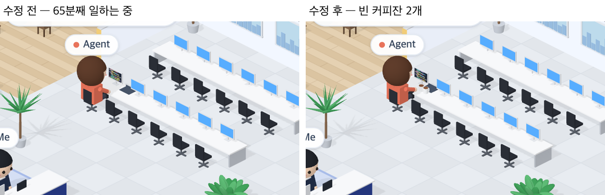

# 71 · 긴 턴에는 빈 커피잔이 쌓인다

- 브랜치: `feat/71-cups-on-long-turns`
- 근거: 사용자 요청(2026-10-27) 「좀 더 귀여운 기믹」 제안 표에 「다 진행해」. docs/plan/spec.md 「작업 공간 기믹」.

## 목표

한 턴이 30분 넘게 이어지면 Claude 책상에 빈 커피잔이 하나씩 쌓인다(최대 3개).

## 한 일

- 이벤트 기록에서 마지막 턴을 찾는다. 내 질문이 온 때부터, Claude 가 그 뒤 처음 멈춘 때(아직 일하면 지금)까지다(`frontend/src/systems/roomGimmicks.ts` 의 `latestTurn`).
- 그 길이 30분마다 잔이 하나씩 늘고, 3개에서 멈춘다(`cupsFor`). 매 프레임 지금 시각으로 세서, 이벤트가 없어도 30분이 되면 늘어난다.
- 턴이 끝나도 잔은 남는다. 내가 새 질문을 보내면 치운다.
- 잔은 커피 자국이 남은 흰 머그다. Claude iMac 옆 서류함 앞에 줄지어 놓인다(`isoEffects.ts`).
- 처음에는 iMac 왼쪽에 작게 놓았더니 앉은 Claude 몸에 가려 안 보였다. 1.5배로 키워 서류함 앞으로 옮겼고, 그러느라 서류함도 iMac 쪽으로 조금 당겼다(ad52115).
- 시험: 마지막 턴과 그 뒤 첫 멈춤을 찾는다 · 30분마다 하나, 3개까지, 끝난 턴은 그 길이만큼(`roomGimmicks.test.ts`).

## 검증

| 단계 | 명령 · 방법 | 결과 |
| --- | --- | --- |
| 정적 검증 | 프런트 `make checkall` | 통과 — 시험 320 · lint · tsc · build |
| 실검증 | run-qa-flow. 이 브랜치 · `origin/main` 을 워크트리로 떠서 백엔드 8030 · 8031, 프런트 4750 · 4751. 질문 시각을 65분 전으로 넣고 Claude 가 지금 파일을 고치는 세션을 만들어 Claude 책상을 찍었다. 이어서 턴을 끝내고, 새 질문을 보냈다. 사용자 지시로 HTML 리포트는 게시하지 않았다 | TC 4건 — ✅ 4. 65분째인 턴: 수정 전은 책상이 그대로이고, 수정 후는 빈 커피잔 2개가 놓였다. 턴이 끝나 Claude 가 라운지로 가도 2개가 남고, 새 질문을 보내면 치워진다. 3개에서 멈추는 것은 시험으로 봤다. 1280 · 1920 넘침 · 콘솔 오류 0. 누르는 자리 4개(확대 · 축소 · 원래대로 · 설정) 터치 · 마우스 전 · 후 같음 |
| 정리 | QA 서버 4개를 내리고 워크트리 2개 · QA DB 를 지웠다 | `:8030` · `:8031` · `:4750` · `:4751` 듣는 프로세스 0 |

## 검증하지 못한 것

- Aside 탐색은 브라우저 프로필이 연결돼 있지 않아 돌리지 못했다.
- 실제로 30분을 기다리지는 않았다. 질문 시각을 과거로 넣어 만들었다.
