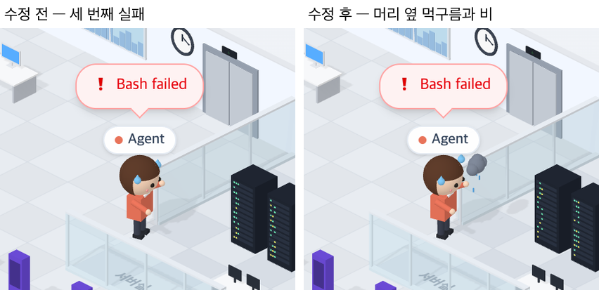

# 72 · 같은 도구가 거듭 실패하면 먹구름

- 브랜치: `feat/72-cloud-on-repeated-failures`
- 근거: 사용자 요청(2026-10-27) 「좀 더 귀여운 기믹」 제안 표에 「다 진행해」. docs/plan/spec.md 「작업 공간 기믹」.

## 목표

같은 도구가 3번 넘게 연달아 실패하면 그 사람 머리 옆에 작은 먹구름이 끼고 비가 내린다.

## 한 일

- 사람마다 마지막 도구가 몇 번 연달아 실패했는지 센다. 성공한 도구나 다른 도구가 나오면 거기서 멈춘다(`frontend/src/systems/roomGimmicks.ts` 의 `failuresInARow`). 3번이면 먹구름을 띄운다(`officePeople.ts` 의 `rainCloud`).
- 먹구름은 회색 뭉게구름 넷과 파란 빗방울 셋이다. 빗방울은 차례로 떨어진다(`isoCharacters.ts` 의 `rainOn`). 실패라서 흘리는 땀과 고민 자세는 그대로다.
- 그 도구가 한 번 성공하면 바로 걷힌다.
- 처음에는 머리 위에 두었는데 이름표가 그 자리를 덮었다. 머리 옆으로 내렸더니 이번엔 랙을 보고 돌아선 머리 뒤로 숨었다. 그래서 어느 쪽을 보든 화면 기준 머리 오른쪽 위에 오게 했다(11615f5).
- 시험: 성공이나 다른 도구에서 멈춰 센다 · 세 번 실패한 사람에게 먹구름을 붙인다(`roomGimmicks.test.ts` · `officePeople.test.ts`).

## 검증

| 단계 | 명령 · 방법 | 결과 |
| --- | --- | --- |
| 정적 검증 | 프런트 `make checkall` | 통과 — 시험 323 · lint · tsc · build |
| 실검증 | run-qa-flow. 이 브랜치 · `origin/main` 을 워크트리로 떠서 백엔드 8030 · 8031, 프런트 4750 · 4751. Claude 에게 `bun run build` 를 세 번 실패로, 네 번째는 성공으로 끝내며 서버실을 찍었다. 사용자 지시로 HTML 리포트는 게시하지 않았다 | TC 4건 — ✅ 4. 두 번 실패: 전 · 후 같다(먹구름 없음). 세 번 실패: 수정 전은 땀 흘리며 고민만 하고, 수정 후는 머리 옆에 먹구름과 비가 생긴다. 성공하면 수정 후도 먹구름이 걷힌다. 다른 도구가 끼면 다시 세는 것은 시험으로 봤다. 1280 · 1920 넘침 · 콘솔 오류 0. 누르는 자리 4개(확대 · 축소 · 원래대로 · 설정) 터치 · 마우스 전 · 후 같음 |
| 정리 | QA 서버 4개를 내리고 워크트리 2개 · QA DB 를 지웠다 | `:8030` · `:8031` · `:4750` · `:4751` 듣는 프로세스 0 |

## 검증하지 못한 것

- Aside 탐색은 브라우저 프로필이 연결돼 있지 않아 돌리지 못했다.
- 다른 세션의 동료는 이벤트 기록이 없어서 먹구름이 끼지 않는다.
