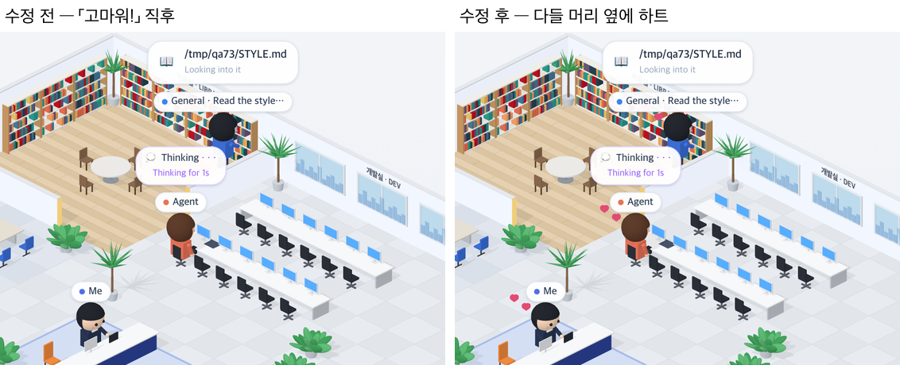

# 73 · 고맙다고 하면 하트

- 브랜치: `feat/73-hearts-on-thanks`
- 근거: 사용자 요청(2026-10-27) 「좀 더 귀여운 기믹」 제안 표에 「다 진행해」. docs/plan/spec.md 「작업 공간 기믹」.

## 목표

내 질문에 「고마워」 · 「thanks」 가 있으면 사무실 사람들 머리 옆에 하트가 잠깐 뜬다.

## 한 일

- 내 마지막 질문이 고맙다는 말인지 본다. 「고마워」 · 「고맙」 · 「감사」 · thank · thx · ty 를 찾는다(`frontend/src/systems/roomGimmicks.ts` 의 `isThanks` · `lastThanks`).
- 그 질문이 새로 온 1분 안의 일이면 3초 동안 모두의 머리 옆에서 분홍 하트 두 개가 번갈아 떠오른다. 「나」 · Claude · 서브에이전트 · 동료 모두다(`isoCharacters.ts` 의 `heartsOn`, `isoPeople.ts`).
- 하트는 어느 쪽을 보든 화면 기준 머리 왼쪽 위에서 카메라를 보고 떠오른다. 이름표가 머리 바로 위를, 먹구름(72)이 오른쪽을 쓰기 때문이다.
- 시험: 한국어 · 영어 고맙다는 말을 알아본다 · 마지막 질문만 본다(`roomGimmicks.test.ts`).

## 검증

| 단계 | 명령 · 방법 | 결과 |
| --- | --- | --- |
| 정적 검증 | 프런트 `make checkall` | 통과 — 시험 325 · lint · tsc · build |
| 실검증 | run-qa-flow. 이 브랜치 · `origin/main` 을 워크트리로 떠서 백엔드 8030 · 8031, 프런트 4750 · 4751. Claude 가 파일을 고치고 서브에이전트가 서재에서 읽는 중에 「고마워! 덕분에 잘 됐어」 를 보낸 뒤 찍었다. 이어서 「다음 것도 해줘」 를 보냈다. 사용자 지시로 HTML 리포트는 게시하지 않았다 | TC 4건 — ✅ 4. 고맙다는 질문: 수정 전은 그대로이고, 수정 후는 「나」 · Claude · 서브에이전트 머리 옆에 하트가 뜬다. 4초 뒤에는 전 · 후 같고 하트가 없다. 고맙다는 말이 없는 질문 뒤에는 전 · 후 모두 하트가 없다. 1280 · 1920 넘침 · 콘솔 오류 0. 누르는 자리 4개(확대 · 축소 · 원래대로 · 설정) 터치 · 마우스 전 · 후 같음 |
| 정리 | QA 서버 4개를 내리고 워크트리 2개 · QA DB 를 지웠다 | `:8030` · `:8031` · `:4750` · `:4751` 듣는 프로세스 0 |

## 검증하지 못한 것

- Aside 탐색은 브라우저 프로필이 연결돼 있지 않아 돌리지 못했다.
- 다른 세션의 「고마워」 는 그 세션 이벤트 기록이 없어서 이 층에 하트를 띄우지 않는다.
- 「ty」 처럼 짧은 영어는 단어로 따로 쓸 때만 알아본다(「type」 은 아니다).
