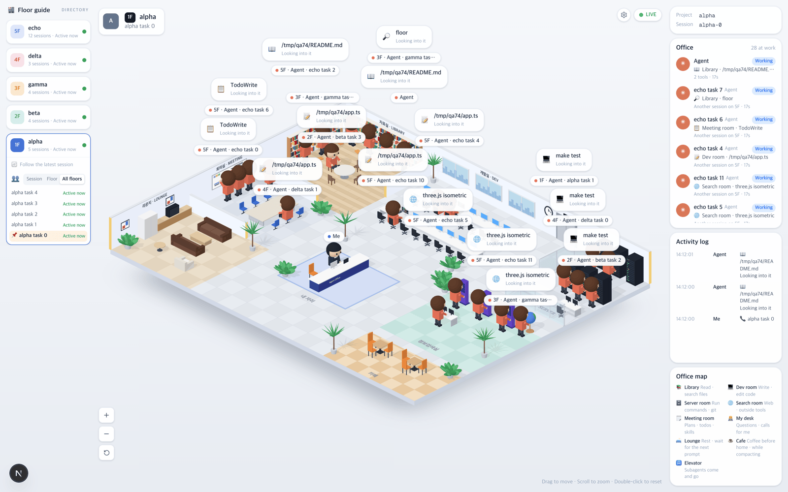

# 74 · 모든 층을 한 사무실에

- 브랜치: `feat/74-all-floors-together`
- 근거: 사용자 요청(2026-10-27) 「모든 층을 한층에 합쳐서 보여줄수있는 옵션도 만들수있음?」, 「그 옵션을 만들고, 동료 제한을 두지말고 많이 돌아다니게해 빈의자늘려도됨」.

## 목표

다른 폴더(층)에서 지금 일하는 세션도 한 사무실에 함께 나온다. 동료 수에 제한을 두지 않는다.

## 한 일

- 「사무실에 함께 보기」를 세션만 · 같은 층 · 모든 층 세 가지로 고른다. 층별 안내와 설정 창에서 고르고, 값은 `office_view` 로 저장한다(`preferencesStore.ts`). 예전 켜고 끄기에서 끈 값은 세션만으로 이어받는다.
- 모든 층이면 모든 프로젝트에서 지금 일하는 세션의 Claude 가 한 사무실에 나온다(`floors.ts` 의 `officeColleagues`). 이름표와 Office 목록에 그 층(3F)이 붙는다.
- 동료 5명 제한을 없앴다. 개발실 책상을 줄당 6석에서 8석으로 늘렸고, 개발실이 차면 회의실 · 자료실 의자에 앉는다(`isoFloorPlan.ts`, 빈 의자 25개). 의자가 다 차면 새로 온 사람끼리 서로 다른 의자를 나눠 쓴다.
- 책상이 길어지자 지름길이 서버실 앞 화분 모서리를 스쳤다. 지름길 검사를 타일의 1/8 간격으로 촘촘히 했다(`pathSmoothing.ts`).
- 이름표 · 말풍선이 설정 창 위로 올라오던 것을 막았다(`isoView.ts`).
- 시험: 보기 세 가지 · 층 번호 · 30명 · 저장값 이어받기(`floors.test.ts`, `preferencesStore.test.ts`).

## 검증

| 단계 | 명령 · 방법 | 결과 |
| --- | --- | --- |
| 정적 검증 | 프런트 `make checkall` (`origin/main` 위로 다시 올린 뒤) | 통과 — 시험 328 · lint · tsc · build |
| 실검증 | 이 브랜치로 백엔드 8040 · 프런트 4760 을 띄워, 폴더 5개에 지금 일하는 세션 28개를 넣고 alpha 세션에서 봤다 | 모든 층: Office 「28 at work」, 이름표에 1F–5F, 개발실 · 회의실 · 자료실 · 서버실 · 검색실로 다들 걸어간다. 세션만: 1명. 같은 층: 그 층 세션 수만큼. 새로고침해도 고른 값이 남는다. 한국어 안내 · 설정 창 정상, 설정 창 위로 이름표가 올라오지 않는다. 콘솔 오류 0 |
| 정리 | QA 서버 2개를 내리고 QA DB 를 지웠다 | `:8040` · `:4760` 듣는 프로세스 0 |

## 검증하지 못한 것

- 실제 여러 폴더의 Claude Code 세션으로는 보지 않았다. 훅 이벤트를 직접 보내 만든 세션으로 봤다.
- 쉬는 세션(턴이 끝나 입력을 기다리거나 5분 넘게 이벤트가 없는 세션)은 같은 층 보기와 같은 기준으로 나오지 않는다.
