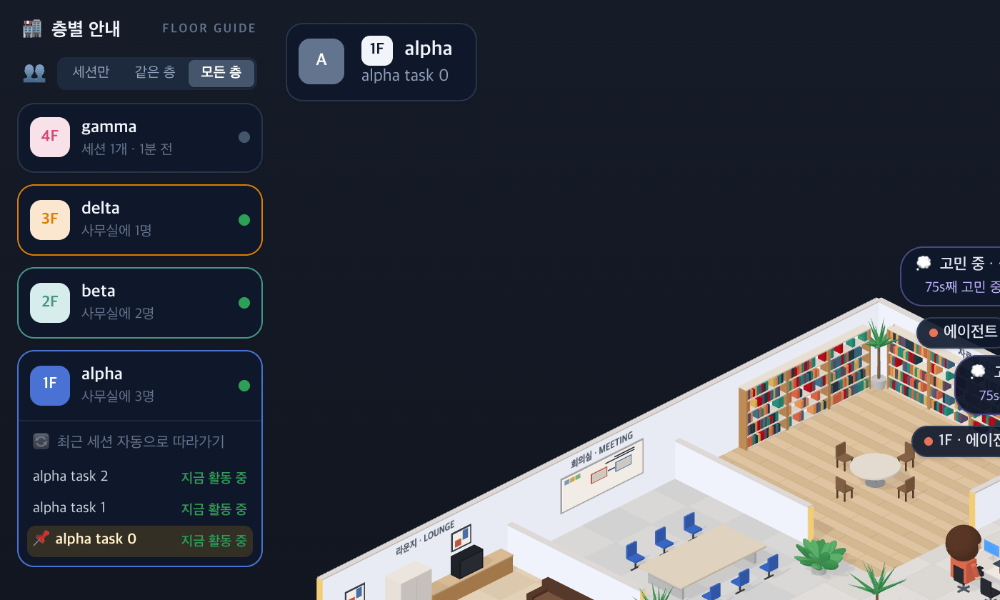

# 75 · 모든 층일 때 층별 안내

- 브랜치: `feat/75-all-floors-guide`
- 근거: 사용자 지적(2026-10-27) 「모든층을 다보여주게 옵션을 켯다면 이부분은 조금 다르게 보여주는게 낫지않을까?」. 고른 안: 스위치를 위로 빼고 층마다 표시한다.

## 목표

모든 층을 고르면 층별 안내에서도 어느 층 사람들이 사무실에 와 있는지 보인다.

## 한 일

- 「세션만 · 같은 층 · 모든 층」 스위치를 지금 보는 층 카드 안에서 층별 안내 맨 위로 뺐다. 사무실 전체에 걸리는 설정이라서다(`IsoFloorGuide.tsx`).
- 모든 층이면 사무실에 사람이 나온 층마다 그 층 색으로 테두리를 두르고 「세션 N개 · 지금 활동 중」 대신 「사무실에 N명」을 보여 준다. 사람 수는 지금 보는 세션과 지금 일하는 세션을 센다(`floors.ts` 의 `floorHeadcounts`). 아무도 안 나온 층은 그대로 회색이다.
- 시험: 지금 보는 세션은 쉬어도 세고, 아무도 없는 층은 빠진다(`floors.test.ts`).

## 검증

| 단계 | 명령 · 방법 | 결과 |
| --- | --- | --- |
| 정적 검증 | 프런트 `make checkall` | 통과 — 시험 329 · lint · tsc · build |
| 실검증 | 이 브랜치로 백엔드 8040 · 프런트 4760 을 띄워, alpha 3 · beta 2 · delta 1 명이 일하고 gamma 는 끝난 상태로 넣고 alpha 세션에서 봤다. 한국어 · 밝은 화면과 어두운 화면 | 모든 층: alpha 「사무실에 3명」 · beta 2명 · delta 1명이 각자 층 색 테두리, gamma 는 회색 「세션 1개 · 1분 전」, 사무실 「6명 근무 중」. 같은 층 · 세션만: 지금 보는 층만 테두리, 나머지는 예전처럼 「세션 N개 · 지금 활동 중」. 스위치는 세 보기 모두 층 카드 위에 있다. 콘솔 오류 0 |
| 정리 | QA 서버 2개를 내리고 QA DB 를 지웠다 | `:8040` · `:4760` 듣는 프로세스 0 |

## 검증하지 못한 것

- 휴대폰 너비에서 여는 층별 안내 시트는 찍지 않았다. 같은 컴포넌트라 모양은 같다.
