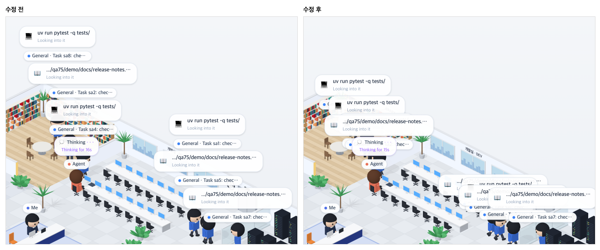

# 76 · 사람이 오가도 이름표와 말풍선은 머리 위에 그대로

- 브랜치: `fix/76-steady-labels`
- 근거: 사용자 지적(2026-10-27) 「풍선이 서로 가려져도 되니까 개선해봐 지금 너무 왔다갔다 이동하는거에 따라서 풍선이 너무 정신없이 움직여」. docs/plan/spec.md 「동선 규칙」 5.

## 목표

사람이 몰려 오가도 이름표와 말풍선이 그 사람 머리 위에서 함께 움직이게 한다. 서로 가리는 것은 괜찮다.

## 한 일

- 63 에서 넣은 밀어 올리기를 없앴다(`frontend/src/systems/labelLift.ts` 삭제). 매 프레임 겹침을 재서 이름표와 말풍선을 올렸다 내렸다 숨겼다 했기 때문에, 누가 걸을 때마다 다른 사람 풍선이 최대 160px 튀었다. 이제는 늘 머리 위에 있고, 서로 가리면 카메라에 가까운 사람 것이 위에 그려진다(three.js 의 CSS2DRenderer 가 거리 순으로 쌓는다).
- 이름표 기준점을 엉덩이에서 몸 전체로 옮겼다(`frontend/src/components/iso/isoCharacters.ts`). 걸음마다의 들썩임 · 만세 뜀 · 머리 감싸기 흔들림 · 라운지에서 기대기에 이름표가 같이 떨렸다. 이제는 앉으면 내려가고 서면 올라가는 것만 따라간다.
- 시험: 걷기 · 만세 · 머리 감싸기 내내 이름표 높이가 같다 · 앉으면 내려가고 서면 돌아온다(`frontend/tests/isoCharacters.test.ts`). 수정 전 코드로 돌리면 둘 다 실패한다(걷는 동안 높이 11가지).

## 검증

| 단계 | 명령 · 방법 | 결과 |
| --- | --- | --- |
| 정적 검증 | 프런트 `make checkall` | 통과 — 시험 325 · lint · tsc · build |
| 실검증 | run-qa-flow. 이 브랜치 · `origin/main` 을 워크트리로 떠서 백엔드 8030 · 8031, 프런트 4750 · 4751. 서브에이전트 8명이 0.75초마다 한 명씩 서재와 서버실을 오가게 하고, 20초 동안 매 프레임 이름표가 그 사람 기준점에서 얼마나 떨어졌는지 쟀다. 사용자 지시로 HTML 리포트는 게시하지 않았다 | TC 2건 — ✅ 2. 수정 전은 81프레임 동안 이름표가 74번 튀고 19번 숨었다 다시 나왔다. 기준점에서 최대 160px 떨어졌고, 사람이 7px 움직이는 사이 163px 옮겨 갔다. 수정 후는 튐 0 · 숨김 0 · 기준점에서 0px 이고, 한 프레임에 최대 7px 로 사람과 같이 움직인다. 1280 · 1920 넘침 · 콘솔 오류 0. 누르는 자리 4개(확대 · 축소 · 원래대로 · 설정) 터치 · 마우스 전 · 후 같음 |
| 정리 | QA 서버 4개를 내리고 워크트리 2개 · QA DB 를 지웠다 | `:8030` · `:8031` · `:4750` · `:4751` 듣는 프로세스 0 |

## 검증하지 못한 것

- Aside 탐색은 브라우저 프로필이 연결돼 있지 않아 돌리지 못했다.
- 걸음 들썩임이 사라진 것은 시험으로만 봤다. 헤드리스 화면이 초당 4프레임쯤이라 들썩임 주기를 잴 수 없다.
- 사람이 몰리면 뒤쪽 사람 말풍선이 가려진다(사용자가 괜찮다고 했다). 가려진 사람이 하는 일은 Office 목록에서 본다.
