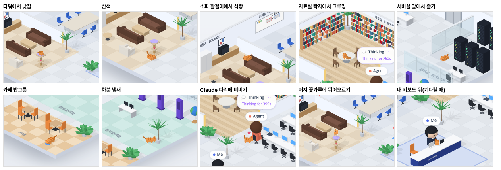

# 77 · 고양이가 사무실을 산책한다

- 브랜치: `feat/77-cat-strolls`
- 근거: 사용자 요청(2026-10-27) 「고양이를 내 책상에만 두지말고 여러군데 산책하는거처럼 돌아다니면서 기믹을 더 많이 넣어줘」. docs/plan/spec.md 「작업 공간 기믹」.

## 목표

70 에서 넣은 고양이는 기다릴 때만 내 키보드 위에 나타났다. 이제는 늘 사무실에 있으면서 여러 자리를 걸어 다니고, 자리마다 고양이다운 동작을 한다.

## 한 일

- 고양이가 들르는 자리 7곳을 정했다. 자리마다 머무는 시간과 하는 일이 다르다(`frontend/src/systems/officeCat.ts`).

  | 자리 | 하는 일 | 머무는 시간 |
  | --- | --- | --- |
  | 라운지 캣타워 꼭대기 | 몸을 말고 잔다 | 40~70초 |
  | 소파 팔걸이 | 식빵 자세로 엎드린다 | 20~35초 |
  | 자료실 둥근 탁자 위 | 앉아서 앞발을 핥는다 | 15~25초 |
  | 서버실 랙 앞 | 눈을 감고 존다 | 25~40초 |
  | 카페 밥그릇 | 고개를 숙이고 밥을 먹는다 | 8~12초 |
  | 정보검색실 화분 | 킁킁 냄새를 맡는다 | 4~6초 |
  | Claude 다리 옆 | 몸을 비비고, 하트가 2초마다 떠오른다 | 6~9초 |

- 사람과 같은 길찾기를 써서 가구를 돌아 걷는다. 사람보다 느리게(초당 1.3m) 네 다리로 걷고, 꼬리를 세운다. 탁자 · 소파 · 타워 · 책상에는 폴짝 뛰어 오르내린다. 자거나 엎드렸다 일어나면 기지개를 켜고 간다.
- Claude 다리에는 Claude 가 자기 책상에 앉아 있을 때만 간다. 비비는 동안 Claude 가 일어나면 다른 데로 간다. 이 판단을 위해 사람 쪽에서 「Claude 가 책상에 앉아 있다」를 알려 준다(`isoPeople.ts` 의 `claudeSeated`).
- 70 의 키보드 고양이는 그대로 둔다. 입력 대기가 길어지면 어디 있든 걸어와 내 키보드 위에 올라앉는다. 내가 질문을 보내면 기지개를 켜고 내려간다.
- 머지 · 푸시로 꽃가루가 떨어지는 3초 동안 고양이가 뒷발로 서서 앞발로 꽃가루를 잡으려 뛴다. 고맙다고 하면 사람들처럼 고양이 위에도 하트가 뜬다.
- 라운지에 캣타워(삼줄 기둥 · 중간 발판 · 꼭대기 쿠션 · 매달린 방울)를, 카페 앞쪽에 파란 밥그릇을 놓았다(`isoFloorPlan.ts`, `isoFurniture.ts`). 캣타워는 사람이 돌아서 걷는다.
- 고양이는 다리 · 양말 · 꼬리 · 눈을 따로 움직이는 몸으로 새로 만들었다(`frontend/src/components/iso/isoCat.ts`). 70 의 고정된 고양이 코드는 `isoEffects.ts` 에서 뺐다.
- 시험(`officeCat.test.ts`) — 8건:
  - 모든 자리 사이를 걸어서 갈 수 있다.
  - 다음 자리는 지금과 다르고, Claude 다리는 앉아 있을 때만 고른다.
  - 낮잠 뒤 기지개 → 뛰어내림 → 걷기 순서로 움직인다.
  - 도착하면 뛰어올라 자리 잡는다. 밥 먹은 뒤에는 기지개 없이 간다.
  - 걷는 중에도 기다림이 길어지면 키보드로 간다. 질문을 보내면 내려온다.
  - 그루밍 중이던 탁자에서도 바로 내려온다. Claude 가 일어나면 비비기를 멈춘다.

## 검증

| 단계 | 명령 · 방법 | 결과 |
| --- | --- | --- |
| 정적 검증 | 프런트 `make checkall` | 통과 — 시험 333 · lint · tsc · build |
| 실검증 | run-qa-flow. 이 브랜치 · `origin/main` 을 워크트리로 떠서 백엔드 8030 · 8031, 프런트 4750 · 4751. 사용자 지시로 HTML 리포트는 게시하지 않았다 | TC 5건 — ✅ 5. ① 페이지를 열면 수정 전은 라운지가 그대로이고, 수정 후는 캣타워 위에서 고양이가 자고 있다. ② 4분째 기다리는 세션을 열면 수정 전은 고양이가 키보드 위에 바로 나타난다. 수정 후는 타워에서 기지개를 켜고 걸어와 25초 안에 키보드에 올라앉는다. 질문을 보내면 수정 전은 고양이가 사라지고, 수정 후는 기지개 뒤 내려와 걸어간다. ③ `git push` 성공: 수정 후 고양이가 타워 위에서 뒷발로 서서 뛴다. 꽃가루가 끝나면 다시 잔다. ④ 「고마워!」: 수정 후 고양이 위에 하트가 뜬다. ⑤ 1280 · 1920 넘침 · 콘솔 오류 0. 누르는 자리 4개(확대 · 축소 · 원래대로 · 설정) 터치 · 마우스 전 · 후 같음 |
| 자리별 동작 | QA 복사본에서만 머무는 시간을 5초로 줄이고 고양이 화면 위치를 읽게 고쳐, 5분 동안 따라다니며 자리마다 찍었다 | 7곳 동작과 걷기 · 뛰기 · 기지개가 모두 찍혔다. 처음에는 화분 자리가 「나」 이름표에 가려 안 보였다. 소파 · 서버실에서는 정면만 보여 고양이로 안 읽혔다. 그래서 화분을 정보검색실 화분으로 옮기고, 엎드리는 자리를 비스듬히 돌렸다. 다시 찍어 확인했다 |
| 정리 | QA 서버 4개를 내리고 워크트리 2개 · QA DB 를 지웠다 | `:8030` · `:8031` · `:4750` · `:4751` 듣는 프로세스 0 |

## 검증하지 못한 것

- Aside 탐색은 브라우저 프로필이 연결돼 있지 않아 돌리지 못했다.
- 자리별 동작 사진은 머무는 시간을 줄인 QA 복사본에서 찍었다. 실제 머무는 시간은 시험으로 봤다.
- 다음 자리는 무작위로 고른다. 그래서 새로고침하면 늘 캣타워에서 자는 것부터 시작한다.
- 고양이는 사람을 피하지 않는다. 길이 겹치면 사람과 잠깐 겹쳐 지나간다.
