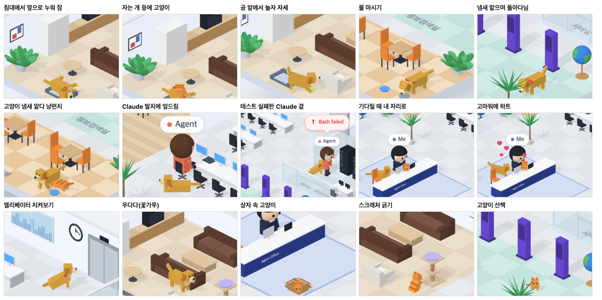

# 78 · 사무실에 골든리트리버, 고양이와 함께 돌아다닌다

- 브랜치: `feat/78-office-dog`
- 근거: 사용자 요청(2026-10-27) 「강아지도 한마리 둬. 골든리트리버같은 좀 큰 강아지 였으면 좋겠음. 고양이와 개의 특성을 고려하여 여러가지 기믹 더 추가해. 그리고 고양이 강아지가 좀 더 자유롭고 활동성있게 돌아다녔으면」. docs/plan/spec.md 「작업 공간 기믹」.

## 목표

사무실에 큰 개(골든리트리버)를 들인다. 개와 고양이가 각자 성격대로 행동하고 서로 어울린다. 둘 다 정해 둔 자리만 오가지 않고 사무실 여기저기를 더 자주 돌아다닌다.

## 한 일

- 고양이와 개가 함께 쓰는 이동 방식을 따로 뺐다(`frontend/src/systems/officePets.ts`). 할 일마다 다음을 정한다.
  - 어디로 갈지, 어떤 빠르기로 갈지(걷기 · 종종걸음 · 달리기).
  - 지나갈 점이 있는지(우다다).
  - 올라갈 곳이 있는지, 거기서 무엇을 얼마나 할지.
  - 뇌(고양이 · 개 따로)가 정하는 세 가지: 지금 당장 가야 할 곳, 하던 일을 계속할지, 다음 갈 곳.
- 빈 바닥 아무 데나 고르는 함수를 두었다(`openSpot`). 갈 수 있는 길이 있는 곳만 고른다. 둘 다 이걸로 정해 둔 자리 사이를 자유롭게 오간다.
- 누구 옆에 설 때는 화면 왼쪽 · 오른쪽 자리를 먼저 고른다(`besidePoint`). 그래야 옆모습이 보이고 서로 가리지 않는다.
- 개(`frontend/src/systems/officeDog.ts`, 화면은 `frontend/src/components/iso/isoDog.ts`):
  - 생김새: 고양이보다 큰 골든리트리버다. 늘어진 귀 · 크림색 가슴 · 빨간 목줄 · 깃털 꼬리가 있고, 깨어 있으면 늘 꼬리를 흔든다.
  - 혼자 하는 일:
    - 라운지 개 침대에 올라가 옆으로 누워 잔다(20~35초).
    - 카페 물그릇에서 물을 마신다.
    - 엘리베이터 옆에 앉아 문을 본다.
    - 바닥 냄새를 맡으며 돌아다닌다.
    - 테니스공 앞에서 놀자 자세로 들썩인다. 다음 자리까지 공을 물고 가서 내려놓는다.
  - Claude 를 따라다닌다:
    - Claude 가 책상에 앉아 있으면 발치에 엎드린다.
    - Claude 가 방에서 일하면 따라가 옆에 앉는다. Claude 가 떠나면 일어난다.
  - 일이 생기면 바로 달려간다(꽃가루 > 위로 > 마중 > 기다림 순).
    - 머지 · 푸시 꽃가루에 우다다 세 바퀴를 뛰고 헥헥댄다.
    - 테스트가 실패한 사람 곁에 앉아 고개를 갸웃한다.
    - 새로 온 서브에이전트를 엘리베이터에서 깡충거리며 맞는다.
    - 입력 대기가 길어지면 공을 물고 와 내 의자 옆에 엎드린다.
  - 고양이가 바닥에 머물러 있으면 다가가 냄새를 맡는다.
  - 고맙다고 하면 하트가 뜨고 꼬리가 더 빨라진다.
- 고양이(`officeCat.ts`, `isoCat.ts`):
  - 다음 갈 곳을 고를 때 30% 는 빈 바닥으로 가서 앉아 두리번거린다. 그중 10% 는 우다다 달린다. 자리마다 머무는 시간은 줄였다.
  - 새 자리 세 곳:
    - 캣타워 기둥: 뒷발로 서서 스크래처를 긁는다.
    - 내 자리 옆 러그의 골판지 상자: 들어가 머리만 내민다.
    - 자는 개의 등: 올라가 몸을 만다. 개가 깨면 내려온다.
  - 깨어서 바닥에 있을 때 개가 다가오면, 개 쪽으로 돌아서 앞발로 친다.
- 사람 쪽에서 「Claude 가 어디서 앉아 있는지 · 일하는지」와 「테스트가 실패한 사람이 어디 있는지」를 알려 준다(`isoPeople.ts` 의 `claude` · `upset`).
- 가구를 더했다(`isoFloorPlan.ts`, `isoFurniture.ts`).
  - 개 침대 · 물그릇은 사람이 밟고 지나가도 되는 바닥 물건이다.
  - 골판지 상자는 사람이 돌아서 걷는다.
- 시험 — 고양이 10건 · 개 9건:
  - 모든 자리 사이를 걸어서 갈 수 있다.
  - Claude · 자는 개 자리는 그때만 고른다.
  - 낮잠 → 기지개 → 뛰어내림 → 걷기.
  - 빈 바닥을 우다다 달린다.
  - 기다릴 때 키보드 · 내 의자 옆으로 간다.
  - 공을 물고 가서 다음 자리에 내려놓는다.
  - 꽃가루에 우다다, 실패한 사람 곁에서는 새로 온 사람에게 안 간다.
  - 자다가 깨서 마중 간다.
  - Claude 를 따라가고, 떠나면 일어난다.
  - 고양이가 올라가 있으면 냄새 맡으러 가지 않는다.

## 검증

| 단계 | 명령 · 방법 | 결과 |
| --- | --- | --- |
| 정적 검증 | 프런트 `make checkall` | 통과 — 시험 344 · lint · tsc · build |
| 실검증 | run-qa-flow. 이 브랜치 · `origin/main` 을 워크트리로 떠서 백엔드 8030 · 8031, 프런트 4750 · 4751. 사용자 지시로 HTML 리포트는 게시하지 않았다 | TC 6건 — ✅ 6. ① 페이지를 열면 수정 후만 라운지 개 침대에서 개가 자고 공이 옆에 있다. ② Claude 의 `pytest` 실패: 수정 후 개가 침대에서 일어나 달려와 11초 만에 Claude 곁에 앉는다. ③ 새 서브에이전트: 수정 후 개가 엘리베이터로 달려간다. ④ `git push` 성공: 수정 후 개가 우다다 뛰고 고양이가 뛰어오른다. ⑤ 4분째 기다리는 세션: 수정 전은 고양이만 키보드에 있다. 수정 후는 고양이가 키보드에, 개가 내 의자 옆에 엎드린다. 「고마워!」 를 보내면 둘 다 하트를 띄우고 기지개를 켠 뒤 떠난다. ⑥ 1280 · 1920 넘침 · 콘솔 오류 0. 누르는 자리 4개(확대 · 축소 · 원래대로 · 설정) 터치 · 마우스 전 · 후 같음 |
| 자리 · 동작별 모습 | QA 복사본에서만 머무는 시간을 4초로 줄였다. 다음 갈 곳을 정해 줄 수 있게 고쳐, 개 · 고양이를 따라다니며 동작마다 찍었다 | 개 동작 15가지와 고양이 새 동작(스크래처 · 상자 · 개 등 위 · 냥펀치 · 두리번 · 우다다)이 모두 찍혔다. 실검증 중 아래를 고쳐 다시 찍었다 — 공 놀이 · Claude 발치 · 마중에서 개가 뒤돌아 있어 세로 막대처럼 보이던 것(옆 자리부터 고르게), 개발실 구석 상자가 동료 · 이름표에 가려지던 것(내 자리 옆으로), 냄새 맡는 개 · 위로하는 개가 고양이 · Claude 와 겹치던 것(간격 1.4m · 1.25m), 위로하러 가던 개가 마중으로 방향을 틀던 것 |
| 정리 | QA 서버 4개를 내리고 워크트리 2개 · QA DB 를 지웠다 | `:8030` · `:8031` · `:4750` · `:4751` 듣는 프로세스 0 |

## 검증하지 못한 것

- Aside 탐색은 브라우저 프로필이 연결돼 있지 않아 돌리지 못했다.
- 자리 · 동작별 사진은 머무는 시간을 줄이고 다음 갈 곳을 정해 준 QA 복사본에서 찍었다. 실제 무작위 선택과 머무는 시간은 시험으로 봤다.
- 개와 고양이는 사람을 피하지 않는다. 길이 겹치면 잠깐 겹쳐 지나간다.
- 테스트가 실패한 순간 개가 멀리 있으면 도착까지 10초쯤 걸린다. 그사이 그 사람이 자리를 뜨면 빈자리 옆에 앉는다.
