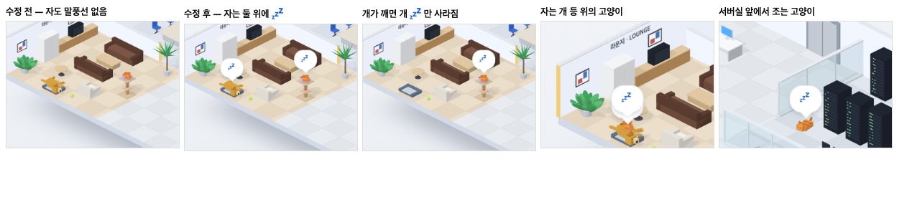

# 79 · 개 · 고양이가 자면 머리 위에 💤

- 브랜치: `feat/79-pet-sleep-bubbles`
- 근거: 사용자 요청(2026-10-27) 「강아지 고양이도 자고있으면 말풍선을 띄워도 괜찮을거같음」. docs/plan/spec.md 「작업 공간 기믹」.

## 목표

사무실 개와 고양이가 자는 동안 머리 위에 말풍선을 띄워, 지금 자고 있다는 것이 한눈에 보이게 한다.

## 한 일

- 소파에서 조는 사람이 띄우던 「💤」 말풍선을 그대로 쓴다. 새 문구는 만들지 않았다. 그 말풍선을 한 곳(`SNORE`)에 두고 사람 · 개 · 고양이가 함께 쓴다(`frontend/src/components/iso/isoBubbles.ts`).
- 펫용 말풍선 자리를 만든다(`petSnore`). 펫에는 이름표가 없어서, 말풍선 아래에 이름표 자리를 비우지 않고 머리 바로 위에 붙인다. 자는지 여부가 바뀔 때만 다시 그린다.
- 고양이: 캣타워 낮잠 · 서버실 앞 졸기 · 개 등 위에서 자는 동안 💤 를 띄운다. 꽃가루에 뛰어오르는 동안은 지운다(`isoCat.ts`).
- 개: 침대에서 자는 동안 💤 를 띄운다(`isoDog.ts`).
- 기지개를 켜기 시작하면 바로 지운다. 키보드 위 고양이와 내 의자 옆 개는 깨어서 기다리는 것이라 띄우지 않는다.
- 시험: 자는 동안만 💤 를 그리고, 깨면 지우고, 이름표 자리를 두지 않는다(`frontend/tests/petSnore.test.ts`).

## 검증

| 단계 | 명령 · 방법 | 결과 |
| --- | --- | --- |
| 정적 검증 | 프런트 `make checkall` | 통과 — 시험 346 · lint · tsc · build |
| 실검증 | run-qa-flow. 이 브랜치 · `origin/main` 을 워크트리로 떠서 백엔드 8030 · 8031, 프런트 4750 · 4751. 화면의 「💤」 말풍선 수를 DOM 으로 세며 찍었다. 사용자 지시로 HTML 리포트는 게시하지 않았다 | TC 8건 — ✅ 8. ① 페이지를 열면 수정 전은 개 · 고양이가 자도 말풍선이 없고, 수정 후는 둘 위에 💤 2개가 뜬다. ② 새 서브에이전트가 오면 개가 깨고 0.3초 안에 개의 💤 만 사라진다(2 → 1). ③ `git push` 성공: 고양이가 뛰어오르는 3초 동안 💤 가 0개였다가, 다시 자면 1개로 돌아온다. ④ 4분째 기다리는 세션: 키보드 위 고양이 · 의자 옆 개에는 💤 가 없다. 소파에서 조는 Claude 의 💤 는 수정 전 · 후 같은 자리에 1개다. ⑤ 개 등 위 · 서버실 앞 졸기: 💤 가 뜨고, 걸어가는 동안은 없다. ⑥ 1280 · 1920 넘침 · 콘솔 오류 0. 누르는 자리 4개(확대 · 축소 · 원래대로 · 설정) 터치 · 마우스 전 · 후 같음 |
| 정리 | QA 서버 4개를 내리고 워크트리 2개 · QA DB 를 지웠다 | `:8030` · `:8031` · `:4750` · `:4751` 듣는 프로세스 0 |

## 검증하지 못한 것

- Aside 탐색은 브라우저 프로필이 연결돼 있지 않아 돌리지 못했다.
- 개 등 위 · 서버실 앞 졸기는 QA 복사본에서 다음 갈 곳을 정해 주고 찍었다. 실제로는 무작위로 그 자리에 간다.
- 고양이가 개 등 위에서 자면 두 💤 가 거의 겹쳐 하나처럼 보인다.
