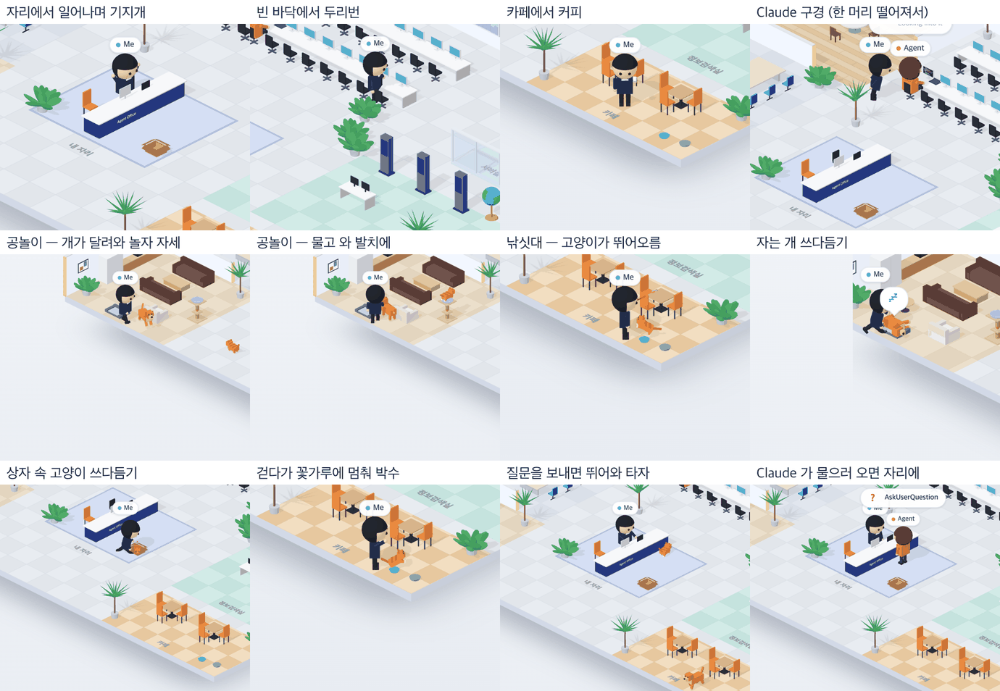

# 80 · 「나」도 일어나 돌아다니고 개 · 고양이와 논다

- 브랜치: `feat/80-me-roams`
- 근거: 사용자 요청(2026-10-27) 「나도 좀 유동적으로 움직이게해줘 고양이 강아지랑 놀아준다던가 돌아다닌다던가 뭐 여러가지 기믹」. docs/plan/spec.md 「작업 공간 기믹」.

## 목표

「나」가 내 자리에만 앉아 있지 않게 한다. Claude 가 일하는 동안 자리에서 일어나 사무실을 돌아다니고, 개 · 고양이와 놀고, 필요할 때는 자리로 돌아온다.

## 한 일

- 「나」의 뇌를 따로 뺐다(`frontend/src/systems/officeMe.ts`). 펫이 쓰는 이동 방식(`officePets.ts`)을 그대로 쓴다. 할 일은 아래 중에서 고른다.
  - 자리에 앉아 한동안 화면 보기. 자리에서 일어날 때는 기지개를 켠다.
  - 개와 공놀이: 공 옆으로 가서 개를 부른다. 개가 달려와 놀자 자세를 하면 공을 던진다. 개가 쫓아가 물고 와 발치에 내려놓으면 또 던진다. 세 번 던지고 끝낸다.
  - 고양이 낚싯대: 깨어 있는 고양이 옆에서 깃털 낚싯대를 흔든다.
  - 쓰다듬기: 개나 고양이 곁에 쪼그려 앉아 쓰다듬는다.
  - Claude 구경: Claude 가 책상에 앉아 있거나 방에서 일하면 한 머리(2.2m) 떨어져서 뒷짐 지고 본다.
  - 카페에서 커피를 마신다. 빈 바닥으로 가서 허리에 손을 얹고 두리번거린다.
- 꼭 자리에 있어야 할 때는 바로 돌아온다.
  - 질문을 보내면 어디에 있든 자리로 뛰어와 앉아서 타자를 친다. 자리에 앉아 있었으면 그 자리에서 친다.
  - Claude 가 물으러 내 자리에 오면(`AskUserQuestion`) 뛰어와 앉고, 묻는 동안 일어나지 않는다.
  - 걷다가 머지 · 푸시 꽃가루가 떨어지면 그 자리에 멈춰 박수를 친다.
- 개(`officeDog.ts`, 화면은 `isoDog.ts`):
  - 내가 부르면 달려와 놀자 자세를 하고, 던진 공을 쫓아가 물고 와 내 발치에 내려놓는다.
  - 공은 내 손에서 포물선을 그리며 날아가 떨어진다.
  - 쓰다듬는 동안 자리를 지키고, 하트가 뜨고, 꼬리가 빨라진다.
- 고양이(`officeCat.ts`, 화면은 `isoCat.ts`):
  - 깨어 돌아다니는 고양이는 7m 안에서 낚싯대를 보면 달려와 나를 보고 뒷발로 서서 깃털을 잡으려 뛴다.
  - 쓰다듬는 동안 자리를 지키고 하트가 뜬다.
- 개 · 고양이끼리 노는 놀이(81)와 서로 끼어들지 않는다. 펫끼리 노는 중이면 나는 그 펫과 놀지 않는다. 나와 공놀이 · 낚싯대 중인 펫에게는 펫끼리 놀이가 시작되지 않는다(`petPlay.ts`).
- 사람 포즈를 더했다(`isoCharacters.ts`): 기지개(팔을 V 자로) · 던지기 · 부르기 · 낚싯대(소품 포함) · 쪼그려 쓰다듬기 · 뒷짐 구경 · 두리번.
- 프레임 순서를 바꿨다(`isoView.ts`). 펫 위치를 먼저 읽고 사람을 움직인 뒤 펫을 움직인다. 그래서 나는 지난 프레임의 펫을, 펫은 이번 프레임의 나를 본다.
- 시험 — 나 12건 · 펫끼리 놀이 1건 더함:
  - 자리에서 바로 타자 / 어디서든 뛰어와 타자.
  - 일어날 때 기지개, 물으러 오면 앉기, 걷다 꽃가루에 박수.
  - 공놀이 한 판(부르기 → 던지기 3번 → 끝).
  - 낚싯대에 가까운 고양이 · 멀리 있는 고양이 · 자는 고양이.
  - 쓰다듬는 동안 개가 머문다.
  - 펫끼리 놀 때는 끼어들지 않는다.

## 검증

| 단계 | 명령 · 방법 | 결과 |
| --- | --- | --- |
| 정적 검증 | 프런트 `make checkall` | 통과 — 시험 382 · lint · tsc · build |
| 실검증 | run-qa-flow. 백엔드 8050 하나에 이 브랜치 · `origin/main` 프런트 4770 · 4771 을 붙였다(백엔드는 바뀐 곳이 없다). 놀이별 모습은 QA 복사본(4772)에서 「나」 · 고양이의 다음 할 일만 정해 주고 찍었다. 다른 세션이 8030 · 4750 을 써서 포트를 옮겼다. 사용자 지시로 HTML 리포트는 게시하지 않았다 | TC 13건 — ✅ 13 · 탐색 2건(이번 결함 1 수정 · 기존 1). ① 일하는 세션 70초: 수정 전은 「나」가 한 자리, 수정 후는 24초쯤 일어나 36번 중 22–26곳을 지난다. ② 카페에서 질문을 보내면 0.1초 만에 자리로 뛰기 시작해 6.3초에 앉아 타자를 친다. ③ `AskUserQuestion` 에 자리로 와 앉고 묻는 동안 일어나지 않는다. ④ 공놀이: 부르기 → 던지기 → 쫓기 → 물고 오기가 세 번 돌고 33초에 끝난다. 공 높이 2.1(손) → 2.8 → 1.2초에 바닥 → 1.0(개 입). ⑤ 고양이가 낚싯대에 0.1초 만에 뛰어오른다. ⑥ 자는 개 · 상자 속 고양이 쓰다듬기에 하트, 개는 5초 넘게 머문다. ⑦ 걷다가 푸시: 0.7초에 멈춰 박수, 꽃가루가 끝나면 다음 일로. ⑧ 4분 기다리는 세션: 고양이 키보드 · 개 내 의자 옆은 전 · 후 같고, 수정 후는 그동안 「나」가 돌아다닌다. 「고마워!」에 하트가 뜨고 「나」가 자리로 와 타자를 친다. ⑨ 1280 · 1600 · 1920 넘침 0 · 콘솔 오류 0. 누르는 자리 4개(확대 · 축소 · 원래대로 · 설정) 전 · 후 같음. 81 · 82 머지 뒤 다시 올려 ① · ⑧ · ⑨ 를 다시 봤다 |
| 실검증 중 고친 것 | 위 실검증 | 기지개 팔이 큰 머리 속에 가려 안 보였다(V 자로). 카페에서 등을 돌려 머그가 안 보였다(화면 쪽으로). 낚싯대를 들고 가는 사이 고양이가 떠나 한 번도 못 놀았다(고양이가 달려오게). 걷던 중 꽃가루에 박수를 안 쳤다(멈춰서 박수). Aside 탐색: Claude 구경 때 1.3m 옆이라 두 머리가 겹쳐 「나」가 가려졌다(3/3, 화면에서 28px) → 2.2m 로 늘려 48px |
| 사람처럼 한 바퀴 | Aside exec 탐색 10분(확대 · 축소 · 드래그 · 더블클릭 · 보기 전환 · 설정 · 새로고침) | 흐름 5개 · 이상 2건. 구경 때 겹침은 위처럼 고쳤다. 설정 창이 Esc · 바깥 클릭으로 안 닫히는 것은 수정 전에도 같아 계획 문서 「발견한 기존 결함」에 적었다 |
| 정리 | QA 서버 4개를 내리고 워크트리 2개 · QA DB · 스크래치 파일을 지웠다 | `:8050` · `:4770` · `:4771` · `:4772` 듣는 프로세스 0 |

## 검증하지 못한 것

- 놀이별 사진은 다음 할 일을 정해 준 QA 복사본에서 찍었다. 실제 무작위 선택 · 머무는 시간은 시험으로 봤다.
- 헤드리스 렌더가 느려 한 프레임 걸음이 상한에 걸린다. 그래서 화면 속 걷는 속도는 실제 브라우저보다 느리게 쟀다.
- 「나」 · 펫 · 사람은 서로 피하지 않는다. 길이 겹치면 잠깐 겹쳐 지나간다(78 과 같음).
- 이름표끼리는 겹칠 수 있다(76 에서 사용자가 겹쳐도 된다고 했다).
