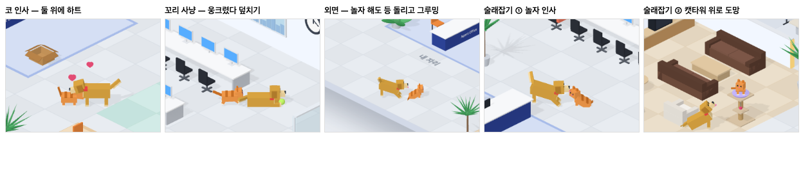

# 81 · 고양이와 강아지가 같이 논다

- 브랜치: `feat/81-pets-play-together`
- 근거: 사용자 요청(2026-10-27) 「고양이랑 강아지랑 같이 노는것도 재밌을거같아 특성 고려해서」. docs/plan/spec.md 「작업 공간 기믹」.
- 번호: 80 은 다른 세션이 쓰고 있어(`feat/80-me-roams`) 81 로 했다.

## 목표

개와 고양이가 가끔 같이 논다. 놀이마다 개는 개답게(놀자고 조르고, 쫓고, 꼬리를 흔들고), 고양이는 고양이답게(높은 곳으로 도망가고, 덮치고, 무시한다) 움직인다.

## 한 일

- 놀이 감독을 새로 만들었다(`frontend/src/systems/petPlay.ts`).
  - 둘 다 깨어 바닥에 있고 14m 안이면, 12초마다 반반 확률로 놀이를 시작한다. 한 판이 끝나면 40초 쉰다.
  - 둘에게 각자 맡을 자리와 동작을 준다. 둘 다 자리에 오면 놀이마다 정한 시간 뒤에 끝낸다.
  - 4초 안에 한쪽이 자리로 오지 않거나, 기다림(내 차례)이 생기면 그만둔다.
- 놀이 네 가지:

  | 놀이 | 개 | 고양이 | 길이 |
  | --- | --- | --- | --- |
  | 술래잡기 | 고양이 앞에서 놀자 자세로 들썩인 뒤, 같은 길로 뒤쫓다가 캣타워 아래에 앉아 꼬리를 흔들며 올려다본다 | 개를 보다가 우다다 도망쳐 캣타워 꼭대기로 뛰어오른다 | 인사 1.5초 · 도착 후 4초 |
  | 꼬리 사냥 | 엎드려 꼬리를 크게 흔든다 | 꼬리 뒤에 웅크려 엉덩이를 흔들다 덮치기를 되풀이한다 | 7초 |
  | 코 인사 | 마주 서서 코를 내민다 | 마주 서서 코를 내민다 | 3초, 둘 위에 하트 |
  | 외면 | 놀자 자세로 들썩인다 | 등을 돌리고 그루밍한다 | 3초 |

- 개 · 고양이 뇌가 놀이 역할을 받는다(`officeCat.ts` · `officeDog.ts`). 내 자리 기다림 · 마중 · 위로 · 꽃가루가 먼저다. 놀이가 끝나면 역할을 놓고 원래대로 돌아다닌다.
- 새 자세를 더했다(`isoCat.ts` · `isoDog.ts`).
  - 고양이: 웅크려 덮치기 · 코 내밀기.
  - 개: 올려다보기 · 꼬리 크게 흔들기 · 코 내밀기.
  - 같이 노는 동안에는 고양이가 냥펀치하지 않는다.
- 상대에게 보이는 정보에 방향과 지금 동작을 더했다(`officePets.ts`). 놀이 감독은 이것으로 둘이 자는지, 어디 올라가 있는지를 본다.
- 시험(`frontend/tests/petPlay.test.ts`) 9건:
  - 자거나 올라가 있거나 불려 갔으면 시작하지 않는다.
  - 놀이마다 자리와 방향이 맞다.
  - 술래잡기는 인사 뒤에 도망 · 추격으로 넘어간다.
  - 정해진 시간 뒤 끝나고 쉰다. 안 오면 취소하고, 기다림이 생기면 그만둔다.
  - 고양이가 역할을 잡고 놓는다.

## 검증

| 단계 | 명령 · 방법 | 결과 |
| --- | --- | --- |
| 정적 검증 | 프런트 `make checkall` | 통과 — 시험 355 · lint · tsc · build |
| 실검증 | run-qa-flow. 이 브랜치 · `origin/main` 을 워크트리로 떠서 백엔드 8030 · 8031, 프런트 4750 · 4751. 게임별 모습은 QA 복사본에서 시작 간격 · 확률을 당기고 다음 게임을 정해 찍었다. 실제 빈도는 관찰 훅만 넣은 실제 코드로 4분 지켜봤다. 사용자 지시로 HTML 리포트는 게시하지 않았다 | TC 9건 — ✅ 9. 코 인사 · 꼬리 사냥 · 외면 · 술래잡기(인사 → 도망 · 추격 → 캣타워)가 차례로 시작되고 끝나며 원래대로 돌아간다. 놀이 중 냥펀치로 몸을 돌린 횟수 0. 꼬리 사냥 중에 기다림을 켜면 놀이가 바로 끝나고, 고양이는 키보드 · 개는 내 의자 옆으로 간다. 실제 코드 4분: 48초에 코 인사, 110초에 외면이 저절로 시작돼 끝났다. 1280 · 1920 넘침 · 콘솔 오류 0. 누르는 자리 4개(확대 · 축소 · 원래대로 · 설정) 터치 · 마우스 전 · 후 같음 |
| 정리 | QA 서버 4개를 내리고 워크트리 2개 · QA DB 를 지웠다 | `:8030` · `:8031` · `:4750` · `:4751` 듣는 프로세스 0 |

## 검증하지 못한 것

- Aside 탐색은 브라우저 프로필이 연결돼 있지 않아 돌리지 못했다.
- 게임별 장면은 QA 복사본에서 시작 간격 · 확률을 당기고 순서를 정해 찍었다. 실제 무작위 빈도는 4분 관찰(2판)과 시험으로 봤다.
- 놀이 자리가 화분 · 가구 뒤면 가려 보일 수 있다(외면 첫 장면에서 고양이가 화분에 가렸다).
