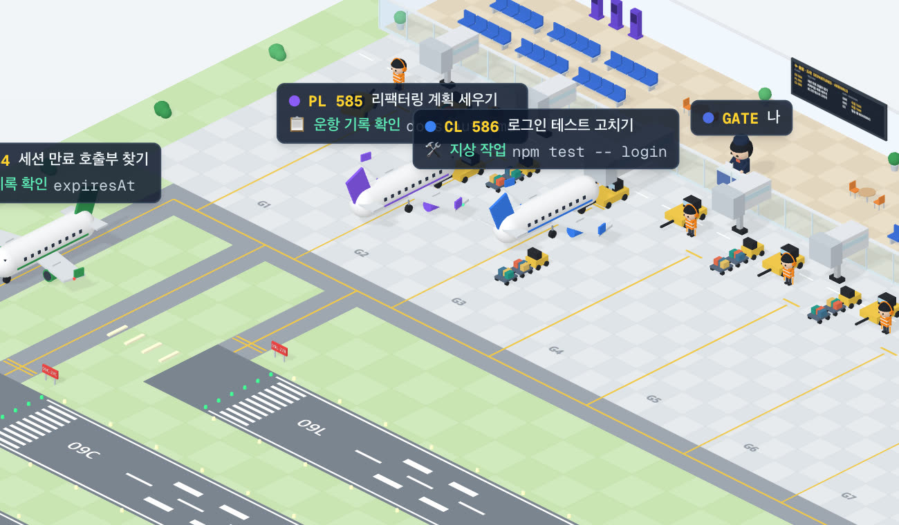

# 82 · 공항 테마

- 브랜치: `feat/82-airport-theme`
- 근거: 사용자 요청(2026-10-27) 「공항을 테마로 디자인을 개편해보는거어때? … 공항에서 비행기가 움직이고 뜨고 관제사가 컨트롤하는 느낌으로 가면 좋을거같음. 그림체는 지금과 비슷하게」, 「지금 office 테마는 그대로두고 공항 테마를 하나 더 추가해서 옵션으로 office 테마를 고를수도있고 공항 테마를 고를수도있게」, 「공항 활주로를 더 크고 더 많이만들어줘 지금 너무 빽뺵해」, 「기존꺼 말고 공항에 특화된 움직임으로 개선해봐 office와 독립적으로 분리되게」.

## 목표

사무실은 그대로 두고, 같은 세션을 공항으로 볼 수 있게 한다. 공항은 움직임 · 사람 · 말이 모두 공항 것이고, 코드도 사무실과 따로 산다.

## 한 일

- 설정 「장소」(사무실 · 공항)를 더했다. 값은 `place` 로 저장하고 이 브라우저에도 남긴다(`utils/place.ts`, `preferencesStore.ts`). 고르면 장면을 새로 그린다(`IsoOffice.tsx`). 보기는 장소 하나를 받는다(`isoWorld.ts`). 사무실은 예전 사람 · 방 효과를 그대로 감쌌고(`isoView.ts`), 문구는 `PlaceWords` 로 장소마다 따로 받는다.
- 공항은 `components/iso/airport/` 안에서 도형(`airportSolids`), 색(`airportPalette`), 사람(`airportFigures`), 소품 · 차량(`airportProps`), 비행기(`airplane`), 장면(`buildAirport`), 게이트 지상 조업(`airportGround`), 순간 효과(`airportEffects`), 태그(`airportLabels`)를 따로 갖고 `airportWorld` 가 엮는다. 사무실의 사람 모델 · 가구 · 말풍선 · 휴식 동작은 쓰지 않는다. 함께 쓰는 건 장면 약속(`isoWorld.ts`)과 캔버스 텍스처(`isoTextures.ts`)뿐이다.
- 공항 장면(120×89): 평행 활주로 세 개(09L · 09C · 09R), 유도로 A와 활주로마다 서쪽 연결로 · 동쪽 출구, 계류장과 게이트 일곱 개, 터미널(셀프 체크인, 의자, 카페, 출발 · 도착 안내판, 게이트 포디움), 격납고, 유리 관제탑, 레이더, 풍향계, 소방차 두 대. 먼 활주로의 연결로는 가까운 활주로 끝을 돌아간다.
- 사람: Claude 는 헤드셋을 쓴 관제사로, 도구를 쓰면 콘솔을 치고 비행기가 뜨고 내리면 쌍안경을 들고 허가할 때 무전을 누르고 쉬면 기대앉았다가 오래 쉬면 존다. 나는 게이트 직원으로, 질문을 보내면 안내 방송을 하고(「📢 질문」), 관제탑이 물어보면 데스크 전화를 받는다(「☎️ 관제탑 호출」). 게이트마다 하이비즈 조끼에 유도봉을 든 마샬러가 들어오는 비행기를 부르고 멈춰 세운다.
- 게이트 조업: 탑승교가 비행기에 뻗었다 접히고, 푸시백 차량이 코에 붙어 꼬리부터 밀어낸 뒤 돌아가고, 수하물 카트가 옆에 왔다 간다(`airportGround.ts`).
- 비행기: 꼬리 · 엔진이 옷 색(Explore 초록, Plan 보라, 범용 파랑, 다른 세션 산호색)을 따른다. 엔진이 돌면 경광등 · 항법등, 활주로와 하늘에서 섬광등, 이착륙 때 착륙등이 켜지고, 착륙 순간 바퀴 연기가 난다. 내려올 활주로 앞 진입등이 차례로 깜빡인다.
- 관제(`systems/airTraffic.ts`): 게이트 → 푸시백 → 연결로 → 이륙 → 공항 둘레 선회 → 착륙 → 출구 → 게이트. 계류장 · 유도로 A는 한 대씩(출발은 연결로에 들어서면, 도착은 게이트 진입로에 들어서면 다음 차례), 활주로는 활주로마다 한 대씩. 기다리는 비행기는 아무것도 붙잡지 않는다. 착륙이 먼저이고 출발은 가장 오래 쉰 활주로부터. 상공은 세 고도이고 위층일수록 조금 느려 같이 뜬 비행기가 벌어진다.
- 태그(`systems/airportTalk.ts`, `airportLabels.ts`): 레이더 데이터 블록처럼 편명 · 작업과 하는 일을 공항 말로 보여 준다. 읽기 → 📋 운항 기록 확인, 수정 → ✏️ 비행 계획 수정, 명령 → 🛠️ 지상 작업, 웹 → 🌦️ 기상 · 외부 교신, 계획 → 🗂️ 운항 계획, 질문 → 📞 게이트 호출, 실패 → ⚠️ 이상 발생, 정리 → 📝 교대 인수인계, 끝 → 🛬 임무 완료!. 내 질문은 관제사 말로 보이지 않고 내 안내 방송에 뜬다.
- 축하: 푸시 · 머지 성공 → 소방차 물대포 아치, 상공의 비행기 한 바퀴, 만세. 「고마워」 → 하트, 날개 흔들기.
- 오른쪽 패널의 안내도가 공항일 때 「공항 안내도」로 바뀐다. 문구는 4개 언어로 넣었다.
- 시험: `airTraffic.test.ts`(9), `airportTalk.test.ts`(4), `preferencesStore.test.ts` 의 `place`.

## 검증

| 단계 | 명령 · 방법 | 결과 |
| --- | --- | --- |
| 정적 검증 | 프런트 `make checkall` (`origin/main` 위로 다시 올린 뒤) | 통과 — 시험 370 · lint · tsc · build |
| 실검증 | 이 브랜치로 백엔드 8041 · 프런트 4761. 세션 하나가 일하는 중에 서브에이전트 셋을 보내고 차례로 끝낸 뒤 `git push` 성공과 「고마워!」 를 보냈다. 확대한 창 셋으로 관제탑 · 게이트 · 활주로 끝을 따로 찍었다. 다른 세션 11개를 폴더 다섯 곳에 띄우고 「모든 층」을 골랐다 | 푸시백 차량이 코에 붙어 밀어내고, 셋이 09R · 09C · 09L 에서 하나씩 이륙한다. 무전 띠에 「PL 585 · 09C 이륙 허가」, 관제사는 쌍안경 · 무전 자세. 끝난 순서대로 착륙해 「🛬 임무 완료!」 로 게이트에 들어간다. 푸시 뒤 물대포 아치, 「고마워」 뒤 하트와 게이트의 「📢 고마워! 덕분에 잘 됐어」. 모든 층에서 11대가 데이터 태그를 달고 돈다(GPU 113–117fps). 밝은 · 어두운 테마 정상, 사무실은 예전 그대로, 설정에서 바꾸면 바로 바뀌고 새로고침해도 남는다. 콘솔 오류 0 |

- `origin/main` 의 강아지 · 고양이(78–81)는 사무실 세계 안으로 옮겨, 사무실에서는 예전처럼 놀고 공항에는 나오지 않는다. 다시 올린 뒤 브라우저에서 사무실의 개 · 고양이와 공항을 확인했다.

## 검증하지 못한 것

- 실제 Claude Code 세션 대신 훅 이벤트를 직접 보내 만든 세션으로 봤다.
- 사무실 전용 장치(화이트보드 메모, 커밋 서류함, 커피잔, 고양이, 먹구름)는 공항에 없다.
