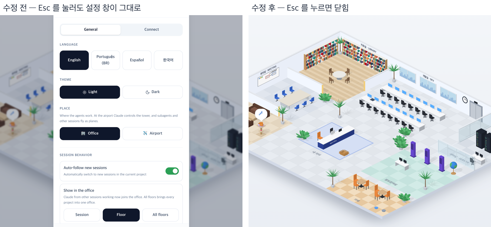

# 83 · 설정 창을 Esc · 바깥 클릭으로 닫는다

- 브랜치: `fix/83-settings-dialog-close`
- 근거: 80 실검증의 Aside 탐색에서 찾은 기존 결함(docs/plan/work-breakdown.md 「발견한 기존 결함」).

## 목표

설정 창이 다른 창처럼 Esc 키나 창 바깥 클릭으로 닫히게 한다. 창 안에서 하던 동작이 실수로 창을 닫지 않게 한다.

## 한 일

- 설정 창의 닫기 막음을 풀었다(`frontend/src/components/overlay/SettingsModal.tsx` 의 `dismissible={false}`).
  - 원본이 예전 「건물」 탭의 저장 안 한 변경을 지키려고 막아 뒀다(원본 커밋 7ae4c8b).
  - 그 탭은 2D 사무실과 함께 없어졌고, 지금 설정은 바꾸는 즉시 적용된다. 그래서 닫혀도 잃는 것이 없다.
- 바깥 클릭 판정을 좁혔다(`frontend/src/components/overlay/Modal.tsx`). 누르기와 떼기가 둘 다 창 바깥(덮개)일 때만 닫는다.
  - 창 안에서 글자를 끌어 고르다 바깥에서 놓아도 닫히지 않는다.
  - 바깥에서 눌러 창 안에서 놓아도 닫히지 않는다.
  - 톱니를 더블클릭하면 두 번째 클릭이 덮개에 떨어진다. 이 클릭(연속 클릭)으로는 닫지 않는다.
- 이 창 틀(`Modal`)을 쓰는 곳은 설정 창 하나뿐이다.

## 검증

| 단계 | 명령 · 방법 | 결과 |
| --- | --- | --- |
| 정적 검증 | 프런트 `make checkall` | 통과 — 시험 382 · lint · tsc · build |
| 실검증 | run-qa-flow. 백엔드 8050 하나에 이 브랜치 · `origin/main` 프런트 4770 · 4771 을 붙였다. 사용자 지시로 HTML 리포트는 게시하지 않았다 | TC 7건 — ✅ 7. ① Esc: 수정 전은 그대로(재현), 수정 후는 닫힌다. ② 1600 폭 바깥 클릭: 수정 전 그대로, 수정 후 닫힌다(3/3). ③ 430 폭 바깥 터치(창 위 · 아래 세 곳): 수정 전 그대로, 수정 후 닫힌다. ④ X · 아래 Close: 전 · 후 닫힌다. ⑤ 창 안 제목 · 탭 누르기(마우스 · 터치): 전 · 후 열린 채. ⑥ 테마를 Dark 로 바꾸고 Esc: 수정 후 닫히고 Dark 가 남는다. ⑦ 콘솔 오류 0 |
| 실검증 중 고친 것 | Aside 탐색 5분(드래그 · Connect 탭 · 키보드 · 연타 · 값 바꾼 뒤 바깥 클릭) | 흐름 5개 · 이상 3건. 닫기를 풀자 생긴 두 가지를 고쳤다 — 창 안에서 끌어 바깥에서 놓으면 닫힘(5/5), 톱니 더블클릭에 열렸다 바로 닫힘(3/3). 고친 뒤 끌어 나가기 · 끌어 들어오기 · 더블클릭 모두 열린 채(각 3/3), 그냥 바깥 클릭은 닫힘(3/3). 창이 열린 채 Tab 이 창 밖으로 나가는 것은 원래부터라 계획 문서 「발견한 기존 결함」에 적었다 |
| 정리 | QA 서버 3개를 내리고 워크트리 1개 · QA DB · 스크래치 파일을 지웠다 | `:8050` · `:4770` · `:4771` 듣는 프로세스 0 |

## 검증하지 못한 것

- 430 폭에서 창 양옆 16px 틈을 터치하면 닫히지 않는다. 브라우저의 터치 보정이 그 탭을 창 안(17px)으로 옮긴다. 같은 자리를 마우스로 누르면 닫힌다.
- Connect 탭의 연결 · 해제 버튼은 내 컴퓨터 설정 파일에 써서 누르지 않았다. 연결이 도는 동안 Esc · 바깥 클릭은 보지 못했다.
