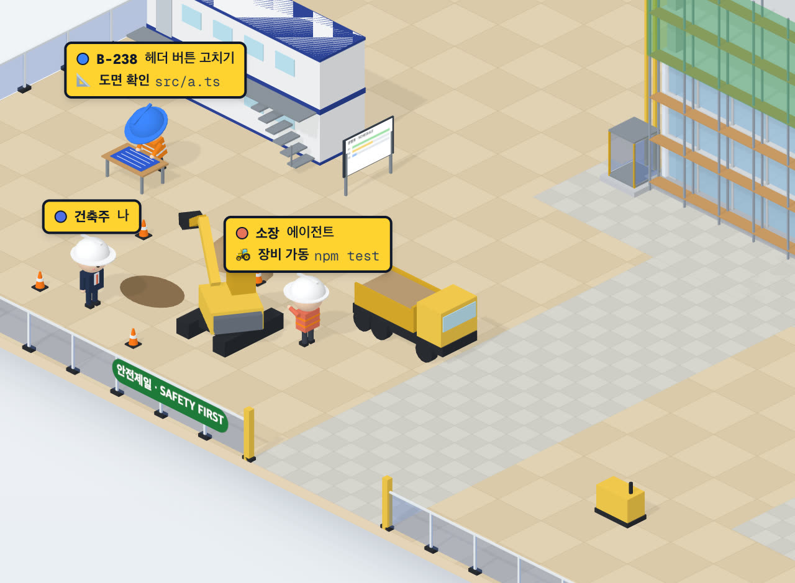

# 85 · 건설 현장 중장비

- 브랜치: `feat/85-site-machines`
- 근거: 사용자 요청(2026-10-27) — 테마 제안 표 「🏗️ 건설 현장」의 「크레인 · 굴착기 같은 중장비」, 「건설현장 아이디어로 진행해봐」. 계획 문서 85행.

## 목표

건설 현장의 기계가 일에 맞춰 움직인다. 명령을 실행하면 굴착기가 땅을 파고, 코드를 고치는 작업자는 호이스트를 타고 꼭대기 층에서 일하고, 레미콘 · 덤프트럭이 정문으로 드나든다.

## 한 일

- 굴착기(`components/iso/construction/siteMachines.ts` 의 `Excavator`): 몸통 · 붐 · 암 · 버킷을 마디로 나눴다. 누군가 장비 자리에 도착해 명령을 실행하는 동안 웅덩이로 팔을 내려 퍼서(버킷에 흙) 돌아 쏟는다. 6초 주기이고, 덤프트럭이 기다리면 트럭 짐칸으로, 없으면 흙더미로 쏟는다. 흙더미는 버킷마다 조금씩 커진다(1.6배까지). 명령이 끝나면 팔을 접는다. 웅덩이 · 흙더미 자리는 `constants/sitePlan.ts` 의 `DIG_PIT` · `DIRT_HEAP`.
- 덤프트럭: 8초 넘게 파면 정문 왼쪽 길로 들어와 굴착기 옆으로 후진해 선다. 세 번 실리면, 또는 15초 동안 아무도 파지 않으면 오른쪽 길로 나간다. 한 대가 나간 뒤 15초는 다시 오지 않는다.
- 레미콘: 커밋으로 층이 오를 때 정문으로 들어와 건물 오른쪽으로 후진해 드럼을 돌리며 9초 붓고 나간다. 붓는 동안 커밋이 또 오면 그 레미콘이 맡는다. 처음 열거나 새로고침할 때는 오지 않는다.
- 호이스트(`Hoist`): 건물 앞 왼쪽에 기둥과 철망 우리를 세웠다. 기둥은 층을 따라 자란다. 코드를 고치는 작업자는 호이스트 앞 → 우리 → 꼭대기 층으로 올라가 지붕 위 자리(`ROOF_SPOTS`)에서 일하고, 다른 일로 바뀌거나 끝나면 타고 내려와 걸어간다. 층이 오르면 지붕 위 작업자도 새 지붕에 선다. 소장은 지붕에 오르지 않고 비계 앞에서 가리킨다(`siteWorld.ts` 의 `plan` · `move`).
- 트럭 길(`TRUCK_ROUTES`)은 앞으로 가는 구간과 후진 구간으로 나눴고, 운전 · 파기 주기 · 호이스트 시간은 순수 함수로 뺐다(`systems/siteMachines.ts`).
- 시험: `siteMachines.test.ts`(파기 주기 · 후진 · 트럭 길이 건물을 피하는지 · 호이스트) 9건.

## 검증

| 단계 | 명령 · 방법 | 결과 |
| --- | --- | --- |
| 정적 검증 | 프런트 `make checkall` | 통과 — 시험 398 · lint · tsc · build |
| 실검증 | run-qa-flow TC 22건 + 탐색 1건 — 백엔드 8043(격리 SQLite) · 수정 후 4764 · 수정 전(main) 4765 | ✅ 21 · ⚠️ 1(흙더미가 커지는 양은 화면으로 재지 못함) · 탐색 기존 결함 1. 누르는 자리 3곳 × 터치 · 마우스 같음 6. 현장 사람 태그 좌표 · 사무실 · 공항은 수정 전과 같다. 콘솔 오류 0 |
| 정리 | QA 서버 3개 · 헤드리스 브라우저 종료, 수정 전 워크트리 · QA DB 삭제 | 포트 4764 · 4765 · 8043 · 9336 비어 있음 |

## 검증하지 못한 것

- 실제 Claude Code 세션 대신 훅 이벤트를 직접 보내 만든 세션으로 봤다.
- 흙더미가 버킷마다 커지는 양은 3D 크기를 읽을 화면 요소가 없어 재지 못했다.
- 기존 결함(탐색): 도면 테이블에 둘이 서면 앞사람이 뒷사람을 가린다. main 도 같아 계획 문서 「발견」 표에 `fix/plan-table-spots` 로 넣었다.

## 다음 작업

- 86 `feat/86-site-moments` — 테스트 실패 경고등 · 검사 도장 · 상량 · 하트 · 밤 작업등.
