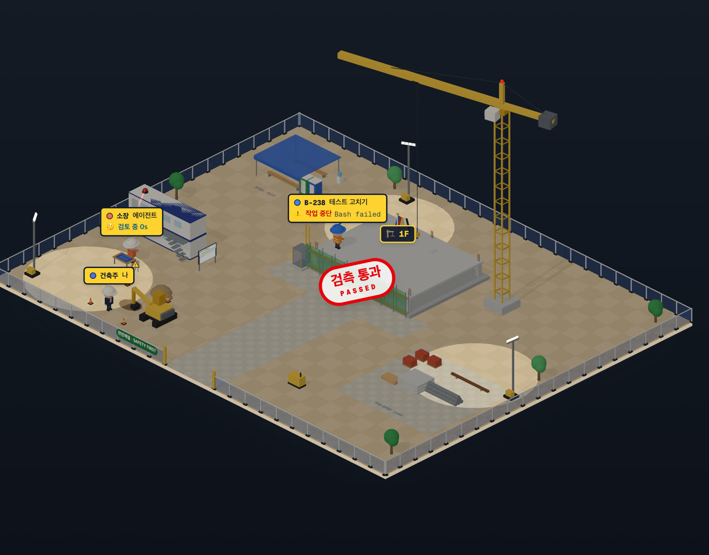

# 86 · 건설 현장 순간

- 브랜치: `feat/86-site-moments`
- 근거: 사용자 요청(2026-10-27) — 테마 제안 표 「🏗️ 건설 현장」의 「테스트가 실패하면 안전 경고등이 돌고, 푸시하면 준공 테이프를 잘라」, 「건설현장 아이디어로 진행해봐」. 계획 문서 86행.

## 목표

건설 현장이 순간마다 반응한다. 테스트 실패 → 경광등 · 경고 표지, 통과 → 검측 통과 도장, 푸시 · 머지 → 상량 깃발과 테이프 커팅, 「고마워」 → 안전모 흔들기, 어두운 테마 → 야간 작업등.

## 한 일

- 테스트 결과(`siteWorld.ts` 의 `react`): 사무실과 같은 기준(`roomGimmicks.ts` 의 `lastPassedTestId` · `lastFailedTestId`)으로 새 결과만 받는다. 실패하면 현장 사무소 지붕의 경광등이 6초 동안 깜빡이며 빛줄기가 돌고, 실패한 사람 옆에 경고 표지가 8초 서고, 그 사람은 2.5초 머리를 감싼다. 통과하면 건물 앞에 「검측 통과 · PASSED」 도장이 크게 내려와 자리 잡고 3.5초에 사라지며 그 사람은 환호한다. 반응하는 동안은 다음 자리로 걷지 않는다. 처음 열 때 지난 결과로는 반응하지 않는다.
- 푸시 · 머지: 지붕 뒤쪽에 오방색 상량 깃발이 올라와 20초 펄럭이고 내려간다. 정문에 빨간 테이프가 걸렸다 1.5초에 잘려 양쪽으로 늘어진다. 모두 환호한다(기존).
- 「고마워」: 소장 · 작업자가 안전모를 벗어 머리 위로 3초 흔든다. 건축주(나)는 흔들지 않는다. 안전모를 따로 움직일 수 있게 인물의 모자를 한 묶음으로 뺐다(`siteFigures.ts`, 자세 `dismay` · `hatWave`).
- 밤: 장면 약속에 밤 신호(`IsoWorld.setNight`)를 더하고 보기의 테마 전환(`isoView.ts`)이 보낸다. 사무실 · 공항은 아무것도 하지 않는다(사무실의 밤은 원래대로 창밖). 현장은 색을 어둡게 칠하고(`siteSolids.ts` 의 `shadeForNight`, 등 · 빛은 제외), 조명탑 3개를 켜 바닥에 빛을 고이게 하고, 완성 층 창을 노랗게 밝히고, 크레인 꼭대기 항공등을 깜빡인다. 낮으로 돌아오면 원래 색으로 되돌린다.
- 그림은 `components/iso/construction/siteMoments.ts`, 시간 계산은 `systems/siteMoments.ts`.
- 시험: `siteMoments.test.ts`(깜빡임 · 도장 · 깃발 · 테이프) 4건.

## 검증

| 단계 | 명령 · 방법 | 결과 |
| --- | --- | --- |
| 정적 검증 | 프런트 `make checkall` | 통과 — 시험 402 · lint · tsc · build |
| 실검증 | run-qa-flow TC 20건 + 탐색 2건 — 백엔드 8044(격리 SQLite) · 수정 후 4766 · 수정 전(main) 4767 | ✅ 20 (act 20). 누르는 자리 21곳 × 터치 · 마우스 같음 42. 낮 → 밤 → 낮에 바닥 픽셀이 처음 값(207,205,198)으로 돌아옴. 사무실(밝게 · 어둡게) · 공항(어둡게) · 현장 사람 태그 좌표는 수정 전과 같다. 콘솔 오류 0 |
| 정리 | QA 서버 3개 · 헤드리스 브라우저 종료, 수정 전 워크트리 · QA DB 삭제 | 포트 4766 · 4767 · 8044 · 9337 비어 있음 |

## 검증하지 못한 것

- 실제 Claude Code 세션 대신 훅 이벤트를 직접 보내 만든 세션으로 봤다.
- 기존 결함(탐색): 새로고침 첫 순간 영어 화면이 보이고, 한국어 화면의 `<html lang>` 이 en 이다. 둘 다 main 도 같아 계획 문서 「발견」 표에 `fix/first-paint-language` · `fix/html-lang` 로 넣었다.

## 다음 작업

- 계획 문서 「발견」 표의 기존 결함들(`fix/plan-table-spots` · `fix/first-paint-language` · `fix/html-lang` · `fix/modal-focus-trap`).
