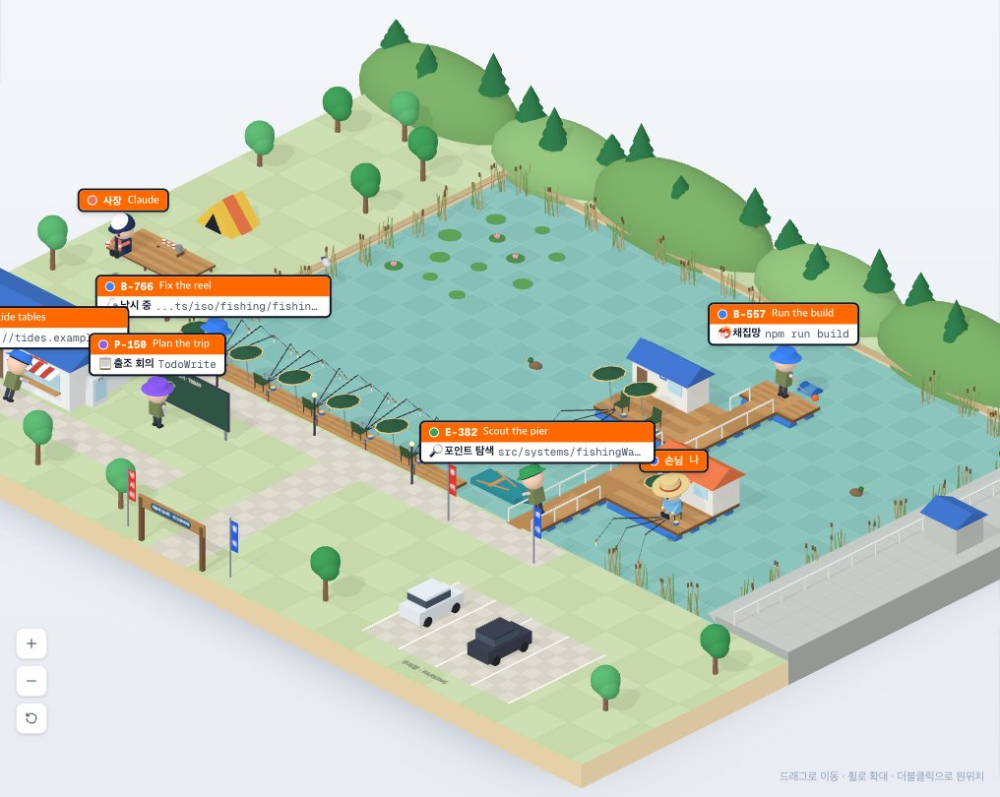
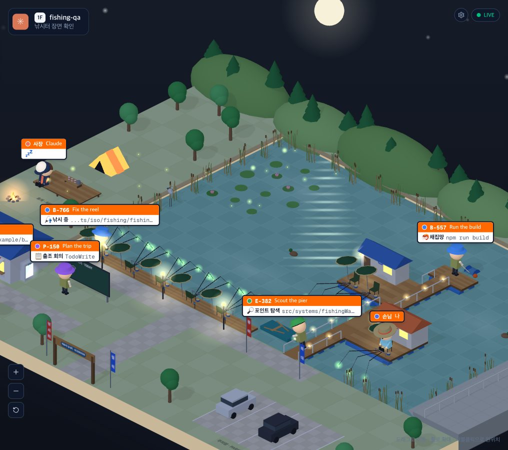

# 88 · 저수지 낚시터

- 브랜치: `feat/88-fishing-spot`
- 근거: 사용자 요청(2026-10-28) — 「낚시 테마로 하나 추가하고싶음」, 낚시터 제안서에 「좋아 이렇게 진행해봐」. 바다 낚시터 1차 구현을 본 뒤 「너무 휑하고 낚시같지가않음. 바다낚시말고 저수지 낚시터로 진행하고 좀 더 낚시터 스럽게해봐」, 저수지판을 본 뒤 「다크모드에 좀 더 감성있게 개선해줘」. 계획 문서 88행.

## 목표

설정 「장소」에 네 번째로 저수지 낚시터를 더한다. 사람이 없어도 낚시터로 보이고, 에이전트가 일하는 모습이 좌석에 앉아 찌를 보는 낚시로 보이며, 커밋할 때마다 물고기가 한 마리씩 수조에 는다. 코드는 사무실 · 공항 · 건설 현장과 따로 산다.

## 한 일

- 설정 「장소」에 🎣 낚시터를 더했다(`utils/place.ts` 의 `fishing`). 선택지가 넷이라 2열로 바꿨고 설명에 낚시터 한 문장을 붙였다. 보기는 `place === "fishing"` 이면 낚시터를 만든다(`isoView.ts`). 문구는 `PlaceWords.fishing` 으로 따로 받는다.
- 낚시터는 `components/iso/fishing/` 안에서 도형(`fishingSolids`), 색(`fishingPalette`), 사람(`fishingFigures`), 소품(`fishingProps`), 수조(`fishingTank`), 장면(`buildFishing`), 태그(`fishingLabels`)를 따로 갖고 `fishingWorld` 가 엮는다. 배치는 `constants/fishingPlan.ts`, 자리 찾기 · 길 찾기는 `systems/fishingWalk.ts`, 낚시 말은 `systems/fishingTalk.ts`, 물고기 종류 · 수조 · 마릿수는 `systems/fishingCatch.ts` 다.
- 한 걸음씩 걷는 규칙(`stepWalk`)은 건설 현장과 같아 `systems/placeWalk.ts` 로 꺼냈다. `siteWalk.ts` 는 그것을 다시 내보내서 현장 코드는 그대로다.
- 낚시터(64×50): 가운데 저수지, 뒤쪽 소나무 언덕, 오른쪽 댐 둑(경사면 · 난간 · 수문 관리실), 왼쪽 둑의 평상 · 텐트, 앞쪽 둑의 낚시 데크(번호 좌석 5개 · 가로등), 관리소(파란 지붕 · 매점 창구와 차양 · 「저수지 낚시터 관리소」 간판 · 벽에 조황판 · 옆에 미끼 냉장고), 수조, 목표 칠판, 부교와 그 끝의 채집망, 좌대 두 채(주황 지붕 「좌대 1」 · 파란 지붕 「좌대 2」), 관리 보트, 입구 간판, 「낚시터 · 월척 · 붕어 · 좌대」 깃발, 주차장의 차 두 대가 있다.
- 비어 보이지 않게: 낚시 좌석은 사람이 없어도 의자 · 파라솔 · 받침틀 · 낚싯대 3대 · 줄 · 찌 · 살림망 · 떡밥 그릇이 펼쳐져 있다. 물가를 따라 갈대, 왼쪽 얕은 물에 연잎과 연꽃, 물 위에 오리 두 마리가 돌고 왜가리가 서서 고개를 숙인다. 찌는 물 위에서 살짝 오르내린다.
- 사람: Claude 는 남색 캡 · 남색 조끼 · 장화의 낚시터 사장, 나는 밀짚모자를 쓰고 좌대 1에서 화면 쪽을 보고 낚시하는 손님, 서브에이전트와 다른 세션은 올리브 낚시 조끼에 벙거지를 쓴 조사다(Explore 초록 · Plan 보라 · 범용 파랑 · 다른 세션 주황). 조사는 입구로 들어와 도구 자리로 걷고, 끝나면 손을 흔들며 입구로 나간다(「🐟 철수!」).
- 읽기 → 부교에서 물속 보기, 수정 → 낚시 좌석(데크 5개 다음 좌대 2의 2개)에 앉아 찌 보기, 명령 → 부교 끝 채집망 줄 잡기, 웹 → 관리소 매점 창구, 계획 → 목표 칠판, 질문 → 좌대 1의 내 옆. 사장의 기본 자리는 관리소 문 앞이다. 사람은 둑 · 데크 · 부교 · 좌대 위로만 걷고, 곧장 못 가는 길은 둑 모퉁이 · 관리소 옆 · 부교 뿌리 · 좌대 갈림 · 부교 끝을 거쳐 돈다.
- 턴이 끝나면 사장은 평상에 앉아 컵라면을 먹고, 대화를 정리할 때는 조행기를 쓰고(「📒 조행기 정리 중」), 오래 쉬면 캡을 눈까지 내리고 존다. 사장이 물으면 내가 무전기를 들고(「📻 사장님 호출」), 내가 질문을 보내면 「📢 손님 요청」을 단다.
- 커밋: 새 커밋마다 일하던 조사(낚시 좌석 먼저, 없으면 다른 조사, 그다음 사장)가 일어나 화면 쪽으로 돌아 물고기를 들어 보이고, 1.2초 뒤 수조에 한 마리가 물보라와 함께 는다. 여러 커밋이 한꺼번에 오면 2.6초 간격으로 한 마리씩 낚는다. 1~3번째는 붕어, 4~6번째 잉어, 7~9번째 향어, 10번째부터 월척이다. 수조에는 최근 12마리가 헤엄치고, 처음 열거나 새로고침하면 그 수로 차 있다. 수조 위에 「🐟 N」, 조황판에 마릿수 · 종류별 수 · 최근 커밋 제목이 적힌다.
- 목표 칠판은 할 일 하나에 물고기 그림 하나다(8개까지). 아직이면 빈 그림, 하는 중이면 반, 끝나면 노랗게 칠한다.
- 테스트가 통과하면 만세, 실패하면 머리를 감싸 쥔다. 푸시 · 머지에는 다 같이 만세한다.
- 어두운 테마는 달빛 밤낚시다. 색을 회색으로 어둡게 하던 것을 푸른 달빛 색조로 바꿨다(`fishingSolids.shadeForNight`). 뒤쪽 언덕 위에 달과 후광, 그 아래 물 위에 일렁이는 달빛 길, 하늘에 반짝이는 별이 뜬다. 찌 끝은 초록 케미라이트로 바뀌어 맥박처럼 밝아졌다 어두워지고 물에 비친 빛이 늘어진다. 가로등과 부교 알전구, 좌대 창 · 문 옆 랜턴, 관리소 매점 창구와 미끼 냉장고, 수문 관리실 등이 켜지고 땅에 빛 웅덩이가 생긴다. 텐트는 안에서 불을 켠 듯 빛나고, 평상 앞 모닥불이 일렁인다. 연잎 위와 텐트 옆에 반딧불이가 떠다니며 깜빡이고, 물 위에 옅은 물안개가 깔린다. 밤에만 보이는 것은 `nightOnly`, 밤에 켜지는 등은 `nightLamp` 로 표시하고 `lightForNight` 가 한 번에 켜고 끈다.
- 태그는 찌처럼 위가 주황(코드 · 이름), 아래가 흰 띠(하는 일 · 파일 경로 · 명령 · URL)다. 🔎 포인트 탐색 · 🎣 낚시 중 · 🦐 채집망 · 🪱 미끼 사기 · 📋 출조 회의 · 📻 손님 호출 · 🤔 찌 보는 중 · ⚠️ 줄 엉킴.
- 오른쪽 패널은 낚시터일 때 「낚시터 안내도」(8칸)다. 문구는 4개 언어로 넣었다.
- 제안서와 다른 점: 배경을 바다 방파제에서 저수지로 바꿨다(사용자 지시). 커밋은 세션 단위라 누가 했는지 몰라서 그때 일하던 조사가 낚는다. 89 에 두려던 오리 · 왜가리 · 찌 흔들림은 「휑하다」는 말에 맞춰 이번에 넣었다.
- 시험: `fishingWalk.test.ts`(모든 자리 · 길목이 마른 땅 위, 모든 자리 쌍 · 입구까지 물에 안 빠지는 길, 한 자리 안에서 화면 가로로 1 이상 떨어짐), `fishingCatch.test.ts`(종류 · 수조 12마리 · 마릿수), `fishingTalk.test.ts`(낚시 말 · 생각 · 줄 엉킴), `preferencesStore.test.ts` 에 fishing 저장값 확인을 더했다.

## 검증

| 단계 | 명령 · 방법 | 결과 |
| --- | --- | --- |
| 정적 검증 | 프런트 `make checkall` | 통과 — 시험 413 · lint · tsc · build |
| 실검증 | 백엔드 8042(격리 SQLite) · 프런트 4762, 훅 이벤트를 직접 보낸 세션(커밋 · 할 일 · 서브에이전트 6명 · 도구 진행 중) | 아래 표 |
| 스모크 회귀 | 사무실 · 공항 · 건설 현장 · 낚시터를 차례로 연다(바다판 때 확인, 저수지판에서 낚시터 다시 봄) | 넷 다 열리고 패널 제목이 장소에 맞다. 콘솔 오류 0 |
| 정리 | QA 서버 2개 종료 | 포트 4762 · 8042 비어 있음 |

### 실검증 TC

| TC | 판정 | 방법 · 근거 |
| --- | --- | --- |
| 처음 열기 | ✅ | 수조 수가 커밋 수, 조사들이 각 자리에 앉거나 서 있다. 읽기는 부교, 수정은 데크 좌석, 명령은 부교 끝 채집망, 웹은 매점 창구, 할 일은 칠판, 나는 좌대 1 |
| 빈 자리 | ✅ | 사람 없는 좌석 · 좌대 2에도 파라솔 · 낚싯대 · 찌가 펼쳐져 있다 |
| 커밋 하나 | ✅ | 커밋을 보내자 데크 1번 좌석의 조사가 일어나 화면 쪽으로 돌아 금빛 월척(12번째)을 들었다 |
| 턴 끝 · 졸기 | ✅ | 사장이 평상에 앉고, 오래 쉰 세션에서는 캡을 눈까지 내리고 존다. 처음엔 캡이 얼굴을 다 덮어 헬멧처럼 보여 덜 내렸다 |
| 텐트 | ✅ | 처음엔 둥근 텐트가 납작한 원판으로 보여 삼각 텐트로 바꿨다 |
| 어두운 테마 | ✅ | 달 · 달빛 길 · 별 · 케미라이트 · 가로등 · 좌대 창 · 텐트 · 모닥불 · 반딧불이가 보인다. 달빛 길은 처음에 세로 한 줄로 그려져서 물 위에 가로로 눕혔고, 너무 옅어서 넓고 밝게 했다 |
| 테마 바꾸기 | ✅ | 설정에서 밝게 → 어둡게 → 밝게로 바꾸면 밤 불빛이 켜졌다 꺼지고, 낮 화면에 빛이 남지 않는다. 콘솔 오류 0 |
| 한국어 | ✅ | 사장 · 손님 · 포인트 탐색 · 낚시 중 · 채집망 · 미끼 사기 · 출조 회의 · 「낚시터 안내도」 |

### 화면

## 검증하지 못한 것

- 실제 Claude Code 세션 대신 훅 이벤트를 직접 보내 만든 세션으로 봤다.
- 사람이 붙어 앉는 데크에서는 앞사람 이름표가 뒷사람을 가린다. 76 대로 태그 겹침은 그대로 뒀다.
- 휴대폰 너비, 다른 세션의 조사(colleague), 저수지판에서 조사가 나가는 길과 사장의 질문은 다시 보지 않았다(길 찾기는 시험이 모든 자리 쌍을 본다).

## 다음 작업

- 89 `feat/89-fishing-gear` — 챔질 · 찌가 쏙 · 채집망 올리기 · 물결 · 관리소 고양이 · 오리가 다가오기.
- 90 `feat/90-fishing-moments` — 방울 · 헌 장화 · 깃발과 「월척!」 방송 · 인증샷 · 하트 · 컵라면.
