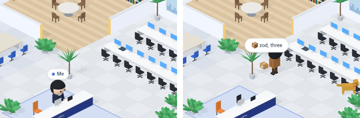

# 94 · 설치하면 택배 상자

- 브랜치: `feat/94-parcels-on-install`
- 근거: 사용자 요청(2026-11-02) 「office 테마에서 재밌는거 더 추가할거없을까?」 제안 표에 「그렇게 다 모두 진행해」. docs/plan/spec.md 「작업 공간 기믹」.

## 목표

패키지를 설치하는 명령이 성공하면 택배 기사가 엘리베이터로 상자를 들고 와서 Claude 자리 뒤 바닥에 쌓고 돌아간다. 송장에는 패키지 이름이 적혀 있다.

## 한 일

- 설치 명령을 알아본다. `npm` · `pnpm` · `yarn` · `bun` 의 install/add/i, `uv add`, `pip install`, `poetry add`, `cargo add`, `go get`, `brew install`, `gem install` 이 대상이다. 이어 붙인 명령(`cd frontend && bun add zod && bun run build`)에서는 설치 부분만 읽는다(`frontend/src/systems/officeParcels.ts` 의 `parcelLabel`).
- 송장 이름은 설치한 패키지 이름이다. 이름 없이 설치하면(`npm install`) 설치 명령 자체를 적는다. 실패한 설치는 세지 않는다(`parcelsDelivered`).
- 택배 기사는 갈색 옷과 모자를 입었다(`isoCharacters.ts` 의 `buildCourier`). 새 설치가 1분 안의 일이면 기사가 엘리베이터에서 나와 상자를 들고 걸어오고, 더미 옆에 서서 상자를 내린 뒤 손을 흔들고 돌아간다(`stepCourier`).
- 기사가 상자를 들고 있는 동안 머리 위에, 내려놓은 뒤 4초 동안 더미 위에 「📦 패키지 이름」 이 뜬다. 상자 더미는 두 줄로 최대 6개까지 쌓인다(`frontend/src/components/iso/isoParcels.ts`).
- 기사가 나오고 들어갈 때 엘리베이터 문이 열리고 표시등이 켜지며, 깨어 있는 개가 맞으러 달려간다. 서브에이전트 출근과 같은 신호를 쓴다(`isoView.ts`).
- 연달아 설치하면 기사는 한 번에 하나씩 다녀가고, 기다리는 상자는 3개까지 둔다. 세션을 바꿔 설치 수가 줄면 더미와 대기열을 비운다.
- 공항 · 건설 현장 · 낚시터에는 기사가 없다(`IsoWorld.setParcels` 는 사무실만 구현한다).
- 실검증에서 처음 자리(Claude 책상 왼쪽 끝)는 Claude 가 앉으면 더미를 가렸다. 그래서 사람들이 다니는 길 702개를 계산해 지나가는 길이 적고 가려지지 않는 Claude 자리 뒤 바닥으로 옮겼다. 기사가 더미 앞에 서면 화분에 가려서 더미 오른쪽에 서게 바꿨다.
- 시험: 설치 판별 · 송장 이름 · 성공한 설치만 세기 · 1분 기준 · 기사 동선 순서 · 상자를 든 동안과 내려놓은 뒤 · 엘리베이터 문(`officeParcels.test.ts`).

## 검증

| 단계 | 명령 · 방법 | 결과 |
| --- | --- | --- |
| 정적 검증 | 프런트 `make checkall` | 통과했다. 시험 424 · lint · tsc · build |
| 실검증 | run-qa-flow. 이 브랜치 백엔드 8050(격리 SQLite), 수정 후 프런트 4770, 수정 전(`origin/main`) 프런트 4771 | TC 18건과 탐색 3건이 ✅ 21건(act 21)이다. 누르는 자리 8곳 × 터치 · 마우스 16번이 수정 전과 같았다. Aside 탐색은 흐름 4개에 이상 3건이 나왔고, headless 로 다시 밟아 환경 탓 1건과 스펙대로 2건으로 판정했다. 콘솔 오류는 0건이다 |
| 정리 | QA 서버 3개와 브라우저 2개를 내리고 워크트리 1개 · QA DB 를 지웠다 | `:8050` · `:4770` · `:4771` · `:9333` · `:9334` 를 듣는 프로세스가 0개다 |

## 검증하지 못한 것

- 1분 넘게 걸린 설치는 기사 없이 상자만 쌓일 수 있다. 커밋 서류와 꽃가루도 같은 1분 기준을 쓴다.
- 같은 층 다른 세션의 설치는 이 화면 이벤트에 없어서 기사가 오지 않는다.
- QA 중에 맥 화면이 잠겨 headless 크롬이 프레임을 그리지 않았다. vsync 를 끄는 옵션으로 브라우저를 다시 띄우고 그 뒤 항목을 처음부터 돌렸다.

## 다음 작업

- 95 결재판(`feat/95-approval-on-pr`)
