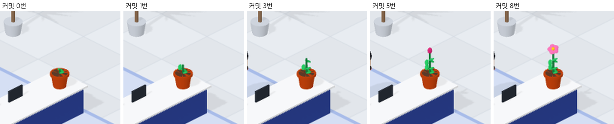

# 97 · 오늘 커밋만큼 자라는 화분

- 브랜치: `feat/97-plants-grow-with-commits`
- 근거: 사용자 요청(2026-11-02) 「office 테마에서 재밌는거 더 추가할거없을까?」 제안 표에 「그렇게 다 모두 진행해」. docs/plan/spec.md 「작업 공간 기믹」.

## 목표

내 자리 접수대 끝에 화분을 두고, 오늘 성공한 커밋 수만큼 자라다 꽃이 피게 한다. 다음 날엔 다시 떡잎부터 시작한다.

## 한 일

- 오늘(로컬 자정부터 자정까지) 성공한 `git commit` 수를 센다. 실패한 커밋은 세지 않는다. 0번은 떡잎, 1번은 줄기와 잎, 3번은 더 큰 잎, 5번은 꽃봉오리, 8번은 분홍 꽃이다(`frontend/src/systems/officePlant.ts`).
- 접수대 왼쪽 끝에 테라코타 화분을 놓고 단계마다 줄기 길이 · 잎 수 · 봉오리 · 꽃을 바꾼다. 보는 동안 단계가 오르면 0.8초 동안 튀어 오르며 커진다(`frontend/src/components/iso/isoPlant.ts`).
- 실검증에서 세 가지를 고쳤다. 실제 탁상 화분 크기로는 기본 화면에서 몇 픽셀이라 단계가 보이지 않아서 화분 전체를 1.6배로 키웠다. 세션을 열 때마다 이벤트가 늦게 와서 떡잎에서 꽃으로 튀었기 때문에, 1분 안에 들어온 커밋이 있을 때만 튀게 했다(`committedJustNow`, 다른 기믹의 `FRESH_MS` 와 같은 기준). 처음 자리(오른쪽 끝)는 질문하러 온 Claude 가 서는 자리 바로 뒤라 머리에 가려서, 화분을 왼쪽 끝으로 옮기고 밤 피자 상자를 모니터 쪽으로 옮겼다(`isoTimeOfDay.ts`).
- 공항 · 건설 현장 · 낚시터에는 없다(`IsoWorld.setCommitTimes` 는 사무실만 구현한다).
- 시험: 단계 경계 · 실패 커밋 제외 · 하루 경계 · 1분 안 커밋(`officePlant.test.ts`).

## 검증

| 단계 | 명령 · 방법 | 결과 |
| --- | --- | --- |
| 정적 검증 | 프런트 `make checkall` | 통과했다. 시험 450 · lint · tsc · build |
| 실검증 | run-qa-flow. 이 브랜치 백엔드 8050(격리 SQLite), 수정 후 프런트 4770, 수정 전(`origin/main`) 프런트 4771. 커밋은 `POST /api/v1/events` 로 보냈고, 튀기는 화면 녹화 프레임의 잎 · 꽃 픽셀 수로 쟀다. 날짜 넘김과 밤 장면은 `page.clock.setFixedTime` 으로 봤다 | TC 12건과 탐색에서 이어 본 2건이 ✅ 14건(act 14)이다. 커밋 0 · 1 · 3 · 5 · 8번에 떡잎 · 잎 · 큰 잎 · 봉오리 · 꽃이 됐고, 단계가 오를 때만 0.8초 튀었다. 실패 커밋과 같은 단계 커밋에는 그대로였고, 다음 날 00:05 에는 떡잎이었다. 실검증에서 찾은 결함 3건(작은 크기 · 열 때 튐 · 질문하러 온 Claude 에 가림)은 고친 뒤 다시 확인했다. 누르는 자리 8곳 × 터치 · 마우스 16번이 수정 전과 같았다. Aside 탐색은 흐름 4개에 이상 0건이었다. 콘솔 오류는 0건이다 |
| 정리 | QA 서버 3개와 브라우저 2개를 내리고 워크트리 1개 · QA DB 를 지웠다 | `:8050` · `:4770` · `:4771` · `:9333` · `:9334` 를 듣는 프로세스가 0개다 |

## 검증하지 못한 것

- 세션을 열면 이벤트가 오기까지 1초 남짓 떡잎으로 보였다가 그 단계로 바뀐다(튀지는 않는다). 이벤트로 그리는 다른 기믹도 같다.
- 지금 보는 세션의 커밋만 센다. 같은 층의 다른 세션 커밋은 세지 않는다.

## 다음 작업

- 98 꾸벅 사과(`feat/98-bow-on-pushback`)
