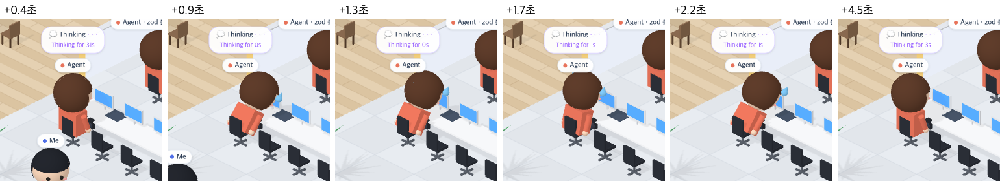

# 98 · 「아니 · 왜 · 다시」에 꾸벅 사과

- 브랜치: `feat/98-bow-on-pushback`
- 근거: 사용자 요청(2026-11-02) 「office 테마에서 재밌는거 더 추가할거없을까?」 제안 표에 「그렇게 다 모두 진행해」. docs/plan/spec.md 「작업 공간 기믹」.

## 목표

프롬프트가 「아니」 · 「왜」 · 「다시」로 시작하면 Claude 가 땀을 흘리며 고개를 숙인다. 고맙다고 하면 뜨는 하트(73)의 짝이다.

## 한 일

- 마지막 프롬프트가 「아니」 · 「왜」 · 「다시」로 시작하면 사과로 본다. 앞 공백은 건너뛰고, 「아니 고마워」처럼 고맙다는 말이 들면 하트만 띄운다(`frontend/src/systems/officeBow.ts`).
- Claude 가 엉덩이에서 앞으로 숙였다 펴기를 2.4초 동안 두 번 한다. 그동안 막혔을 때 쓰던 땀방울이 머리 옆에 흐른다. 앉아 있으면 다리는 의자 위 그대로다(`isoCharacters.ts` 의 bow 자세).
- 프롬프트가 오면 Claude 가 라운지에서 책상으로 돌아가므로, 걷는 동안에는 꾸벅을 미뤄 두었다가 걸음이 멈추면 시작한다. 15초 안에 멈추지 않으면 꾸벅하지 않는다(`isoPeople.ts`).
- 1분 안에 들어온 새 사과만 꾸벅한다. 하트와 같은 규칙이다(`isoView.ts` 의 setPushback). 공항 · 건설 현장 · 낚시터에는 없다(`IsoWorld.bow` 는 사무실만 구현한다).
- 시험: 고르기 · 고마워와 겹칠 때 · 마지막 프롬프트 · 꾸벅 각도(`officeBow.test.ts`).

## 검증

| 단계 | 명령 · 방법 | 결과 |
| --- | --- | --- |
| 정적 검증 | 프런트 `make checkall` | 통과했다. 시험 455 · lint · tsc · build |
| 실검증 | run-qa-flow. 이 브랜치 백엔드 8050(격리 SQLite), 수정 후 프런트 4770, 수정 전(`origin/main`) 프런트 4771. 프롬프트는 `POST /api/v1/events` 로 보냈고, 두 화면을 CDP screencast 로 함께 녹화해 프레임을 비교했다 | TC 11건과 탐색에서 나온 1건이 ✅ 12건(act 12)이다. 「아니」 · 「왜」 · 「다시」 세 프롬프트에 두 번 꾸벅했고, 라운지에서 쉬던 Claude 는 책상까지 걸어가 앉은 뒤 꾸벅했다. 「아니 고마워」에는 하트만, 「이건 아니야」에는 아무 일도 없었다. 사과 111초 뒤 다시 열면 꾸벅하지 않았다. 「고마워」 하트와 막혔을 때의 땀은 수정 전과 같았다. 누르는 자리 8곳 × 터치 · 마우스 16번이 수정 전과 같았다. Aside 탐색은 흐름 4개에 이상 1건이었고, 새로고침하면 확대가 풀리는 기존 동작이라 스펙대로로 판정했다. 콘솔 오류는 0건이다 |
| 정리 | QA 서버 3개와 브라우저 2개를 내리고 워크트리 1개 · QA DB 를 지웠다 | `:8050` · `:4770` · `:4771` · `:9333` · `:9334` 를 듣는 프로세스가 0개다 |

## 검증하지 못한 것

- 책상에 앉은 Claude 는 모니터를 보고 있어 화면에서는 등 뒤가 보인다. 얼굴 대신 숙이는 등과 땀방울로 사과를 알 수 있다.

## 다음 작업

- 99 비상벨(`feat/99-alarm-on-risky-commands`)
