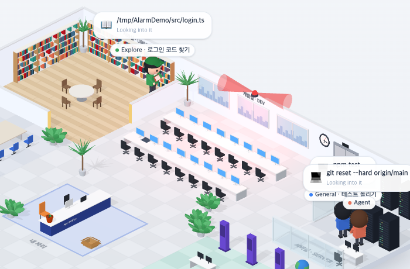

# 99 · 위험한 명령에 비상벨

- 브랜치: `feat/99-alarm-on-risky-commands`
- 근거: 사용자 요청(2026-11-02) 「office 테마에서 재밌는거 더 추가할거없을까?」 제안 표에 「그렇게 다 모두 진행해」. docs/plan/spec.md 「작업 공간 기믹」.

## 목표

`push --force` · `reset --hard` · `rm -rf` 를 실행하면 천장 경광등이 돌고 다들 그쪽을 돌아본다.

## 한 일

- Bash 명령을 `;` · `&&` · `||` · 파이프 · 줄로 나눠, 강제 push(`--force` · `--force-with-lease` · `-f`), `git reset --hard`, 재귀이면서 강제인 `rm`(`-rf` · `-fr` · `-r -f` · `--recursive --force`)을 위험 명령으로 본다. 따옴표 안 글자와 heredoc 본문(커밋 메시지)은 세지 않는다(`frontend/src/systems/officeAlarm.ts`).
- 개발실 뒷벽 위(벽 높이 3.4m, 방 이름 오른쪽 창문 사이)에 빨간 경광등을 단다. 평소에는 어두운 빨강이고, 위험 명령이 시작되면 4초 동안 밝아지며 빨간 빛줄기 두 개가 돌고 개발실이 붉게 번쩍인다(`isoAlarm.ts`).
- 그동안 걷고 있지 않은 사람은 모두 경광등 쪽으로 몸을 돌리고, 4초 뒤 원래 방향으로 돌아온다(`isoPeople.ts`). 1분 안에 들어온 새 명령만 울린다(`isoView.ts` 의 setAlarm). 공항 · 건설 현장 · 낚시터에는 없다.
- 실검증에서 빛줄기가 흰 벽 앞에서 하얗게 날아가는 것을 찾아, 더하기 혼합을 일반 혼합으로 바꾸고 3m 로 줄였다. 탐색에서 경광등이 방 이름 「개발실 · DEV」 위에 겹친 것을 찾아 옆으로 옮겼다.
- 시험: 위험 명령 10가지 · 아닌 명령 10가지(커밋 메시지 · heredoc · echo 포함) · 최신 위험 명령 · 돌아보는 각도(`officeAlarm.test.ts`).

## 검증

| 단계 | 명령 · 방법 | 결과 |
| --- | --- | --- |
| 정적 검증 | 프런트 `make checkall` | 통과했다. 시험 460 · lint · tsc · build |
| 실검증 | run-qa-flow. 이 브랜치 백엔드 8050(격리 SQLite), 수정 후 프런트 4770, 수정 전(`origin/main`) 프런트 4771. 명령은 `POST /api/v1/events` 로 보냈고, 서브에이전트 둘이 일하는 화면을 CDP screencast 로 함께 녹화했다 | ac63a57 에서 TC 11건이 ✅ 11건(act 11)이다. 강제 push · 하드 리셋 · rm -rf 에 울렸고, 커밋 메시지 속 「rm -rf」와 일반 push 에는 울리지 않았다. 앉은 Claude 와 자료실 서브에이전트가 경광등을 봤다가 돌아왔다. 누르는 자리 8곳 × 터치 · 마우스 16번이 수정 전과 같았다. Aside 탐색은 흐름 4개에 이상 3건이었다. 경광등이 「개발실 · DEV」 글자를 가린 것(E1)은 경광등을 x 22.2 로 옮겨 고쳤고 headless 로 다시 봤다. 1분 안에 다시 열면 또 울리는 것(E2)은 하트 · 꾸벅과 같은 규칙이다. 다시 열 때 꽃가루가 다시 터지는지(E3)와 리포트 게시는 사용자 지시로 작업을 멈춰 남았다 |
| 정리 | QA 서버 3개와 브라우저 2개를 내리고 워크트리 1개 · QA DB 를 지웠다 | `:8050` · `:4770` · `:4771` · `:9333` · `:9334` 를 듣는 프로세스가 0개다 |

## 검증하지 못한 것

- Claude 자신은 Bash 를 실행하면 서버실로 걸어가므로 경보 중에 대개 걷고 있어 돌아보지 않는다.

## 다음 작업

- 100 프린터(`feat/100-printer-on-new-file`)
