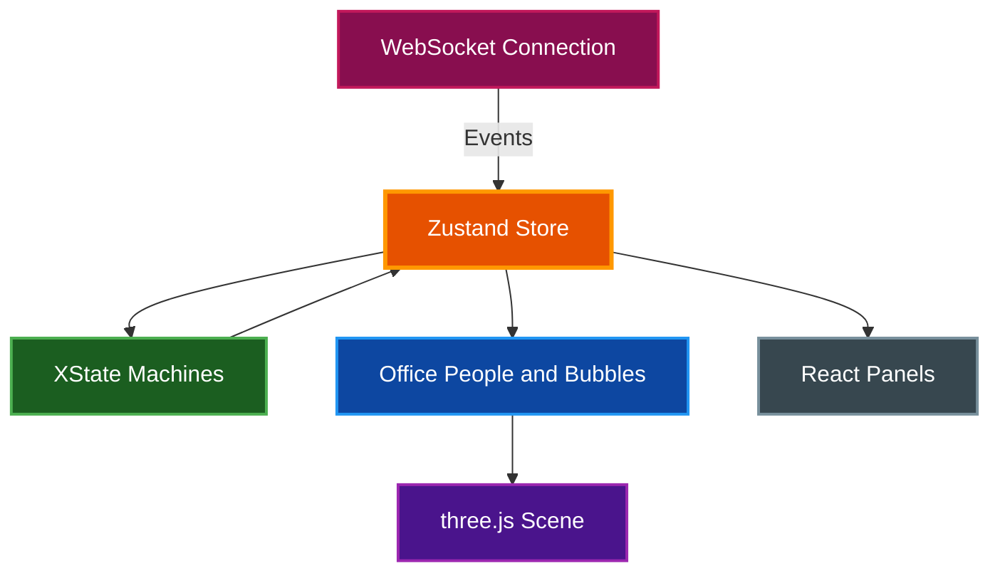

# Claude Office Visualizer Frontend

Next.js application that renders a real-time isometric office with three.js, visualizing coding agent operations as people working in an office.

## Table of Contents

- [Overview](#overview)
- [Architecture](#architecture)
- [Prerequisites](#prerequisites)
- [Installation](#installation)
- [Running the Application](#running-the-application)
- [Project Structure](#project-structure)
- [Key Components](#key-components)
- [State Management](#state-management)
- [Environment Variables](#environment-variables)
- [Testing](#testing)
- [Related Documentation](#related-documentation)

## Overview

The frontend provides an interactive visualization of coding agent operations:

- **Isometric Office**: A three.js orthographic scene of one floor with seven rooms; people walk to the room of the tool they run, with name chips and bubbles drawn as HTML on top
- **Floor Guide and Side Panel**: Projects shown as floors with their sessions, plus the people in the office, an activity log and a room legend
- **State Machines**: XState v5 manages the subagent lifecycle with explicit states and transitions
- **WebSocket Updates**: Live state synchronization with the backend
- **Settings**: Language, auto-follow and connecting coding agents from the browser

## Architecture



### Data Flow

1. WebSocket receives state updates and events from the backend
2. `systems/stateReconciler.ts` syncs the Zustand store (agents, boss, office)
3. XState machines track each subagent's arrival and departure
4. `systems/officePeople.ts` and `officeBubbles.ts` derive who is on the floor and what each person says
5. The three.js scene walks the people on the floor plan and draws their bubbles
6. React panels show the floor guide, the people, the activity log and the room legend

## Prerequisites

| Requirement    | Version    | Purpose              |
| -------------- | ---------- | -------------------- |
| Node.js or Bun | 20+ / 1.0+ | Runtime              |
| Backend server | Running    | WebSocket connection |

## Installation

```bash
# From the frontend directory
bun install
```

Or with npm:

```bash
npm install
```

## Running the Application

### Development Mode

```bash
# From the frontend directory
make dev
```

Or directly:

```bash
bun run dev
```

The application runs at [http://localhost:4747](http://localhost:4747).

> **Note:** The backend must be running at `localhost:8000` for WebSocket connectivity.

### Production Build

```bash
# Build for production
bun run build

# Start production server
bun run start
```

### Static Export

For deployment with the backend:

```bash
# From project root
make build-static
```

This exports the frontend and copies it to `backend/static/` for FastAPI serving.

## Project Structure

```
frontend/src/
├── app/            # Next.js App Router: the isometric office page (/iso redirects to /)
├── components/
│   ├── iso/        # three.js scene, people, bubbles, floor guide, side panel
│   ├── overlay/    # Modals (settings)
│   └── settings/   # Settings tabs (connect)
├── constants/      # Iso floor plan, rooms, positions, quotes, coding agents
├── hooks/          # WebSocket, sessions, session switching, i18n
├── i18n/           # Locale loader and translations (en, es, ko, pt-BR)
├── machines/       # XState agent machines + queue manager
├── stores/         # Zustand stores (game, preferences)
├── systems/        # Path finding, walk grids, errand rules, office people, state reconciler
├── types/          # TypeScript types incl. generated.ts (backend contract)
└── utils/          # API client, cron helpers
```

## Key Components

### IsoOffice

`components/iso/IsoOffice.tsx` mounts the three.js scene (`isoView.ts`), subscribes to the game store and hands the people from `systems/officePeople.ts` to the scene. Arriving subagents are seated at once and each person shows their latest bubble; `isoPeople.ts` walks them between rooms on the floor plan in `constants/isoFloorPlan.ts`.

### Agent State Machine

Agents follow a defined lifecycle through XState v5, implemented as a composition of sub-machines:

```
Arrival:  spawn → arriving → in_arrival_queue → walking_to_ready → conversing
          → walking_to_boss → at_boss → walking_to_desk → idle

Departure: idle → departing → in_departure_queue → walking_to_ready → conversing
           → walking_to_boss → at_boss → walking_to_elevator → in_elevator
           → waiting_for_door_close → elevator_closing → removed
```

The isometric office skips the arrival walk (it seats newcomers at once) and reads the departure phases to send a person home by elevator.

The machine is split across:

- `agentMachine.ts` — Composition root with shared setup
- `agentArrivalMachine.ts` — Arrival flow states
- `agentDepartureMachine.ts` — Departure flow states
- `agentMachineCommon.ts` — Shared actions, guards, and delays

## State Management

### Zustand Store

The unified store (`stores/gameStore.ts`) contains:

| Category | State                                                           |
| -------- | --------------------------------------------------------------- |
| Agents   | `agents`, `arrivalQueue`, `departureQueue`                      |
| Boss     | `boss`, `compactionPhase`                                       |
| Office   | `sessionId`, `deskCount`, `elevatorState`, `todos`              |
| Context  | `contextUtilization`, `isCompacting`, `toolUsesSinceCompaction` |
| UI       | `isConnected`, `isReplaying`, `debugMode`                       |

### Selectors

Use primitive selectors to prevent unnecessary re-renders:

```typescript
const isConnected = useGameStore(selectIsConnected);
const boss = useGameStore(selectBoss);
```

### Preferences Store

User preferences are stored in the backend and synced via `preferencesStore.ts`:

| Preference              | Values                    | Default | Description                              |
| ----------------------- | ------------------------- | ------- | ---------------------------------------- |
| `autoFollowNewSessions` | `true`, `false`           | `true`  | Auto-follow new sessions in same project |
| `language`              | `en`, `es`, `ko`, `pt-BR` | `en`    | UI language                              |

Both are set in the Settings modal (the gear button by 「LIVE」).

### Internationalization

The frontend supports multiple languages via a lightweight i18n system in `frontend/src/i18n/`. English is the default and serves as the fallback for missing translation keys. The `useTranslation` hook provides a `t()` function with parameter interpolation and pluralization support.

To add a language, create a new file (e.g., `fr.ts`) with all `TranslationKey` entries, register it in `index.ts`, and add the locale to the `Locale` type.

## Environment Variables

The frontend reads these at build time (Next.js `NEXT_PUBLIC_` convention):

| Variable                 | Default                 | Description                               |
| ------------------------ | ----------------------- | ----------------------------------------- |
| `NEXT_PUBLIC_API_URL`    | `http://localhost:8000` | Backend HTTP API base URL                 |
| `NEXT_PUBLIC_WS_URL`     | `ws://<hostname>:8000`  | Backend WebSocket base URL (session feed) |
| `NEXT_PUBLIC_I18N_DEBUG` | (unset)                 | Set to `true` to log i18n lookup misses   |

## Testing

```bash
make test        # vitest run (unit tests in tests/ and src/**/*.test.ts)
make typecheck   # tsc --noEmit
make lint        # eslint --max-warnings=0
make checkall    # fmt + lint + typecheck + build + test
```

Unit tests use [Vitest](https://vitest.dev/) with the `@ → src` alias configured in `vitest.config.ts`. Tests live in `tests/` plus colocated `*.test.ts` files.

### Code Quality

```bash
# Format code
make fmt

# Lint with auto-fix
bun run lint --fix
```

## Related Documentation

- [Project README](../README.md) - Project overview
- [Architecture](../docs/architecture/ARCHITECTURE.md) - System design details
- [Quick Start](../docs/guides/quickstart.md) - Getting started guide
- [PRD](../PRD.md) - Original product requirements (historical snapshot)
